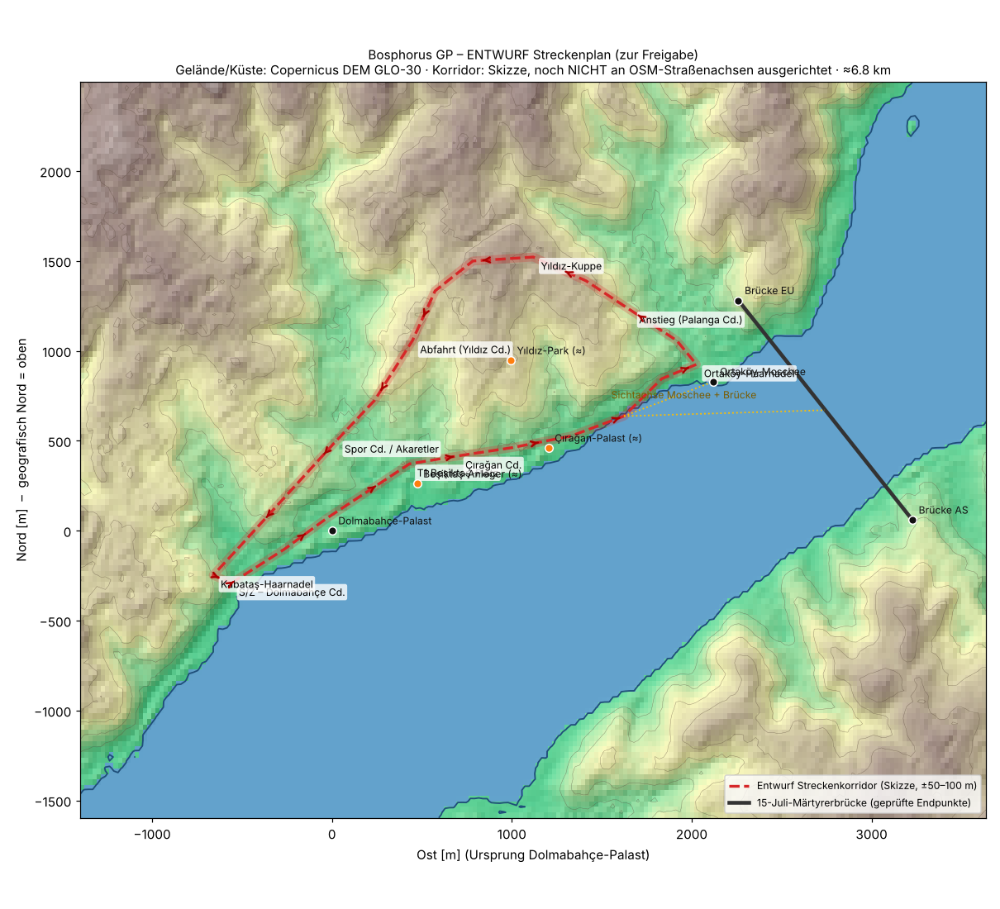
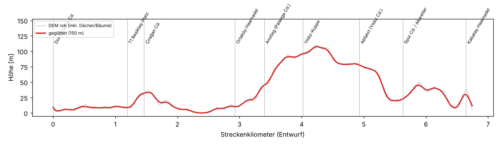
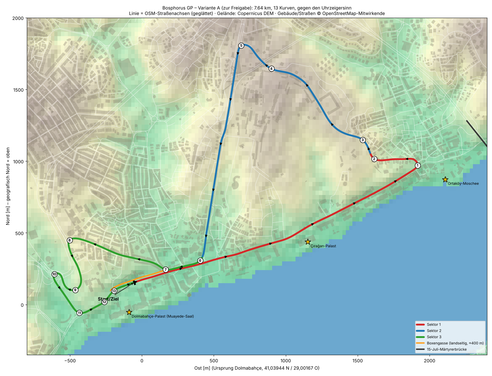
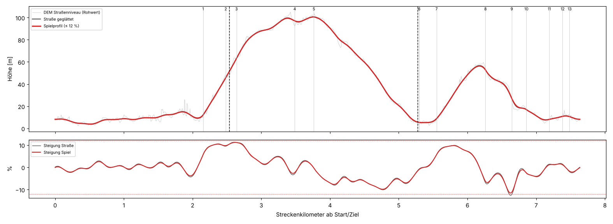

# Bosphorus GP: geografische Neuplanung (Phasen 1–3)

Stand: 2026-10-26. Auftrag: „Complete Master Prompt – Authentic Istanbul“.
**Status: Phase 3 ist an echten Straßen ausgearbeitet (Variante A). Ich warte auf die Freigabe. Die bestehende Unity-Strecke ist unverändert.**

> Der Abschnitt „Phase 3: Streckenplan (Entwurf zur Freigabe)“ weiter unten ist der frühere Skizzen-Entwurf. Maßgeblich ist der neue Abschnitt **„Phase 3b“** am Ende.

## Phase 1: Bestandsaufnahme

**Sicherung:** Der Stand vor dem Umbau liegt auf dem Branch `backup/bosphorus-schematic-v1` (Commit `649a9be`). Ein Tag-Push war in dieser Umgebung nicht möglich.

| Bereich | Ist-Zustand | Bewertung für die Neuplanung |
|---|---|---|
| Streckenführung | 5,1 km, 20 Kurven, gegen den Uhrzeigersinn, 3 Sektoren, Boxengasse links an der Start/Ziel-Geraden. Verlauf **fiktiv** | wird ersetzt |
| Geo-Bezug | Eine starre Transformation (Drehung 52°, Maßstab 1:1) legt echte Wahrzeichen um die fiktive Strecke. Norden zeigt im Spiel auf 308° | Wahrzeichen in sich konsistent, die Strecke folgt aber keinen echten Straßen |
| Küstenlinien | von Hand genähert (±50–100 m) | wird durch DEM-Küste (jetzt) bzw. OSM-Küstenlinie (später) ersetzt |
| Stadt | prozedurale Blöcke (`CityLayout`), drei Dichtezonen, Sichtachsen | Basis bleibt. Künftig OSM-Gebäudegrundrisse in Zone A/B, Viertel-Stile |
| Wahrzeichen | eigene Platzhalter-Silhouetten (`LandmarkGeometry`) | bleiben vorerst, Detailstufe muss steigen |
| Höhenprofil | aus den fiktiven Streckenpunkten | wird aus Copernicus-DEM abgeleitet |
| Betroffene Rennsysteme | Strecken-JSON, `TrackGeometry`, KI-Linie (`RacingLine`), Boxengasse, Startplätze, Sektoren, Bestzeiten (Schlüssel = Strecken-ID), Kurvenschilder, Tests in `TrackTests`/`EnvironmentTests` | nur diese werden angepasst. Physik, Regeln, Reifen, Wetter, HUD, Karriere bleiben unberührt |
| Performance | nur Dreieckszahlen bekannt. **Keine Messung auf Geräten** | Phase 7 |

## Phase 2: Geodaten

### Erreichbarkeit (geprüft am 2026-10-26 aus der Cloud-Umgebung)
| Quelle | Host | Ergebnis |
|---|---|---|
| Copernicus DEM GLO-30 | `copernicus-dem-30m.s3.amazonaws.com` | **erreichbar**: Kacheln N41E028 und N41E029 geladen |
| SRTM/Terrain Tiles | `s3.amazonaws.com/elevation-tiles-prod` | erreichbar (nicht benötigt) |
| Overpass API | `overpass-api.de`, `overpass.kumi.systems` | **gesperrt** (Proxy 403) |
| OSM-Downloads | `download.geofabrik.de`, `osmdata.openstreetmap.de` | **gesperrt** |
| OSM-Kacheln/API | `tile.openstreetmap.org`, `www.openstreetmap.org` | **gesperrt** |

### Benötigte OSM-Daten (falls die Freigabe nicht klappt)
| Datei | Ausschnitt (S, W, N, O) | Inhalt | Format | Ablage |
|---|---|---|---|---|
| `bosphorus_core.osm` | 41.020, 28.970, 41.065, 29.050 | Straßen, Küste, Gebäude, Parks, Mauern, Moscheen/Historisches, Laternen/Ampeln | OSM-XML | `data/geo/osm/` |
| `bosphorus_coast.osm` | 40.990, 28.930, 41.100, 29.100 | Küstenlinie, Wasserflächen, Brücken, Anleger | OSM-XML | `data/geo/osm/` |

So geht's: Die fertigen Abfragen liegen in `data/geo/osm/*.overpassql`. Inhalt bei https://overpass-turbo.eu einfügen, „Ausführen“ klicken, dann „Exportieren → Rohdaten (OSM)“ und unter dem Dateinamen oben speichern.
Alternativ diese Domains in der Umgebung freigeben: `overpass-api.de` (Reserve: `overpass.kumi.systems`). Dann lade ich die Daten selbst.

### Pipeline (fertig, wartet auf Daten)
- `tools/geo/fetch_dem.sh`: lädt die DEM-Kacheln. Sie werden nicht eingecheckt.
- `tools/geo/dem_tools.py`: DEM-Abfrage (bilinear) und Umrechnung WGS84 → lokales Metersystem.
- `tools/geo/osm_import.py`: OSM-XML → `data/geo/osm/bosphorus_osm.json`, mit Straßen (Name, Klasse, Breite, Einbahn, Brücke/Tunnel, Höhe aus DEM), Küstenlinie, Gebäuden (Grundriss, Höhe/Geschosse), Grünflächen, Mauern und Wahrzeichen. Danach prüft das Skript, ob die benötigten Straßen vorhanden sind. Selbsttest: `--selftest`.
- `tools/geo/track_plan.py`: Planungskarte und Höhenprofil.

### Koordinatensystem (neu)
- Lokale Tangentialebene um den Dolmabahçe-Palast (41,03944 N, 29,00167 O).
  - x = Osten: (lon − 29,00167) · 111.320 · cos(41,03944°) m
  - z = Norden: (lat − 41,03944) · 110.574 m
- **Keine Drehung:** Wahr-Nord = +z, Maßstab 1:1. Fehler der Näherung im 10-km-Ausschnitt < 0,1 %.
- Alle Elemente (Strecke, Küste, Gebäude, Wahrzeichen, Gelände) nutzen ausschließlich diese Transformation.
- Die alte Drehung um 52° entfällt mit dem Umbau.

### Datenqualität
| Daten | Status |
|---|---|
| Wahrzeichen Dolmabahçe, Ortaköy-Moschee, Brückenenden, Galata, Leanderturm, Sultan-Ahmed | **verifiziert** (Wikipedia/Structurae/Pleiades) |
| Hagia Sophia, Çırağan, Beylerbeyi, Anleger, Yıldız-Park | **Näherung**. Wird mit OSM überprüft |
| Gelände und Küste | **verifiziert**: Copernicus DEM, 30 m. Das DEM ist ein Oberflächenmodell (Dächer und Bäume enthalten), deshalb wird das Straßenprofil geglättet. Meer = 0 m |
| Straßenverläufe | **fehlen**: Im Entwurf skizziert, nicht verifiziert |
| Gebäudegrundrisse und -höhen | **fehlen** (OSM). Höhen sind in OSM oft lückenhaft und werden dann aus Geschossen bzw. dem Viertel-Stil ergänzt |

### Lizenzen (keine Rechtsberatung)
- **OSM (ODbL 1.0):** In den Credits steht „© OpenStreetMap-Mitwirkende“. Das Spiel gilt als *Produced Work*. Die daraus abgeleitete Geodatenbank (`bosphorus_osm.json` und die daraus erzeugten Streckendaten) muss bei Veröffentlichung unter ODbL angeboten werden (ODbL 4.6). Deshalb bleiben diese Daten getrennt vom Code und lassen sich per Skript reproduzieren. Kombinationen mit anderen Höhendaten gelten in der OSM-Community teils als abgeleitete Datenbank. Vor dem Release sollte das juristisch geprüft werden.
- **Copernicus DEM:** frei nutzbar, Quellenangabe Pflicht. Bei veränderten Daten lautet sie „produced using Copernicus WorldDEM-30 …“, dazu kommt ein Haftungsausschluss. Wortlaut siehe `docs/ASSET_LICENSES.md`.

## Phase 3: Streckenplan (Entwurf zur Freigabe)

**Wichtig:** Gelände, Küste und Wahrzeichen in der Karte sind echt. Die rote Linie ist eine **Skizze der Straßenkorridore** (±50–100 m), noch **nicht** an OSM-Straßenachsen ausgerichtet. Länge und Kurven werden sich nach dem OSM-Abgleich verschieben.

**Variante A:** gegen den Uhrzeigersinn, ≈ 6,8 km (Skizze), Höhenunterschied ≈ 105 m (DEM, geglättet).

| Abschnitt | Reale Straße | Charakter | Sehenswürdigkeiten / Sicht |
|---|---|---|---|
| Start/Ziel, Sektor 1 | **Dolmabahçe Caddesi**, Kabataş → Beşiktaş | breite Hochgeschwindigkeitsgerade an der Palastmauer, ≈ 1,2 km. Boxengasse und Paddock auf der Landseite (Gelände am Stadion, *fiktive Nutzung*) | Dolmabahçe-Palast und Uhrturm direkt am Streckenrand |
| T1 | **Beşiktaş-Platz** | harte Bremszone, 90° rechts. **Überholstelle 1** | Platz, Anleger, Blick auf Üsküdar |
| T2–T5 | **Çırağan Caddesi** | schnelle Uferstraße mit leichten Knicken, eng zwischen Palast- und Parkmauern („Baku-Burgabschnitt“ auf Istanbuler Art) | Çırağan-Palast, Yıldız-Parkmauer. **Signaturblick:** Moschee und Brücke voraus (DEM-Sichtprüfung: frei) |
| T6, Sektor 2 | **Ortaköy** | Haarnadel links. **Überholstelle 2** | Moschee etwa 100 m entfernt, die Brücke darüber |
| T7–T10 | **Palanga Cd.** bzw. Hangstraßen nach Yıldız | Bergaufpassage, S-Kurven, blinde Kuppe | Blick über den Bosporus zur Brücke (DEM-Sichtprüfung: frei) |
| T11–T13, Sektor 3 | **Yıldız** (Kammstraßen), dann **Yıldız Cd.** bergab | technisch, Mauern, Grün; Bergabbremsen | Yıldız-Park |
| T14–T15 | **Spor Cd. / Akaretler** | enge historische Passage (Akaretler-Reihenhäuser) | historische Fassaden |
| T16 | **Kabataş** | Haarnadel auf die Start/Ziel-Gerade. **Überholstelle 3** (nach der Bergabfahrt) | – |

**Kennzeichnung fiktiver Anpassungen (geplant):** temporäre Verbreiterung auf ≥ 11–12 m in engen Passagen, Auslaufzonen an den Haarnadeln, umgestaltete Kreuzungen am Beşiktaş-Platz und in Kabataş, Boxengasse auf temporären Flächen. Wahrzeichen werden nicht verschoben.

### Offene Punkte, die erst echte Straßendaten klären
1. **Steigungen:** Das DEM zeigt am Yıldız-Anstieg bis zu ≈ 19 % (geglättet über 150 m), bergab bis ≈ 27 %. Ein Teil davon sind Dächer und Bäume im Oberflächenmodell. Liegt die echte Straßensteigung über ≈ 12 %, schlage ich entweder eine flachere Nachbarstraße vor oder eine **dokumentierte fiktive Abflachung**.
2. **Engpass Beşiktaş:** Alle Wege zwischen Hang und Ufer treffen sich in Beşiktaş. Ob Hin- und Rückweg ohne Kreuzung getrennt bleiben (Variante A über Spor Cd.), lässt sich nur mit dem Straßengraphen prüfen. **Variante B** wäre Barbaros Bulvarı bergab (breit, lange Bergabgerade, gute Überholchance) mit Fahrtrichtung im Uhrzeigersinn. Dann braucht es am Platz eine fiktive Führung über eine Überführung.
3. **Länge:** Die Skizze kommt auf ≈ 6,8 km. Nach dem Abgleich wird geprüft, ob sich ein Abschnitt ohne spielerischen Mehrwert kürzen lässt.
4. **Weitere Sichtprüfungen (DEM inkl. Gebäude):** Galata-Turm von der Yıldız-Kuppe aus verdeckt (4,6 km), Leanderturm von der Dolmabahçe Cd. aus verdeckt, Sultan-Ahmed von Kabataş aus verdeckt. Diese Wahrzeichen bleiben Fernkulisse und werden nicht in die Sicht gerückt.

### Nach der Freigabe (Phase 4)
OSM-Achsen übernehmen → Strecke glätten (Mindestradius, Breite, Steigungsgrenze) → neues Strecken-JSON mit neuer Strecken-ID, damit alte Bestzeiten nicht vermischt werden → Tests anpassen: Länge und Kurvenzahl aus dem Plan, gegen den Uhrzeigersinn bleibt bei Variante A → KI-Runde und volles Rennen auf dem Prüfstand → Boxengasse und Startplätze prüfen.

---

## Phase 3b: Variante A an echten Straßenachsen (Stand 2026-10-26, zur Freigabe)

**Datengrundlage:** OSM-Auszüge vom 2026-10-26 (8.032 Straßenabschnitte, 22.224 Gebäude, 114 Küstenabschnitte; © OpenStreetMap-Mitwirkende, ODbL) und Copernicus DEM GLO-30.
**Werkzeuge:**
- `tools/geo/road_graph.py`: Straßengraph auf Knotenebene, 19.554 Knoten
- `tools/geo/route_variants.py`: Routing entlang benannter Straßen. Doppelnutzung und Kreuzungen der eigenen Strecke sind dabei verboten, Tunnel ausgeschlossen
- `tools/geo/track_analysis.py`: Glättung, Kurven, Sektoren, Profil, Sichtachsen, Breiten

### Kennzahlen
| | Wert |
|---|---|
| Länge | **7,64 km** (Straßenachsen geglättet) |
| Fahrtrichtung | gegen den Uhrzeigersinn |
| Kurven | 13 (Schwelle: Radius < 220 m und ≥ 18° Richtungsänderung; dazu leichte Knicke auf Çırağan Cd. und Palanga Cd.) |
| Sektoren | S1 0–2,53 km (Ufer bis Ortaköy) · S2 2,53–5,28 km (Palanga-Anstieg und Barbaros-Abfahrt) · S3 5,28–7,64 km (Akaretler, Bayıldım, Kabataş) |
| Höhe | 5 bis 103 m über dem Meer (DEM-Straßenniveau, Unsicherheit etwa ±5–8 m absolut) |
| Steigung | **max. ≈ 11 %** (über ≈ 125 m geglättet), im unteren Palanga-Anstieg und auf der Bayıldım Cd. Die früheren 19 %/27 % stammten aus Dach- und Baumhöhen im Oberflächenmodell. Das Spielprofil begrenzt auf ≤ 12 %, eine Abflachung ist kaum nötig |
| Kreuzungen der eigenen Strecke | keine. Keine Überführungen, keine Tunnel |

### Abschnitte und Kurven (Geschwindigkeiten sind grobe Schätzungen fürs Balancing)
| Nr. | km | Straße | Richtung, Winkel, Radius | ≈ km/h | Anlauf | Bemerkung |
|---|---|---|---|---|---|---|
| S/Z | 0,0 | Dolmabahçe Caddesi | – | – | – | Start/Ziel, Startaufstellung auf der 13 m breiten Dolmabahçe Cd., Palastmauer rechts |
| – | 0–2,15 | Dolmabahçe Cd. → Beşiktaş Cd. → Çırağan Cd. | leichte Knicke | 300+ | – | **2,2 km Vollgas am Ufer** („Baku-Gerade“), Palast- und Parkmauern |
| T1 | 2,15 | Ortaköy (Çırağan Cd. → Taşbasamak Sk.) | links, 193°, R ≈ 26 m | ≈ 100 | 2,2 km | **Ortaköy-Haarnadel, Überholstelle 1**. Moschee rechts voraus |
| T2–T3 | 2,48–2,64 | Palanga Caddesi | rechts 78°, links 50° | 150–210 | – | Beginn des Anstiegs, bis ≈ 11 % |
| T4 | 3,49 | Palanga Caddesi (Kamm) | rechts, 21° | ≈ 300 | 0,8 km | schneller Knick über den Yıldız-Kamm, Kuppe |
| T5 | 3,77 | Palanga → Barbaros (Anschluss) | links, 160°, R ≈ 32 m | ≈ 110 | – | Haarnadel auf die Barbaros Bulvarı |
| – | 3,77–5,23 | Barbaros Bulvarı (Richtungsfahrbahn Süd) | gerade, bergab bis ≈ 9 % | 300+ | – | **1,45 km Bergabgerade** |
| T6 | 5,30 | Beşiktaş (Barbaros → Beşiktaş Cd.) | rechts, 65°, R ≈ 71 m | ≈ 180 | 1,4 km | **Überholstelle 2**, harte Bremszone bergab |
| T7 | 5,55 | Beşiktaş Cd. → Süleyman Seba Cd. | rechts, 51° | ≈ 165 | – | Einfahrt nach Akaretler |
| T8 | 6,26 | Süleyman Seba Cd. → Maçka/Bayıldım | links, 144°, R ≈ 28 m | ≈ 105 | 0,6 km | **Überholstelle 3**, nach dem Anstieg durch die historischen Akaretler-Reihenhäuser |
| T9 | 6,64 | Bayıldım Caddesi | rechts, 193°, R ≈ 53 m | ≈ 150 | – | Bayıldım-Kehre, bergab |
| T10 | 6,86 | Bayıldım → Kadırgalar (Knoten) | links, Haarnadel, R ≈ 19 m | ≈ 85 | – | engste Kurve. Wendet am vorhandenen Knoten von der Bayıldım Cd. auf die Kadırgalar Cd. |
| T11 | 7,19 | Kabataş (Kadırgalar → Dolmabahçe Cd.) | links, 88° | ≈ 145 | – | auf die Start/Ziel-Gerade |
| T12–T13 | 7,38–7,49 | Dolmabahçe Caddesi | links 21°, rechts 27° | 260+ | – | Knicke vor Start/Ziel |

### Beşiktaş: Streckenverbindungen geprüft
- **Hinweg:** Dolmabahçe Cd. → Beşiktaş Cd. (Richtungsfahrbahn Nordost) → Çırağan Cd. Er führt geradeaus durch den Barbaros-Knoten.
- **Rückweg:** Barbaros Bulvarı (Richtungsfahrbahn Süd) mündet über ihre **vorhandene** Abbiegespur in die Beşiktaş Cd. (Richtungsfahrbahn Südwest). Nach ≈ 300 m geht es rechts in die Süleyman Seba Cd.
- Hin- und Rückweg liegen auf diesen ≈ 300 m auf den **zwei getrennten Richtungsfahrbahnen derselben Straße**, Achsabstand 10–13 m. Den vorhandenen Mittelstreifen ersetzt eine temporäre Betonwand.
- Es gibt **keine Kreuzung** der beiden Streckenteile und **keine Überführung**. Geprüft per Graph: keine gemeinsam genutzten Knoten; geometrisch: keine Schnittpunkte.
- Die anfangs gewählte Route über den Busbahnhof (İETT-Peronlar) habe ich verworfen.

### Boxengasse
- Landseitig (links) an der Dolmabahçe Cd., von ≈ 170 m vor bis ≈ 230 m nach Start/Ziel, also ≈ 400 m lang.
- Der Platz ist nach OSM unbebaut, nach DEM nahezu eben (≤ 2–3 m Höhenunterschied innerhalb von 45 m auf ≈ 250 m Länge). Dort liegen der Şairler-Sofrası-Park und der Vorplatz.
- **20 Boxen à 9 m auf ≈ 180 m** passen. Der Boxenausgang liegt an der beginnenden Beşiktaş Cd. Dort stehen die Gebäude 21–25 m von der Achse entfernt, genug für eine Ausfahrspur von etwa 6 m.
- **Fiktiv:** Garagen, Paddock und Hospitality als temporäre Bauten auf Park- und Vorplatzflächen, Paddock zusätzlich am İnönü-Park.
- Auf der Wasserseite liegt der Dolmabahçe-Palast. Er bleibt unberührt.

### Sichtachsen (DEM-Sichtlinie inkl. Gebäudehöhen, Augenhöhe 1 m)
| Wahrzeichen | sichtbar auf | wo |
|---|---|---|
| Ortaköy-Moschee | ≈ 1,0 km | Çırağan Cd. ab km 1,3 bis Ortaköy-Haarnadel (T1), danach kurz im Palanga-Anstieg |
| Bosporusbrücke (Pylon) | ≈ 3,6 km | Start/Ziel, Çırağan Cd., ganzer Palanga-Anstieg bis zum Kamm, Akaretler, Kabataş |
| Bosporusbrücke (Fahrbahn) | ≈ 2,6 km | Çırağan Cd. und unterer Palanga-Anstieg |
| Dolmabahçe-Palast | ≈ 1,9 km | Start/Ziel-Gerade (0–0,8 km), Beşiktaş/Akaretler, Anfahrt von Kabataş |
| Çırağan-Palast | ≈ 1,5 km | Çırağan Cd. (km 1,0–1,5), Akaretler |

Signaturmoment: Auf der Çırağan Cd. vor der Ortaköy-Haarnadel sind Moschee und Brücke gemeinsam sichtbar. Beide stehen an ihren echten Positionen. Die Brücken-Endpunkte aus OSM stimmen mit Structurae auf ≈ 20 m überein.

### Übernommen oder angepasst
| Abschnitt | Länge | übernommen | Anpassung fürs Rennspiel |
|---|---|---|---|
| Dolmabahçe Cd. | 0,45 km | Verlauf, Breite (13 m, 4 Fahrstreifen) | keine |
| Beşiktaş Cd. (Nordost, Hinweg) | 0,62 km | Verlauf | Richtungsfahrbahn 6,6 m → 11 m (Mittelstreifen/Gehweg temporär) |
| Çırağan Cd. | 1,47 km | Verlauf | 9,9 m → 11 m; an Palast- und Parkmauern nur minimal, ggf. 10 m belassen |
| Ortaköy-Anschluss (Taşbasamak Sk.) | 0,05 km | Verlauf | Haarnadel mit Auslauf, Kreuzung umgestaltet |
| Palanga Cd. | 1,53 km | Verlauf, Steigung | 6,6 m → 11 m (deutlichste Verbreiterung, Hangstraße) |
| Anschluss Palanga → Barbaros | 0,04 km | Verlauf | Rampe 3,3 m → 11 m, Kreuzung umgestaltet |
| Barbaros Bulvarı (Süd) | 1,46 km | Verlauf, Steigung | 9,9 m → 11 m |
| Beşiktaş Cd. (Südwest, Rückweg) | 0,31 km | Verlauf | 9,9 m → 11 m, temporäre Mittelwand |
| Süleyman Seba Cd. (Akaretler) | 0,72 km | Verlauf | 6,6 m → 11 m |
| Bayıldım Cd. | 0,60 km | Verlauf, Kehre | Richtungsfahrbahn 3,3 m → 11 m: beide Richtungsfahrbahnen zusammenlegen |
| Kadırgalar Cd. → Kabataş | 0,33 km | Verlauf | 9,9 m → 11 m, Knoten Kabataş umgestaltet |

Breitenangaben: aus der OSM-Fahrstreifenzahl × 3,3 m (89 %) oder Standardwerten (11 %) geschätzt, **nicht gemessen**. Alle Anpassungen sind fiktiv und werden im Spiel als temporäre Streckenbauten dargestellt. Kein Wahrzeichen und keine Uferlinie wird verschoben.

### Alternativen
- **A-Ihlamur** (9,03 km): Rückweg durch das Ihlamur-Tal ohne Doppelnutzung der Beşiktaş Cd. Länger, Ihlamur Yıldız Cd. nur ≈ 3,3–6,6 m breit, Anschluss über Wohnstraßen. Nicht empfohlen.
- **Optionale Abkürzung am Knoten Kabataş:** eine fiktive Verbindung von ≈ 40–50 m von der Bayıldım Cd. zur Kadırgalar Cd. würde die engste Haarnadel T10 ersetzen. Wegen deines Wunsches nach realen Verbindungen nicht im Plan.
- **Variante B** ist nicht nötig, weil Variante A als geschlossener Rundkurs funktioniert.

### Noch offen / Risiken
- Breiten und Höhen sind Schätzungen: OSM-Fahrstreifen bzw. Oberflächenmodell.
- Kurvengeschwindigkeiten sind grob. Die echte Fahrbarkeit prüfe ich in Phase 4 mit der KI-Linie und dem Simulationsprüfstand.
- 7,64 km sind länger als bisher (5,1 km); eine Runde dauert schätzungsweise ≈ 2:05–2:20 min. Rennlängen und Rundenzahlen müssen angepasst werden.
- Die Startaufstellung liegt teils auf den leichten Knicken T12/T13 der Dolmabahçe Cd.
