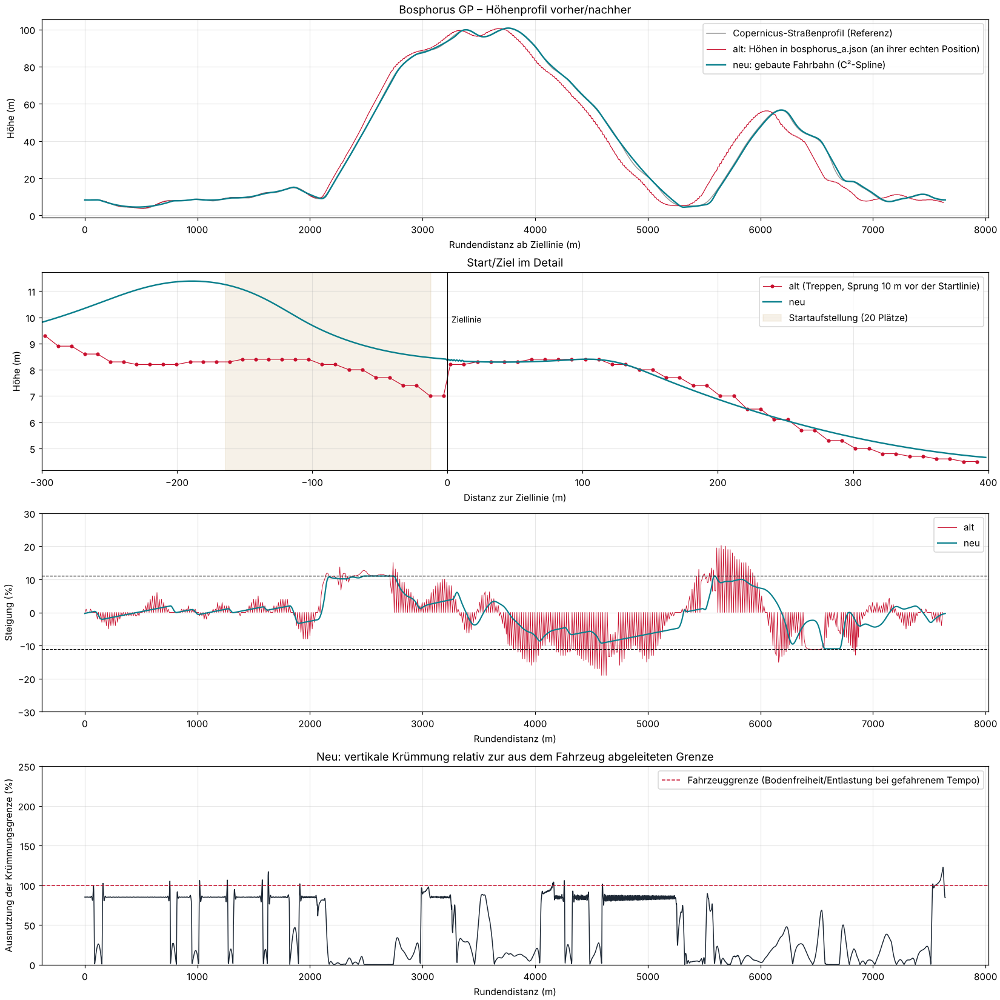

# Bosphorus GP: Reparatur von Fahrbahn und Kollision (P0)

**Status:**
- **Implementiert und offline getestet:** 3D-Prüfstand auf den echten Collider-Dreiecken plus geometrische Validierung.
- **Noch nicht in Unity bestätigt:** Der Prüfstand ist nicht PhysX. Er zeigt Geometriefehler und ihre Größe, die Bestätigung im Editor steht aus.

Checkpoint vor dem Umbau: Tag `checkpoint/before-road-geometry-fix`, lokal auf Commit `136638a` (= `main` nach PR #8).
Der Push des Tags wurde vom Proxy abgelehnt (HTTP 403). Der Stand ist über `main` 136638a wiederherstellbar.

## 1. Ursachen (Diagnose)

Nachgewiesen mit dem neuen Prüfstand (`SurfaceRig`) auf den echten Collider-Dreiecken. Er reproduzierte vor der Reparatur genau die gemeldeten Symptome.

| # | Ursache | Wirkung im Spiel | Belege |
|---|---|---|---|
| 1 | **Höhen als Treppe:** `build_track_a.py` nahm den *nächsten* Wert des 20-m-DEM-Profils statt zu interpolieren. | Je zwei Stützpunkte gleich hoch, dann ein Sprung. Am Yıldız-Anstieg wechselt die Steigung alle 10 m zwischen 0 % und ~22 %. Das Auto setzt auf, springt und verliert Traktion. | Grafik unten, Steigung „alt“ (Sägezahn ±20 %) |
| 2 | **Lauflänge = Index × 10 m**, obwohl die Punkte im Mittel 9,72 m auseinanderliegen. | Höhen um bis zu 220 m gegenüber der Geografie verschoben. An der Schließstelle **10 m vor der Ziellinie** springt das Profil um 1,2 m auf 5 m (24 %). Pole Position steckt fest. Startlinie 13 m versetzt, Notausfahrten bis 56 m und Beşiktaş-Parallelabschnitte an falscher Stelle. | Vorher: Slot 0 nach 0 m festgefahren, bei 288 m |
| 3 | **Höhen mit Catmull-Rom interpoliert** (C¹): Krümmungssprung an jedem Stützpunkt. | Kleine Stöße alle ~10 m, bei Höchsttempo spürbar. | Validator: bis 250 % der Krümmungsgrenze |
| 4 | **Kerb-Keile:** Wo ein Kerb beginnt oder endet, lieferte das leere Ende den Offset (0,0,0,0). Das Viereck spannte sich von der **Mittellinie** zur Kerb-Kante. | Schräge Keile bis 5 cm quer über die Fahrbahn an jedem Kerb-Anfang und -Ende. Bei 250 km/h ein Stoß, Bodenkontakt, 0,5 s in der Luft. | Prüfstand Yıldız 3903 m: Bodenpunkt über „Kerbs“ bei 3,9 m Querlage |
| 5 | **Beşiktaş-Parallelfahrbahnen** (11 m nebeneinander) unabhängig berechnet, bis zu **1,9 m Höhenunterschied**. | Das Gelände zwischen ihnen richtet sich nach der näheren Fahrbahn und **ragt durch die andere**. Rad auf Gelände, danach in der Wand. | Prüfstand raw 5627 m: Rad auf „Terrain“ |
| 6 | **Fahrzeug-Collider** (eigener Commit): Die Bodenbox war unten flach 4 cm über der Straße, das Setup hat aber Anstellwinkel (Plank vorne 35 mm, hinten 75 mm). Vor der Vorderachse lag die Box tiefer als der Unterboden. | Ab ~290 km/h schleift das Heck auf **ebener** Straße; die Nase setzt beim harten Anbremsen auf. | `limits`: −2 mm Freiheit auf ebener Straße bei 300 km/h |
| 7 | **KI** (eigener Commit): Bremspunkte ohne Steigung geplant. Boxenausfahrt: Spurwechsel erst 25 m vor dem Ende, die Trennwand endet aber schon 60 m davor. | Bergab-Haarnadel (Bayıldım, 11 % Gefälle) zu schnell angefahren. Risiko, an der Boxenausfahrt in das Wandende zu fahren. | Prüfstand-Trace 6860–6935 m |

**Geprüft und nicht ursächlich:**
- Fahrbahn ist **ein** durchgehendes Mesh, keine Chunk-Grenzen.
- Collider-Fläche = Entwurf (0,0 mm Abweichung), keine doppelten Fahrbahn-Collider, keine Querneigungsfehler.
- Normalen richtig, keine degenerierten Dreiecke im Raycast-Pfad.
- Fahrbahnmarkierungen und Deko ohne Collider.
- Wand-Collider liegen auf dem Wandabstand.

## 2. Reparatur

### Höhenprofil (vertikale Trassierung)
`tools/geo/vertical_alignment.py`, aufgerufen von `build_track_a.py`, löst **ein** quadratisches Programm auf einem 5-m-Raster.

Minimiert wird:
- Abweichung vom Copernicus-Straßenprofil,
- plus kleine Strafterme auf Krümmung und Krümmungsänderung (Kuppen und Senken laufen weich ein und aus).

Harte Bedingungen:
- Steigung ≤ 11 %.
- **Geschwindigkeitsabhängige** Mindestradien für Kuppe und Senke (85 % der Fahrzeuggrenze).
- Beide Beşiktaş-Fahrbahnen gleich hoch (±5 cm).

Löser: ADMM in numpy.

Die Grenzen kommen aus dem Fahrzeug (`Apex.Tracks.VerticalLimits`, `dotnet run -- limits`):
- Collider-Unterkante gegenüber der Straße.
- Aero-Einfederung über dem Tempo, gemessen am `VehicleSimulation`-Modell.
- Achsstand und Überhänge.
- Entlastung auf Kuppen (mindestens 50 % Radlast bleibt).
- Grundlage ist die erreichbare Geschwindigkeit: Kurven- und Bremsgrenzen der Ideallinie plus gemessene Volllast-Beschleunigung minus Steigung. Höchsttempo 330 km/h.

| Tempo | Kuppe R ≥ | Senke R ≥ |
|---|---|---|
| 100 km/h | 130 m | 86 m |
| 200 km/h | 335 m | 295 m |
| 280 km/h | 435 m | 1 238 m |
| 320 km/h | 441 m | 11 963 m |

Ergebnis:
- Höhe 4,4–100,7 m (Referenz 3,7–100,7 m), **Yıldız-Anstieg und Barbaros-Abfahrt bleiben**.
- Abweichung vom DEM max. 1,7 m, im Mittel 0,42 m.
- Steigung max. 11,0 %.
- Kleinster Radius: Kuppe 612 m, Senke 388 m. Diese Radien kommen an langsamen Stellen vor; an schnellen Stellen sind sie entsprechend größer.

`TrackGeometry` interpoliert die Höhe jetzt mit einem **periodischen kubischen Spline (C²)**: Höhe, Steigung und Krümmung sind stetig. Die Lage (x/z) bleibt Catmull-Rom wie bisher.

### Eine kanonische Fahrfläche
`Apex.Tracks.RoadSurface` (rein, in Apex.Simulation) erzeugt Fahrbahn, Kerbs, Auslauf, Boxengasse, Boxenmauer, Kollisionswände und Gelände.

`CircuitBuilder` baut daraus Mesh **und** MeshCollider Vertex für Vertex. Prüfstand und Validierung raycasten gegen genau diese Dreiecke (`CollisionWorld`, nur Vorderseiten wie Unity).

Der Kerb-Keil-Fehler ist dort behoben: Ein leeres Streifenende fällt auf die Innenkante des anderen Endes zusammen.

### Fahrzeug-Collider (eigener Commit)
`Apex.Vehicle.BodyCollider` ersetzt die eine flache Box durch zwei Boxen mit gleichem Umriss:
- **Unterboden:** von hinten bis zur Vorderachse, unten auf der Plank-Linie des Setups (35 mm vorne, 75 mm hinten).
- **Nase:** von der Vorderachse bis vorne, unten auf Plank-Höhe an der Vorderachse.

Unverändert: Bodenfreiheit, Federn, Aero, Motor, Getriebe, Lenkung, Bremsen.

Grund: Die Box berührt die Straße jetzt genau dann, wenn auch das Aero-Modell aufsetzt.

### KI und Boxengasse (eigener Commit)
- `RacingLine` und `AIDriver` rechnen die Steigung in Brems- und Beschleunigungsweg ein. Bergab bremst man kürzer, bergauf beschleunigt man schwächer.
- `RaceController`: Die KI verlässt die Boxengassen-Spur dort, wo die Boxenmauer endet (60 m vor der Ausfahrt), statt erst 25 m davor.

## 3. Prüfungen

Alle Läufe sind tatsächlich ausgeführt, auf dem Offline-Prüfstand mit 120 Hz und den echten Collider-Dreiecken.

### Vorher / nachher (`dotnet run -- surface bosphorus_a all`)

| Lauf | Vorher | Nachher |
|---|---|---|
| Pole Position, Vollgas | **steckt bei 288 m fest** (Höhensprung), 19 Bodenkontakte | 800 m, 313 km/h, 0 Kontakte, 0 Stöße |
| Startplatz 20, Vollgas | 670 m in 30 s, max. 169 km/h, 62 Bodenkontakte, 41 Stöße > 2,5 g, 4× in der Luft | 800 m, 314 km/h, 0 Kontakte, 0 Stöße |
| 2 Runden KI ab Pole | nach 5,4 km von der Strecke (Gelände in Beşiktaş) | 2 Runden, 326 km/h, 0 Stöße, 0× in der Luft, kein Rad abseits |

### Automatisierte Tests (`Tests/EditMode/RoadSurfaceDriveTests.cs`, laufen in `tools/verify.sh`)

| Test | Inhalt | Ergebnis |
|---|---|---|
| A | alle 20 Startplätze, je 400 m anfahren | bestanden: kein Festhängen, kein Aufsetzen, kein Abheben, > 150 km/h |
| B | 2 Runden mit dem schnellsten KI-Fahrer des Spiels (Tempo 0,974) | bestanden: Runden 134,2 s / 131,2 s, alle 13 Kurven |
| C | Gerade Dolmabahçe–Çırağan, Vollgas aus dem Stand und ab 100 km/h | bestanden: > 315 km/h bzw. > 320 km/h, wie auf ebener Straße |
| D | Runde mit 88 % Tempo, andere Linie | bestanden: kein Stoß, kein Durchschlagen der Federung |
| E | KI-Runde ab Startplatz 20 | bestanden |
| F | Boxengasse: Einfahrt, Spur, Ausfahrt, wie das Spiel sie fährt | bestanden |
| G | Fahrbahn-Validierung | bestanden: 0 kritische Befunde, 20/20 Startplätze |

Erfasst werden pro Schritt:
- Radkontakt und Federweg.
- Bodenkontakt der Collider (Eindringtiefe, Impuls).
- Vertikale Beschleunigungsspitzen.
- Räder auf Gelände oder Wand.
- Verlassen der Strecke und Festhängen.

### Geometrische Validierung (`dotnet run -- validate-road bosphorus_a`)
Abtastung alle 2 m, Bericht mit Rundendistanz und Weltkoordinaten: `docs/bosphorus_road_validation.txt`.
- Collider-Fläche = Entwurf (0,0 mm), Querneigung 0, Mindestbreite 9,4 m.
- Kein Gelände, das durch Fahrbahn, Auslauf oder Boxengasse ragt.
- Steigung max. 11,0 % (2 m) bzw. 10,9 % (50 m).
- **0 kritische Befunde.** 13 Warnungen, alle nahe Höchsttempo: Senken mit R 8–12 km nutzen dort bis zu 123 % der Grenze, das kostet weniger als 1 mm Bodenfreiheit über das ebene Maß hinaus.

## 4. Offene Punkte (ehrlich)

1. **In Unity bestätigen.** Der Prüfstand bildet `VehicleController` nach, ist aber nicht PhysX. Bitte Bosporus starten und prüfen:
   - Start von der Pole.
   - Gerade bis Ortaköy mit Vollgas.
   - Yıldız-Kuppe.
   - Bayıldım-Haarnadel.
   - Boxengasse.
2. **Leichte Berührungen bei Höchsttempo.** Über 300 km/h berührt der Unterboden in zwei Runden 14-mal die Straße, mit höchstens 0,2 mm Tiefe. Das ist die Aero-Einfederung des Fahrzeugs: Das Aero-Modell senkt die Plank bei 330 km/h vorne bis gegen 0 mm, auch auf ebener Straße. Es ist keine Straßenfrage. Abhilfe wäre eine Fahrzeug-Abstimmung (Federrate vorne oder Bodeneffekt-Kurve); das habe ich nicht angefasst.
3. **KI am theoretischen Limit (Tempo 1,0)** rutscht in der Bayıldım-Haarnadel noch nach außen. Im Spiel fährt die KI höchstens 0,974 und schafft die Runden. Die Ideallinie rechnet beim Beschleunigen weiterhin etwas optimistisch; das ist ein eigenes KI-Thema.
4. **Höhenprofil weicht bis 1,7 m vom DEM ab** (Glättung und Kopplung der Beşiktaş-Fahrbahnen). Die Wahrzeichen stehen unverändert an ihren Positionen.

## 5. Werkzeuge (`build/Apex.Tuning`, `dotnet run -c Release -- …`)
- `limits <track> <csv>`: Fahrzeuggrenzen und Entwurfsgeschwindigkeiten; die CSV nutzt das Profil-Skript (`data/geo/bosphorus_a_limits.csv`).
- `surface <track> [grid|lap|all]`: Fahrtests auf dem Prüfstand.
- `validate-road <track> [txt]`: geometrische Validierung.
- `probe-surface <track> <von> <bis>`: Collider-Höhe entlang der Strecke.
- `trace <track> <von> <bis> [tempo]`: Prüfstand Schritt für Schritt.
- `profile-csv <json> <csv>`, `vmax`.

Reihenfolge nach Änderungen an Strecke oder Fahrzeug:
1. `limits` laufen lassen.
2. `python3 tools/geo/build_track_a.py`.
3. `tools/verify.sh`.
