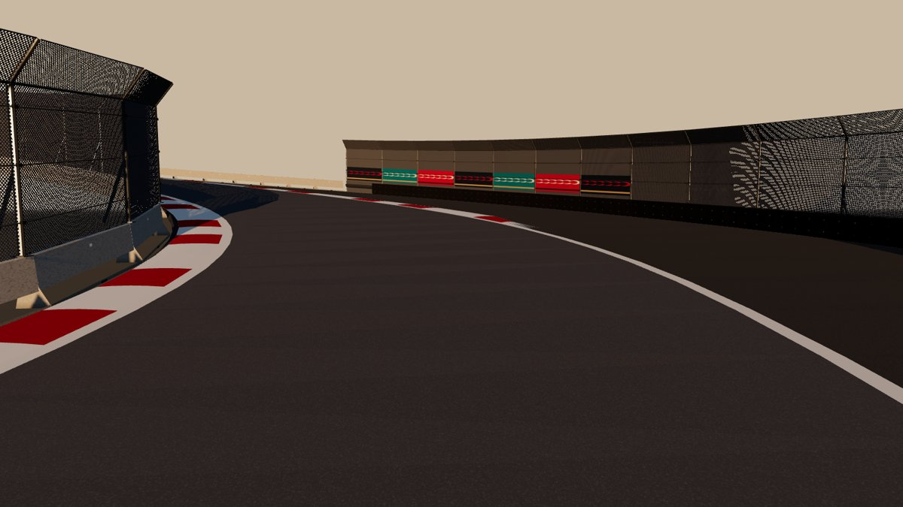
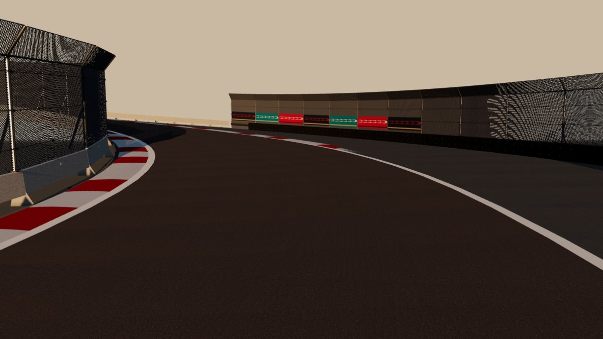
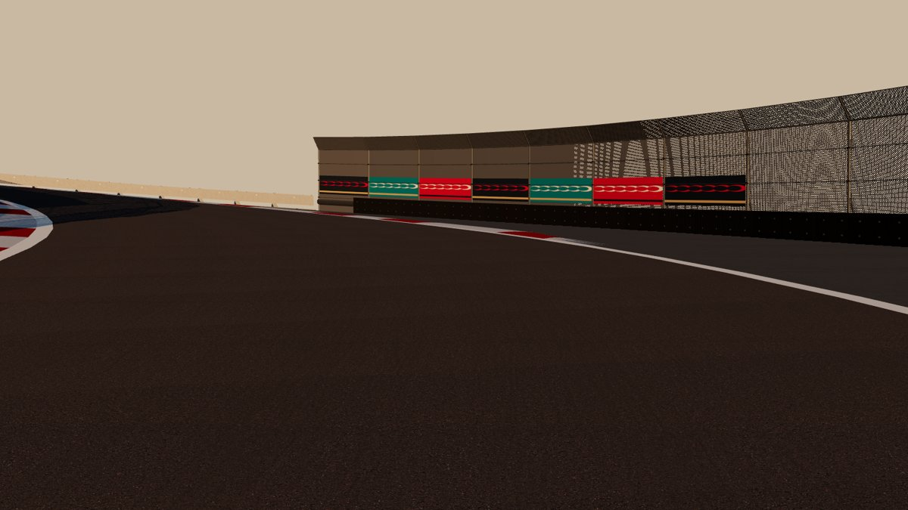

# CC0-Materialien für Asphalt und Kerbs (Phase 1)

**Stand:** 2026-10-26.

**Status:**
- **Importiert, offline geprüft** (three.js-Vorschau am echten T1-Abschnitt).
- **Im Unity-Editor nicht gesehen.**

## Importierte Sätze (Poly Haven, CC0)

| Satz | Quelle | Kachel | Albedo linear (Scan → Spiel) | Glätte (Mittel) |
|---|---|---|---|---|
| `asphalt` (Fahrbahn) | [asphalt_track](https://polyhaven.com/a/asphalt_track), Dimitrios Savva | 2,0 m | 0,014 → **0,07** | 0,17 |
| `runoff` (Auslauf) | [clean_asphalt](https://polyhaven.com/a/clean_asphalt), Dimitrios Savva | 2,1 m | 0,060 → **0,09** | 0,34 |
| `kerb` (Kerbs, Lackbasis rot/weiß) | [concrete_floor_worn_001](https://polyhaven.com/a/concrete_floor_worn_001), Dimitrios Savva, Rico Cilliers | 3,0 m | Lackfarbe × Struktur | 0,46 |

**Auswahl:**
- **`asphalt_track`:** Rennstrecken-Asphalt, feine Körnung, ohne Risse.
- **`clean_asphalt`:** grauer, älterer Belag; hebt den Auslauf von der Fahrbahn ab.
- **`concrete_floor_worn_001`:** glatter, leicht abgenutzter Beton. Eingefärbt sieht er wie abgefahrene Lackierung aus.

**Verworfen:**
- `painted_concrete`: stark abgeplatzt
- `concrete_floor_painted`: grobe Schlieren
- `anti_slip_concrete`: Noppenmuster

**Albedo-Kalibrierung:**
- Der Rennasphalt-Scan ist sehr dunkler, frischer Belag (linear 1,4 %) und wirkte in der Vorschau fast schwarz.
- `SurfaceTextures.AlbedoTint` färbt deshalb linear auf einen Zielwert für gealterten Stadtasphalt (Fahrbahn 0,07, Auslauf 0,09; plausibel: frisch 0,04–0,05, gealtert 0,08–0,12). Die Körnung bleibt.
- **Im Unity-Test zu prüfen:** Helligkeit unter der goldenen Stunde und am Tag. Die Zielwerte sind Konstanten in `SurfaceTextures`.

**Auflösung:**
- 1K (Fahrbahn 512 px/m, das Texeldichte-Ziel des Masterplans), etwa 10 MB für alle drei Sätze.
- 2K/4K für die Ultra-Stufe erst mit Git LFS (Repo-Entscheidung des Product Owners).

**Nässe:** Auch der Auslauf wird jetzt bei Regen nass dargestellt.

## Weg in das Spiel
1. **CC0-Satz besorgen**, eine der beiden Möglichkeiten:
   - **a)** Im Browser von polyhaven.com oder ambientcg.com laden (2K, PNG oder JPG, Karten Diffuse bzw. Color, Normal GL, Roughness, AO).
   - **b)** In den Umgebungseinstellungen `api.polyhaven.com` und `dl.polyhaven.org` freigeben; dann lädt das Werkzeug selbst (`--polyhaven <id>`).
2. **Importieren:**
   ```sh
   python3 tools/textures/import_cc0.py <ordner-oder-zip> --name asphalt --metres <kachelgröße> --source-url <seite> --author "<autor>"
   python3 tools/textures/import_cc0.py <ordner-oder-zip> --name kerb --metres <kachelgröße> --paint-base --source-url <seite> --author "<autor>"
   ```
   - Ergebnis in `Runtime/Resources/Textures/CC0/<name>/`:
     - `BaseColor` (JPG), `Normal` (PNG, OpenGL; DirectX wird umgerechnet), `MetallicSmoothness` (PNG, URP: Glätte im Alpha), `Occlusion` (JPG)
     - bei Kerbs zusätzlich `PaintBase`: entsättigte Struktur, die mit Rot bzw. Weiß eingefärbt wird
     - `source.json` mit Herkunft, Autor, Lizenz, Kachelgröße, mittlerer Glätte und SHA-256 der Dateien
   - Das Werkzeug gibt die Zeile für `docs/ASSET_LICENSES.md` aus; **die Zeile muss eingetragen werden.**
3. **Im Spiel wird automatisch verwendet:**
   - `asphalt` → Fahrbahn; `runoff` → Auslauf (ohne `runoff`: `asphalt` heller getönt)
   - `kerb` → Kerbs (Rot und Weiß aus `PaintBase` × Kerbfarbe, Normal-, Glätte- und AO-Karte)
   - Ohne Satz bleibt der jeweilige Fallback.

## Technische Punkte
- **Maßstab:** Fahrbahn, Kerbs und Auslauf haben metrische UVs (`RoadSurface.UvMetres` = 10 m je UV-Einheit; Test `RoadKerbAndRunoffUvsAreMetricSoScannedTexturesKeepTheirSize`). Die Kachelung ist 10 m / Kachelgröße des Satzes; ein 4-m-Scan bleibt also 4 m groß.
  - Der Auslauf hatte vorher einen eigenen Maßstab (4 m). Er ist jetzt metrisch; die prozedurale Kachelung ist so angepasst, dass das Bild gleich bleibt.
- **Nässe:**
  - URP skaliert die Glättekarte mit `_Smoothness`, kann sie aber nicht über den Scan hinaus anheben.
  - Bei Nässe schaltet `WeatherVisuals` die Karte ab und blendet von der mittleren Scan-Glätte zum Nassfilm (0,88). Trocken gilt die Karte unverändert.
- **Import-Einstellungen** (`Editor/CC0TextureImporter.cs`):
  - Normal-Map-Typ, Datenkarten linear, trilinear mit Anisotropie 8
  - Mobil höchstens 2048 px ASTC 6×6; PC höchstens 4096 px, BC7 bzw. BC5 für Normalen
- **Repo-Größe:** Ein 2K-Satz hat etwa 10–20 MB als PNG. Für 4K-PC-Texturen ist Git LFS zu prüfen, bevor sie eingecheckt werden.

## Prüfung nach dem Import (Unity)
- Rennkamera bei 300 km/h:
  - keine sichtbare Kachelwiederholung auf den Geraden
  - Moiré-Freiheit bei flachem Blickwinkel (Anisotropie)
- Kerbs aus der Nähe: Lack mit Abnutzung, nicht plastisch.
- Regen: glänzender Nassfilm ohne Sprung beim Übergang trocken/nass. Bei sichtbarem Sprung das Schaltniveau (2 % Nässe) anpassen.

## Vorschau (offline, three.js, keine Spielaufnahme)
Vorher (prozedural) / nachher (CC0, kalibriert) / flacher Blick auf die Körnung:




