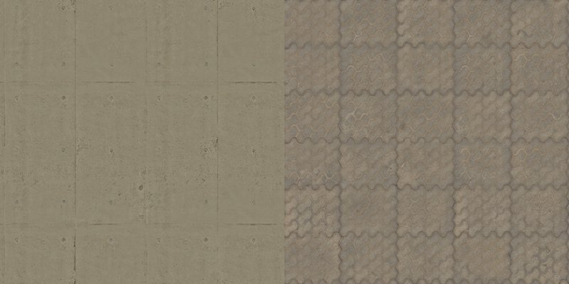
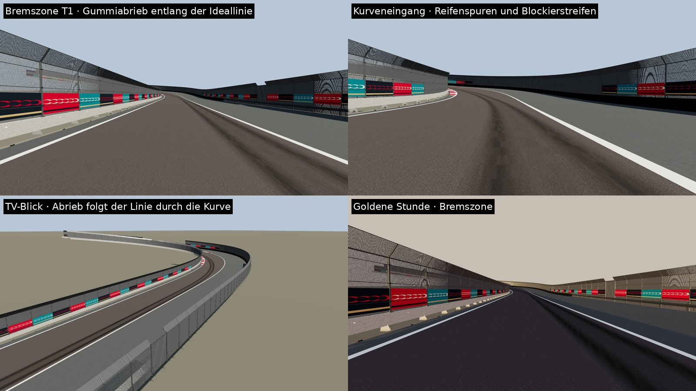

# CC0-Materialien für Asphalt und Kerbs (Phase 1)

**Stand:** 2026-10-26.

**Status:**
- **Importiert, offline geprüft** (three.js-Vorschau am echten T1-Abschnitt).
- **Im Unity-Editor nicht gesehen.**

## Importierte Sätze (Poly Haven, CC0)

| Satz | Quelle | Kachel | Albedo linear (Scan → Spiel) | Glätte (Mittel) |
|---|---|---|---|---|
| `asphalt` (Fahrbahn) | [asphalt_track](https://polyhaven.com/a/asphalt_track), Dimitrios Savva | 2,0 m | 0,014 → **0,07** | 0,17 |
| `runoff` (Auslauf) | [clean_asphalt](https://polyhaven.com/a/clean_asphalt), Dimitrios Savva | 2,1 m | 0,060 → **0,09** | 0,34 |
| `kerb` (Kerbs, Lackbasis rot/weiß) | [concrete_floor_worn_001](https://polyhaven.com/a/concrete_floor_worn_001), Dimitrios Savva, Rico Cilliers | 3,0 m | Lackfarbe × Struktur | 0,46 |

**Auswahl:**
- **`asphalt_track`:** Rennstrecken-Asphalt, feine Körnung, ohne Risse.
- **`clean_asphalt`:** grauer, älterer Belag; hebt den Auslauf von der Fahrbahn ab.
- **`concrete_floor_worn_001`:** glatter, leicht abgenutzter Beton. Eingefärbt sieht er wie abgefahrene Lackierung aus.

**Verworfen:**
- `painted_concrete`: stark abgeplatzt
- `concrete_floor_painted`: grobe Schlieren
- `anti_slip_concrete`: Noppenmuster

**Albedo-Kalibrierung:**
- Der Rennasphalt-Scan ist sehr dunkler, frischer Belag (linear 1,4 %) und wirkte in der Vorschau fast schwarz.
- `SurfaceTextures.AlbedoTint` färbt deshalb linear auf einen Zielwert für gealterten Stadtasphalt (Fahrbahn 0,07, Auslauf 0,09; plausibel: frisch 0,04–0,05, gealtert 0,08–0,12). Die Körnung bleibt.
- **Im Unity-Test zu prüfen:** Helligkeit unter der goldenen Stunde und am Tag. Die Zielwerte sind Konstanten in `SurfaceTextures`.

**Auflösung:**
- 1K (Fahrbahn 512 px/m, das Texeldichte-Ziel des Masterplans), etwa 10 MB für alle drei Sätze.
- **Ultra-Stufe 4K (PC):** wird bei Bedarf geladen, nicht eingecheckt (siehe unten).

**Nässe:** Auch der Auslauf wird jetzt bei Regen nass dargestellt.

## Weg in das Spiel
1. **CC0-Satz besorgen**, eine der beiden Möglichkeiten:
   - **a)** Im Browser von polyhaven.com oder ambientcg.com laden (2K, PNG oder JPG, Karten Diffuse bzw. Color, Normal GL, Roughness, AO).
   - **b)** In den Umgebungseinstellungen `api.polyhaven.com` und `dl.polyhaven.org` freigeben; dann lädt das Werkzeug selbst (`--polyhaven <id>`).
2. **Importieren:**
   ```sh
   python3 tools/textures/import_cc0.py <ordner-oder-zip> --name asphalt --metres <kachelgröße> --source-url <seite> --author "<autor>"
   python3 tools/textures/import_cc0.py <ordner-oder-zip> --name kerb --metres <kachelgröße> --paint-base --source-url <seite> --author "<autor>"
   ```
   - Ergebnis in `Runtime/Resources/Textures/CC0/<name>/`:
     - `BaseColor` (JPG), `Normal` (PNG, OpenGL; DirectX wird umgerechnet), `MetallicSmoothness` (PNG, URP: Glätte im Alpha), `Occlusion` (JPG)
     - bei Kerbs zusätzlich `PaintBase`: entsättigte Struktur, die mit Rot bzw. Weiß eingefärbt wird
     - `source.json` mit Herkunft, Autor, Lizenz, Kachelgröße, mittlerer Glätte und SHA-256 der Dateien
   - Das Werkzeug gibt die Zeile für `docs/ASSET_LICENSES.md` aus; **die Zeile muss eingetragen werden.**
3. **Im Spiel wird automatisch verwendet:**
   - `asphalt` → Fahrbahn; `runoff` → Auslauf (ohne `runoff`: `asphalt` heller getönt)
   - `kerb` → Kerbs (Rot und Weiß aus `PaintBase` × Kerbfarbe, Normal-, Glätte- und AO-Karte)
   - Ohne Satz bleibt der jeweilige Fallback.

## Technische Punkte
- **Maßstab:** Fahrbahn, Kerbs und Auslauf haben metrische UVs (`RoadSurface.UvMetres` = 10 m je UV-Einheit; Test `RoadKerbAndRunoffUvsAreMetricSoScannedTexturesKeepTheirSize`). Die Kachelung ist 10 m / Kachelgröße des Satzes; ein 4-m-Scan bleibt also 4 m groß.
  - Der Auslauf hatte vorher einen eigenen Maßstab (4 m). Er ist jetzt metrisch; die prozedurale Kachelung ist so angepasst, dass das Bild gleich bleibt.
- **Nässe:**
  - URP skaliert die Glättekarte mit `_Smoothness`, kann sie aber nicht über den Scan hinaus anheben.
  - Bei Nässe schaltet `WeatherVisuals` die Karte ab und blendet von der mittleren Scan-Glätte zum Nassfilm (0,88). Trocken gilt die Karte unverändert.
- **Import-Einstellungen** (`Editor/CC0TextureImporter.cs`):
  - Normal-Map-Typ, Datenkarten linear, trilinear mit Anisotropie 8
  - Mobil höchstens 2048 px ASTC 6×6; PC höchstens 4096 px, BC7 bzw. BC5 für Normalen
- **Repo-Größe:** Im Repo liegen nur die 1K-Sätze (etwa 10 MB). Die 4K-Sätze sind gitignoriert.

## Beton und Gehwege (Phase 1, zweiter Schritt)
**Status:**
- **Importiert, kompiliergeprüft, offline gesehen.**
- **In Unity nicht gesehen.**

| Satz | Quelle | Kachel | Albedo linear | Verwendung |
|---|---|---|---|---|
| `barrier` | [concrete_wall_008](https://polyhaven.com/a/concrete_wall_008) | 2,71 m | 0,24 | **Detailkarte** (URP Lit „multiply ×2“ plus Normalen 0,8) über der vorhandenen Blocktextur der Fertigteil-Barrieren: Fugen, Kratzer und Schmutz am Fuß bleiben, dazu kommt echtes Betonkorn. Kachelung 3,8 m Block × 1,6 m Profil. |
| `pavement` | [patterned_concrete_pavers](https://polyhaven.com/a/patterned_concrete_pavers) | 1,8 m | 0,21 | Volles Material der Gehwege: graues Verbundpflaster („kilit taşı“), wie es Istanbul an den Uferstraßen verlegt. Die UVs sind jetzt einheitlich 3 m je Einheit (vorher teils 4 m). |

**Auswahl:**
- **Verworfen nach Sichtprüfung der automatischen Erstwahl:**
  - `precast_concrete_wall`: Bruchsteinmuster, keine Rennstrecken-Barriere
  - `interlocking_concrete_pavers`: braune Zierplatten
- **Begründung der Wahl:** Glatter Ortbeton mit feinen Schalungsspuren passt zu Fertigteil-Barrieren.



- **Importer:** neue Option `--detail` (`Detail.jpg`: entsättigt, Mittelwert sRGB 0,5 = neutral).
- **Satzliste:** `cc0_sets.json` mit `"detail": true`.

**Wichtig für Builds:**
- Die gescannten Sätze schalten zur Laufzeit Lit-Keywords ein: Normal-, Glanz-, Occlusion- und Detailkarten; nasse Straßen schalten die Glanzkarte ab.
- Unity behält in Player-Builds nur Varianten, die ein Material-Asset nutzt.
- „Project Apex → 2. Materialien erzeugen“ legt deshalb unter `Resources/…/VariantKeepers` kleine Materialien für jede Kombination an.
- **Ohne diesen Schritt fehlen im Build die Texturen.** Im Editor fällt das nicht auf.

## Gummiabrieb und Bremsspuren
**Status:**
- **Implementiert und getestet** (`RubberFollowsTheRacingLineAndDarkensWhereTheTyresWork`).
- **Offline gesehen, in Unity nicht.**

**Vorher:**
- Pro Kurve zwei gerade Streifen mit fester seitlicher Lage.
- Gleich stark, ohne Bezug zur tatsächlichen Linie.

**Jetzt** (`TrackInfrastructurePlan.BuildRubber`):
- **Reifenarbeit je Abtastpunkt** aus dem Geschwindigkeitsprofil der KI-Ideallinie:
  - Längsbeschleunigung (Bremsen zählt ×1,4) und Querbeschleunigung v²κ, bezogen auf 1,5 g
  - über ±12 m geglättet, weil Autos nie exakt dieselbe Linie fahren
  - überall ein leichter Grundfilm (12 %)
- **Zwei Reifenspuren** (±0,8 m um die Linie) und die Rille dazwischen, in 4-m-Stücken entlang der Linie.
  - Sie werden breiter, wo stark gearbeitet wird.
- **Blockierspuren** in Bremszonen mit mehr als 25 m/s Geschwindigkeitsabbau:
  - 2–5 schmale Streifen, 8–30 m lang
  - im ersten Drittel der Zone
  - bis 0,4 m seitlich driftend, mit verjüngten Enden
- **Darstellung:**
  - Stock-URP-Lit, transparent.
  - Die Deckkraft je Streifen steckt in einem Textur-Atlas mit 16 Stufen, bis 55 %.
  - Auf 75 % gedeckelt wirkte der Abrieb in der Vorschau zu schwarz.



## Ultra-Stufe 4K (PC)
**Status:**
- **Implementiert, offline geprüft.**
- **In Unity nicht gesehen.**

**Laden** (dieselben drei Sätze, 4096 px; Farbe, Rauheit und AO als JPG von Poly Haven, Normalen verlustfrei):
```sh
python3 tools/textures/fetch_cc0.py --tier ultra     # ~5 min, ~176 MB nach Runtime/Resources/Textures/CC0_Ultra/
python3 tools/textures/fetch_cc0.py --tier base      # 1K-Sätze neu erzeugen (eingecheckt)
```
- Die Satzliste steht in `tools/textures/cc0_sets.json`.

**Warum nicht im Repo:**
- Ohne LFS würde der Klon jeder Cloud-Sitzung etwa 176 MB größer.
- Mit Git LFS sind Speicher und Bandbreite kontingentiert (1 GB/Monat im Gratiskontingent).
- Ob LFS kommt, entscheidet der Product Owner.

**Im Spiel:**
- `SurfaceTextures` nimmt auf PC den 4K-Satz, wenn vorhanden, sonst 1K.
- Mobil immer 1K.
- Optionen → „Straßentexturen (ab nächster Session)“: Ultra (4K) / Standard (1K) für den A/B-Vergleich. Die Zeile erscheint nur, wenn die 4K-Sätze geladen sind.
- **Achtung Mobil-Build:** Alles unter `Resources` wird mitgebaut. Auf einer Build-Maschine für Mobil darf `CC0_Ultra` nicht liegen.

**Befund der Offline-Vorschau** (three.js, T1, Rennkamera-Abstand):
- Bei Rennkamera-Abstand ist gegenüber 1K **kein sichtbarer Gewinn** zu erkennen; die Mip-Stufen gleichen sich an.
- Die 4K-Normalenkarte hat deutlich stärkere Mikronormalen (Streuung 13 statt 8 von 255).
- Im flachen Blick erzeugt sie in der Vorschau eine leichte Orangeverschiebung und Streifen. Ursache ist vermutlich Glanz-Aliasing (Specular Aliasing).
- Im Unity-Editor mit dem Schalter zu prüfen: Flimmern bei Fahrt, Nahansicht der Kerbs, Boxengasse.
- **Empfehlung, falls 4K flimmert:** Ultra auf 2K senken (`TIERS` in `fetch_cc0.py`) oder die Normalenstärke im Material reduzieren.

## Prüfung nach dem Import (Unity)
- Rennkamera bei 300 km/h:
  - keine sichtbare Kachelwiederholung auf den Geraden
  - Moiré-Freiheit bei flachem Blickwinkel (Anisotropie)
- Kerbs aus der Nähe: Lack mit Abnutzung, nicht plastisch.
- Regen: glänzender Nassfilm ohne Sprung beim Übergang trocken/nass. Bei sichtbarem Sprung das Schaltniveau (2 % Nässe) anpassen.

## Vorschau (offline, three.js, keine Spielaufnahme)
Vorher (prozedural) / nachher (CC0, kalibriert) / flacher Blick auf die Körnung:


