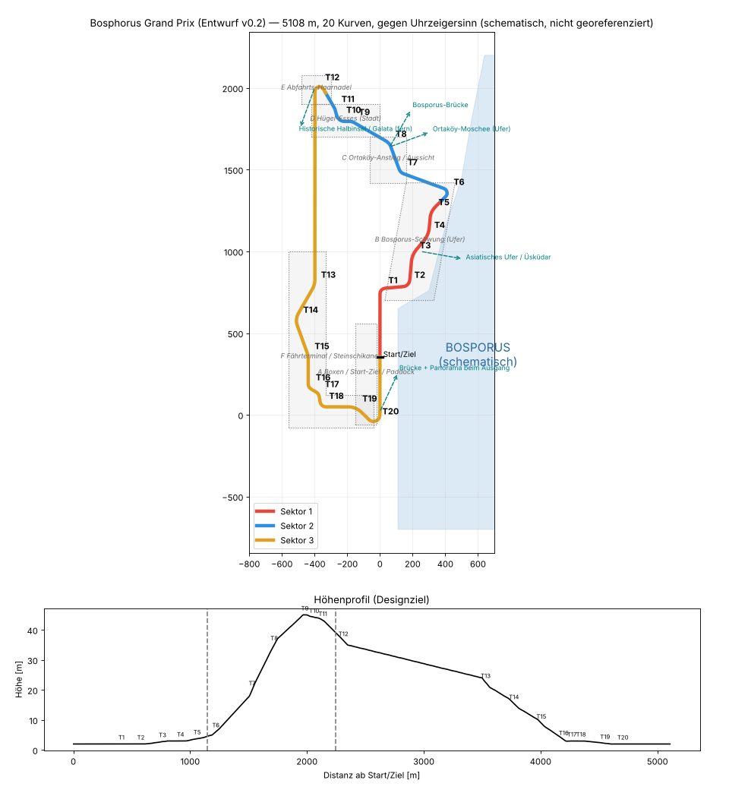

# Bosphorus Grand Prix: Referenz- und Blockout-Plan (Layout v0.2)

Status: **Layout v0.2 implementiert und automatisiert getestet; als Graybox fahrbar.** Alle Maße sind fiktive, abstimmbare Designziele. Nichts ist georeferenziert oder vermessen. Die Strecke ist ein fiktiver, temporär gesperrter Rennkorridor, inspiriert vom europäischen Bosporus-Ufer bei Beşiktaş und Ortaköy. Sie behauptet nicht, dass diese Straßen, Breiten oder Kurven real existieren.

- Daten: `unity/com.projectapex.game/Runtime/Resources/Tracks/bosphorus_gp.json`
- Generator: `python3 tools/build_bosphorus_layout.py` (Kurve für Kurve aus Geraden und Bögen; die Schleife wird durch Lösen zweier Geradenlängen geschlossen)
- Bericht und Grafik: `python3 tools/circuit_report.py <json> docs/img/bosphorus_schematic.png` (Ausgabe in `docs/img/bosphorus_report.txt`)

## 1. Kennzahlen (automatisch gemessen)

| Größe | Ziel laut Brief | Layout v0.2 |
|---|---|---|
| Länge | ca. 5,1 km | 5 108 m |
| Kurven | 19–21 (Ziel 20) | **20**, alle in der Richtung laut Brief |
| Fahrtrichtung | (siehe 2.) | gegen den Uhrzeigersinn (freigegeben) |
| Höhenunterschied | 35–55 m | 43 m (2 → 45 m) |
| Max. Steigung | – | 9,7 % (Ortaköy-Anstieg) |
| Breite | 11–16 m | 12,5–15 m |
| Start-Ziel-Gerade | 650–850 m | 740 m (Startlinie 330 m nach T20, ca. 410 m bis T1) |
| Min. Abstand nicht benachbarter Abschnitte | – | 89 m |
| Sektoren | 3 | S1 0–22,5 % (Gerade, T1–T5), S2 22,5–44 % (T6–T11, Anstieg/Hügel), S3 44–100 % (T12–T20, Abfahrt/Ufer) |
| Autopilot-Runde (Prüfstand, eben) | – | 120,7 s, bleibt in den Tracklimits |

## 2. Fahrtrichtung

„Im Uhrzeigersinn“ widerspricht „Wasser rechts“ und den vorgegebenen Kurvenrichtungen. Deshalb ist die Richtung **gegen den Uhrzeigersinn** freigegeben (Entscheidung 2026-10-25).
Die Gerade läuft nach Norden am Ufer entlang: rechts Tribünen und Bosporus, links Paddock und Boxen.

## 3. Kurvenplan v0.2

| Kurve | Charakter laut Brief | Layout v0.2 (Richtung, Winkel, kleinster Radius, Höhe) |
|---|---|---|
| T1 | schwere Bremsung, Rechts 75–95° | R 89°, r 29 m, 2 m |
| T2 | kurze Links | L 82°, r 38 m |
| T3–T5 | Ufer R-L-R, mittelschnell | R 35° · L 34° · R 40° (r 93–120 m) |
| T6 | Ortaköy-Anstieg, enge Links | L 119°, r 26 m, 6 m |
| T7 | bergauf Rechts | R 51°, r 43 m, 20 m |
| T8 | blinde Kuppe, schwungvolle Links | L 40°, r 69 m, 35 m |
| T9–T11 | Hügel-Esses L-R-L | L 32° · R 77° · L 16° (45 m) |
| T12 | abschüssige Links-Haarnadel, Überholpunkt 2 | L 153°, r 23 m, 37 m |
| (Grand Descent) | – | ca. 1,15 km lange Abfahrt nach Süden |
| T13–T15 | Fährterminal-Fluss | R 30° · L 51° · R 20° |
| T16–T18 | Steinschikane, Überholpunkt 3 | L 64° · R 54° · L 83° (r 26–32 m) |
| T19 | schnelle Rechts | R 45°, r 98 m |
| T20 | langsamere Links auf die Gerade | L 135°, r 28 m |

Offene Punkte für den Graybox-Fahrtest (M2):
- Die lange Abfahrt nach T12 ist 1,15 km lang. Sie prüfen und gegebenenfalls mit einer flachen Biegung auflockern.
- T11 (16°) ist mild. Testen, ob er sich als eigene Kurve anfühlt.
- Die maximale Steigung von 9,7 % liegt im Anstieg T6–T7. Die Fahrbarkeit mit Abtrieb und Kuppe prüfen.

## 4. Boxengasse

- **Einfahrt:** links (Innenseite) vor T20. Die Boxengasse verläuft parallel zur Geraden auf der Landseite (Westen), hinter der Boxenmauer.
- **Ausfahrt:** nach T1, an der Außenseite der Auslaufzone. Die Geometrie wird in M2 validiert: keine Kreuzung der Ideallinie und eine sichere Einfädelspur.
- 20 Garagen, Startaufstellung versetzt mit 8 m Abstand (Pole 12 m hinter der Linie, Platz 20 ca. 164 m dahinter, also vor T20).

## 5. Distrikte (Produktionszellen)

| Zelle | Abschnitt | Nah (an der Strecke) | Mittel | Fern / Sichtachsen |
|---|---|---|---|---|
| **A** Boxen/Paddock | Gerade | Garagen, Boxenmauer, Medienzentrum, Tribünen auf der Wasserseite, LED-Wände, Zäune | Fähranleger, Uferpromenade | Brücke im Nordosten, Asiatisches Ufer |
| **B** Bosporus-Schwung | T1–T5 | Tecpro-artige fiktive Barrieren, Fangzäune, Marshal-Posten | Cafés, Platanen, Anleger | Fähren (Bewegungsschleifen), Üsküdar-Hänge im Dunst |
| **C** Ortaköy-Anstieg | T6–T8 | Stützmauern, Fußgängerbrücke mit Freiraum | Wohnblöcke am Hang | **Signaturmoment an der Kuppe:** Brücke im Nordosten, Moschee am Ufer (außerhalb der Strecke, Ausrichtung nach Referenz) |
| **D** Hügel-Esses | T9–T11 | Mischbebauung (osmanisch/europäisch-modern), Balkon-Zuschauer | Dachlandschaft mit roten Ziegeln | Blicke aufs Wasser zwischen den Blöcken |
| **E** Abfahrts-Haarnadel | T12 | Auslaufterrasse, LED-Zeitanzeige, Zuschauerterrassen | Zypressen, Parks | Historische Halbinsel und Galata in der Ferne (nur von sinnvollen Blickpunkten aus) |
| **F** Fährterminal/Steinschikane | T13–T20 | Steinbögen und Böschung (ggf. Unterführung mit Hall), Kaikräne | Terminal-Architektur | Schluss-Panorama: Brücke und Asiatisches Ufer |

Jede Zelle bekommt Nah/Mittel/Fern-Geometrie, Verdeckungszonen, Streaming-Grenzen, LOD-Budgets, lokale Ambience, Lichtvolumen und Kamerapunkte.

## 6. Landmarken: Regeln zur Geografie

- Die Bosporus-Brücke (15.-Juli-Märtyrer-Brücke) spannt zwischen den Bereichen Ortaköy und Beylerbeyi. Sie ist nur nördlich bzw. nordöstlich sichtbar und an Ufer und Gelände verankert, nie über der Strecke schwebend.
- Üsküdar liegt gegenüber am asiatischen Ufer. Den Leanderturm nur zeigen, wo die Blickrichtung nach Süden geografisch passt.
- Hagia Sophia, Sultanahmet und Topkapı liegen auf der historischen Halbinsel südlich bzw. südwestlich des Goldenen Horns, Galata nördlich davon. Beide sind nur als ferne Silhouetten von erhöhten Punkten aus zu sehen.
- Keine Collage: Jede Landmarke erscheint nur entlang der Sichtachsen im Schema.
- Religiöse und historische Bauten werden respektvoll und referenzgetreu dargestellt und liegen nie im Rennkorridor.

## 7. Referenz- und Lizenzprozess

1. Referenzboard aus eigenen oder lizenzierten Fotos (z. B. Wikimedia Commons, Lizenz pro Bild notieren). Keine Google-Maps- oder Earth-Geometrie und keine Texturen von dort.
2. Für die Lage OpenStreetMap-Daten (ODbL): Attribution im Spiel und in `docs/ASSET_LICENSES.md`. Abgeleitete Datenbanken unterliegen der Share-Alike-Pflicht. Das vor kommerzieller Nutzung rechtlich prüfen lassen.
3. Höhen nur als fiktives Designziel. Echte DEM-Daten erst nach Lizenzprüfung verwenden.

## 8. Asset-Liste (Blockout → Final)

| Asset | M2 Graybox | Final (M3/M9) | Quelle |
|---|---|---|---|
| Straße, Randsteine, Auslauf, Barrieren | prozedural aus dem Spline | prozedural plus PBR-Materialien | selbst erstellt |
| Boxengebäude, Tribünen, Gantry | Boxen-Blockout | modulares Kit | selbst erstellt (Blender) |
| Modularer Istanbul-Gebäudekit (Fassaden, Dächer) | Quader mit Farbcodierung | 20–30 Module, 3 LODs | selbst erstellt oder lizenziert |
| Bosporus-Brücke | Silhouette (Impostor) | vereinfachtes Hero-Modell | **extern, lizenzpflichtig oder eigenes Modell nach Referenz** |
| Ortaköy-Moschee, Galata, historische Halbinsel | Silhouetten-Karten | Low-Poly-Modelle und Impostor | extern, lizenzpflichtig oder eigenes Modell |
| Fähren, Boote | Platzhalter | 2–3 Modelle mit Bewegungsschleifen | selbst erstellt oder lizenziert |
| Platanen, Zypressen | Billboards | LOD-Bäume und Impostor | lizenziert (z. B. Asset-Store-Lizenz prüfen) |
| Wasser | einfaches Shader-Material | mobiles Wasser (Normal-Maps, Reflection Probe) | selbst erstellt |
| Audio (Möwen, Fährhorn, Ufer) | – | lizenzierte Aufnahmen | lizenziert |

## 9. Performance-Budgets (Startwerte, nicht gemessen)

Ziel: 60 fps (16,67 ms) auf Flaggschiff-Geräten, 30 fps (33,33 ms) als Rückfallstufe. Diese Werte gelten als erfüllt erst nach Messung auf echten Geräten.

| Budget | High | Balanced | Low |
|---|---|---|---|
| Draw Calls (SRP Batcher, Instancing) | ≤ 350 | ≤ 250 | ≤ 150 |
| Dreiecke im Bild | ≤ 1,2 M | ≤ 700 k | ≤ 400 k |
| Schattendistanz / Kaskaden | 150 m / 2 | 100 m / 2 | 60 m / 1 |
| Texturspeicher (ASTC) | ≤ 900 MB | ≤ 600 MB | ≤ 400 MB |
| Physik (20 Autos, 120 Hz) | ≤ 3 ms | ≤ 3 ms | ≤ 3 ms (KI-LOD) |
| Render-Skalierung | 1,0 | 0,85 | 0,7 |

Pro Zelle: Nahbereich ≤ 120 Draw Calls; der Fernbereich nutzt Impostor und gebackene Skyline-Ebenen.

## 10. Nächste kleine Schritte

1. ~~Fahrtrichtung entscheiden~~ (erledigt: gegen den Uhrzeigersinn).
2. ~~Kurvenfolge auf 20 Kurven in Brief-Reihenfolge bringen~~ (erledigt, v0.2).
3. M2 in Unity: Boxengasse, Kurventafeln T1–T20, Bremsmarken, Minimap, Geometrie im Editor vorbacken, 10 saubere Autopilot-Runden als Play-Mode-Test.
