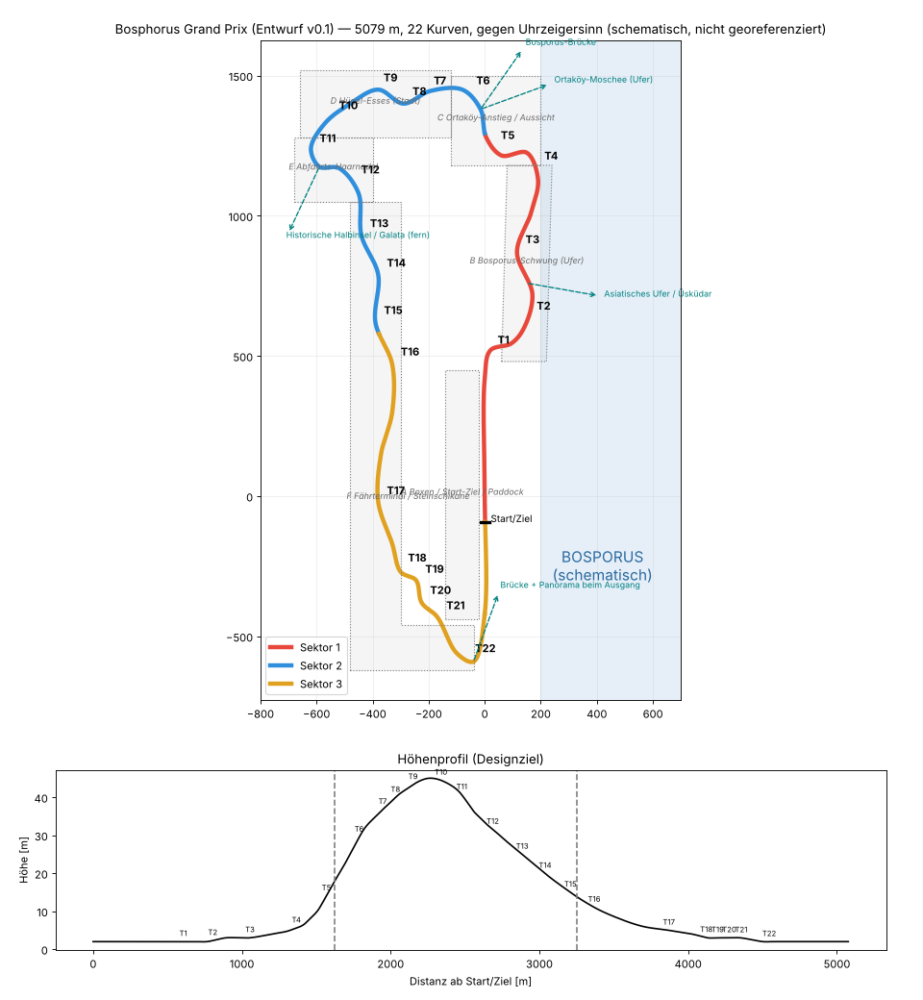

# Bosphorus Grand Prix: Referenz- und Blockout-Plan (Entwurf v0.1)

Status: **Vorschlag**. Alle Maße sind fiktive, abstimmbare Designziele. Nichts ist georeferenziert oder vermessen. Die Strecke ist ein fiktiver, temporär gesperrter Rennkorridor, inspiriert vom europäischen Bosporus-Ufer bei Beşiktaş und Ortaköy. Sie behauptet nicht, dass diese Straßen, Breiten oder Kurven real existieren.

Datenquelle: `unity/com.projectapex.game/Runtime/Resources/Tracks/bosphorus_gp.json` · Bericht und Grafik: `python3 tools/circuit_report.py unity/com.projectapex.game/Runtime/Resources/Tracks/bosphorus_gp.json docs/img/bosphorus_schematic_v0.png`

## 1. Kennzahlen des Entwurfs (automatisch gemessen)

| Größe | Ziel laut Brief | Entwurf v0.1 |
|---|---|---|
| Länge | ca. 5,1 km | 5 079 m |
| Kurven | 19–21 (Ziel 20) | 22 erkannte Richtungswechsel ≥ 12°; zwei davon sind Knicke mit Vollgas und werden zusammengelegt (siehe 3.) |
| Höhenunterschied | 35–55 m | 43 m (2 → 45 m) |
| Max. Steigung | – | 7,4 % (Anstieg T5–T6) |
| Breite | 11–16 m | 12–15 m |
| Min. Abstand nicht benachbarter Abschnitte | – | 113 m |
| Sektoren | 3 | S1 0–32 %, S2 32–64 %, S3 64–100 % |

## 2. Wichtiger Konflikt in der Vorgabe: Fahrtrichtung

Der Brief verlangt gleichzeitig:

1. **im Uhrzeigersinn**,
2. **Wasser rechts** auf der Start-Ziel-Geraden und im Bosporus-Schwung (T3–T5),
3. die Kurvenrichtungen T1 rechts, T2 links, T6 links, T8 links, T12 linke Haarnadel und T20 linke Schlusskurve, wobei die Aufstiege landeinwärts führen.

Diese drei Punkte widersprechen sich. In einer Runde im Uhrzeigersinn liegt rechts immer das Innenfeld. „Wasser rechts“ hieße dann, dass der Bosporus im Inneren der Strecke liegt, die Strecke aber gleichzeitig landeinwärts bergauf führt. Die vorgegebenen Kurvenrichtungen (überwiegend links, linke Haarnadel, linke Schlusskurve) ergeben geometrisch eine Runde **gegen den Uhrzeigersinn**.

**Empfehlung A (im Entwurf umgesetzt):** gegen den Uhrzeigersinn fahren. Dabei bleiben „Wasser rechts“ und alle Kurvenrichtungen erhalten. Die Gerade läuft nach Norden am Ufer entlang, rechts Tribünen und Bosporus, links Paddock und Boxen.

**Alternative B:** im Uhrzeigersinn fahren und das Layout spiegeln. Dann liegt das Wasser auf der Geraden links, und T1 wird zur Linkskurve. Das widerspricht anderen Punkten des Briefs.

## 3. Kurvenplan: Vorgabe gegen Entwurf v0.1

| Brief | Charakter laut Brief | Entwurf v0.1 (Richtung, Winkel, Radius) | Abweichung / To-do |
|---|---|---|---|
| Start/Ziel | Gerade 650–850 m | ca. 600 m bis zum Bremspunkt T1 | Startlinie ca. 50–100 m zurücksetzen |
| T1 | schwere Bremsung, Rechts-Haarnadel 75–95° | R 76°, r 30 m | ✓ |
| T2 | kurze Links | L 107°, r 42 m | Winkel zu groß, entschärfen |
| T3–T5 | Ufer R-L-R, mittelschnell | R 51° · L 122° · R 102° | T4/T5 sind zu eng: Sie liegen schon am Fuß des Anstiegs. Ufer-Schwung verlängern |
| T6–T8 | Ortaköy-Anstieg: enge Links, Rechts bergauf, blinde Kuppe links | L 96° · (L 19° Knick) · R 72° · L 72° | Knick ausglätten, Kuppe T8 bei ca. 43 m ✓ |
| T9–T11 | Hügel-Esses L-R-L, 12–14 m breit | (L 14° Knick) · L 136° · R 98° | Esses fehlen noch als echte Folge. Die Haarnadel liegt zu früh |
| T12 | abschüssige Links-Haarnadel, Überholpunkt 2 | (L 136° ≈ T11 des Entwurfs) | neu ordnen |
| T13–T15 | Fährterminal-Fluss, mittelschnell | L 28° · R 35° · L 33° · R 23° | ✓ Charakter. Die vier Biegungen auf drei reduzieren |
| T16–T18 | Steinschikane (technisch, Überholpunkt 3) | L 60° · R 66° · L 48° | ✓ |
| T19 | schnelle Rechts | R 29° | ✓ |
| T20 | langsamere Links auf die Gerade | L 144°, r 17 m | Radius auf ca. 25 m erhöhen |

Fazit: Länge, Höhenprofil, Distrikte, Sichtachsen und die Abfolge der Sektoren stimmen. Die genaue Kurvenfolge in S1 und S2 braucht noch eine Iteration. Danach wird sie im Graybox-Fahrtest (M2) endgültig abgestimmt.

## 4. Boxengasse

- **Einfahrt:** rechts vor T20, an der Innenseite der Schlusskurve. Die Boxengasse verläuft parallel zur Geraden auf der Landseite (Westen), hinter der Boxenmauer.
- **Ausfahrt:** nach T1, an der Außenseite der Auslaufzone, Einmündung vor T2. Die Geometrie wird in M2 validiert: keine Kreuzung der Ideallinie und eine sichere Einfädelspur.
- 20 Garagen, Startaufstellung versetzt mit 8 m Abstand. Der Abstand zwischen Gerade und Boxengasse wird in M2 festgelegt.

## 5. Distrikte (Produktionszellen)

| Zelle | Abschnitt | Nah (an der Strecke) | Mittel | Fern / Sichtachsen |
|---|---|---|---|---|
| **A** Boxen/Paddock | Gerade | Garagen, Boxenmauer, Medienzentrum, Tribünen auf der Wasserseite, LED-Wände, Zäune | Fähranleger, Uferpromenade | Brücke im Nordosten, Asiatisches Ufer |
| **B** Bosporus-Schwung | T1–T5 | Tecpro-artige fiktive Barrieren, Fangzäune, Marshal-Posten | Cafés, Platanen, Anleger | Fähren (Bewegungsschleifen), Üsküdar-Hänge im Dunst |
| **C** Ortaköy-Anstieg | T6–T8 | Stützmauern, Fußgängerbrücke mit Freiraum | Wohnblöcke am Hang | **Signaturmoment an der Kuppe:** Brücke im Nordosten, Moschee am Ufer (außerhalb der Strecke, Ausrichtung nach Referenz) |
| **D** Hügel-Esses | T9–T11 | Mischbebauung (osmanisch/europäisch-modern), Balkon-Zuschauer | Dachlandschaft mit roten Ziegeln | Blicke aufs Wasser zwischen den Blöcken |
| **E** Abfahrts-Haarnadel | T12 | Auslaufterrasse, LED-Zeitanzeige, Zuschauerterrassen | Zypressen, Parks | Historische Halbinsel und Galata in der Ferne (nur von sinnvollen Blickpunkten aus) |
| **F** Fährterminal/Steinschikane | T13–T20 | Steinbögen und Böschung (ggf. Unterführung mit Hall), Kaikräne | Terminal-Architektur | Schluss-Panorama: Brücke und Asiatisches Ufer |

Jede Zelle bekommt Nah/Mittel/Fern-Geometrie, Verdeckungszonen, Streaming-Grenzen, LOD-Budgets, lokale Ambience, Lichtvolumen und Kamerapunkte.

## 6. Landmarken: Regeln zur Geografie

- Die Bosporus-Brücke (15.-Juli-Märtyrer-Brücke) spannt zwischen den Bereichen Ortaköy und Beylerbeyi. Sie ist nur nördlich bzw. nordöstlich sichtbar und an Ufer und Gelände verankert, nie über der Strecke schwebend.
- Üsküdar liegt gegenüber am asiatischen Ufer. Den Leanderturm nur zeigen, wo die Blickrichtung nach Süden geografisch passt.
- Hagia Sophia, Sultanahmet und Topkapı liegen auf der historischen Halbinsel südlich bzw. südwestlich des Goldenen Horns, Galata nördlich davon. Beide sind nur als ferne Silhouetten von erhöhten Punkten aus zu sehen.
- Keine Collage: Jede Landmarke erscheint nur entlang der Sichtachsen im Schema.
- Religiöse und historische Bauten werden respektvoll und referenzgetreu dargestellt und liegen nie im Rennkorridor.

## 7. Referenz- und Lizenzprozess

1. Referenzboard aus eigenen oder lizenzierten Fotos (z. B. Wikimedia Commons, Lizenz pro Bild notieren). Keine Google-Maps- oder Earth-Geometrie und keine Texturen von dort.
2. Für die Lage OpenStreetMap-Daten (ODbL): Attribution im Spiel und in `docs/ASSET_LICENSES.md`. Abgeleitete Datenbanken unterliegen der Share-Alike-Pflicht. Das vor kommerzieller Nutzung rechtlich prüfen lassen.
3. Höhen nur als fiktives Designziel. Echte DEM-Daten erst nach Lizenzprüfung verwenden.

## 8. Asset-Liste (Blockout → Final)

| Asset | M2 Graybox | Final (M3/M9) | Quelle |
|---|---|---|---|
| Straße, Randsteine, Auslauf, Barrieren | prozedural aus dem Spline | prozedural plus PBR-Materialien | selbst erstellt |
| Boxengebäude, Tribünen, Gantry | Boxen-Blockout | modulares Kit | selbst erstellt (Blender) |
| Modularer Istanbul-Gebäudekit (Fassaden, Dächer) | Quader mit Farbcodierung | 20–30 Module, 3 LODs | selbst erstellt oder lizenziert |
| Bosporus-Brücke | Silhouette (Impostor) | vereinfachtes Hero-Modell | **extern, lizenzpflichtig oder eigenes Modell nach Referenz** |
| Ortaköy-Moschee, Galata, historische Halbinsel | Silhouetten-Karten | Low-Poly-Modelle und Impostor | extern, lizenzpflichtig oder eigenes Modell |
| Fähren, Boote | Platzhalter | 2–3 Modelle mit Bewegungsschleifen | selbst erstellt oder lizenziert |
| Platanen, Zypressen | Billboards | LOD-Bäume und Impostor | lizenziert (z. B. Asset-Store-Lizenz prüfen) |
| Wasser | einfaches Shader-Material | mobiles Wasser (Normal-Maps, Reflection Probe) | selbst erstellt |
| Audio (Möwen, Fährhorn, Ufer) | – | lizenzierte Aufnahmen | lizenziert |

## 9. Performance-Budgets (Startwerte, nicht gemessen)

Ziel: 60 fps (16,67 ms) auf Flaggschiff-Geräten, 30 fps (33,33 ms) als Rückfallstufe. Diese Werte gelten als erfüllt erst nach Messung auf echten Geräten.

| Budget | High | Balanced | Low |
|---|---|---|---|
| Draw Calls (SRP Batcher, Instancing) | ≤ 350 | ≤ 250 | ≤ 150 |
| Dreiecke im Bild | ≤ 1,2 M | ≤ 700 k | ≤ 400 k |
| Schattendistanz / Kaskaden | 150 m / 2 | 100 m / 2 | 60 m / 1 |
| Texturspeicher (ASTC) | ≤ 900 MB | ≤ 600 MB | ≤ 400 MB |
| Physik (20 Autos, 120 Hz) | ≤ 3 ms | ≤ 3 ms | ≤ 3 ms (KI-LOD) |
| Render-Skalierung | 1,0 | 0,85 | 0,7 |

Pro Zelle: Nahbereich ≤ 120 Draw Calls; der Fernbereich nutzt Impostor und gebackene Skyline-Ebenen.

## 10. Nächste kleine Schritte

1. Fahrtrichtung entscheiden (Empfehlung A).
2. Kurvenfolge in S1 und S2 nachschärfen, bis der Bericht 20 Kurven in der Reihenfolge des Briefs ausweist.
3. In M2 als Graybox in Unity umsetzen: Spline-Mesh, Sektoren, Boxengasse, Kurventafeln, Minimap und 10 saubere Runden des Autopiloten als automatischer Test.
