# Bosphorus GP – Istanbul-Welt und visuelle Überarbeitung

**Stand:** 2026-11-01.

**Status:**
- **Phase 1 (Analyse):** abgeschlossen.
- **Phase 2, Uferhöhen:** implementiert und getestet (Simulation, Messwerkzeuge, Vorschau-Renders).
  - **Im Unity-Editor nicht geprüft.** Die Bilder sind three.js-Vorschauen der Spielgeometrie, keine Unity-Aufnahmen.
- **Phase 3, Referenzzone Dolmabahçe:** implementiert und getestet (Abschnitt 2b). Im Unity-Editor nicht geprüft.
- **Phase 4, erster Teil (Infrastruktur, Ufertypen, Gebäudedetails):** implementiert und getestet (Abschnitt 2c). Im Unity-Editor nicht geprüft.
- **Phase 4, zweiter Teil (Gebäudefamilien):** implementiert und getestet (Abschnitt 2d). Im Unity-Editor nicht geprüft.
- **Phase 5, Atmosphäre (Zuschauerzonen, Boote, Flaggenwind, Hörner und Möwen):** implementiert und getestet (Abschnitt 2e). Im Unity-Editor nicht geprüft, nicht gehört.
- **Phase 6, Tests und Leistung:**
  - Sichtprüfung, Budgetzählung und Messwerkzeug: implementiert und getestet (Abschnitt 2f).
  - Frame-Zeiten auf PC und Mobil: **nicht gemessen.** Dafür braucht es Unity und echte Geräte; das Messwerkzeug liegt bereit.

**Git-Checkpoint:** `main` bei Commit `8a3377a` (Merge von PR #25), dem Stand vor dieser Überarbeitung. Das lokale Tag `checkpoint-pre-istanbul-overhaul` ließ sich über den Proxy nicht hochladen.

## 1. Technische Bestandsaufnahme (Phase 1)

| System | Code | Stand | Ursache sichtbarer Probleme |
|---|---|---|---|
| Höhenmodell | `tools/geo/build_track_a.py` → `geo.heights` (100-m-Raster), `LandModel` | Copernicus GLO-30 je Zelle 10. Perzentil, OSM-Dächer ausgeschnitten | GLO-30 ist ein **Oberflächenmodell**: Bäume, Mauern, Böschungen zählen mit. Die 100-m-Zellen mitteln den Hang bis ans Wasser. Messwerte am Ufer: Dolmabahçe 6–17 m roh, im Raster 10–36 m; real ist es aufgeschüttetes Land auf Kaihöhe. |
| Nahgelände | `TerrainField.NearHeight` | Straßenband 30 m, dann bis 18° zum DEM | Kein Ufermodell: Landzellen behielten die DEM-Höhe bis zur Küste, Wasserzellen −4 m. **Das ergab die Klippe** (Abschnitt 2). |
| Küstenlinie | `tools/geo/osm_land.py`, `TerrainField.IsWater` | OSM-Küste, horizontal korrekt (PR #19) | Horizontal richtig, vertikal falsch: Genau das beschreibt der Brief. |
| Kai und Promenade | `Waterfront`, `EnvironmentGeometry.WaterfrontEdge` | 4,5 km Kai, 3,5 km Promenade | Kaioberkante war auf höchstens 6 m begrenzt. Darüber lag die 10–36 m hohe Erdwand frei; das war die „braune Steilwand“. Alle Abschnitte bekommen dieselbe Kaigeometrie (Abschnitt 4, Phase 4). |
| Gebäude | `OsmCity`, `EnvironmentGeometry.FootprintBuilding`, `FacadeOrnaments`, `StreetFronts` | 4.088 OSM-Grundrisse, Höhen aus OSM-Tags oder Schätzung, Fassadenornamente nur an Straßenfronten | Grundkörper sind extrudierte Grundrisse mit einer gemeinsamen Fassadentextur. Erker, Balkone, Klimageräte, Markisen und Alterung fehlen außerhalb von Ortaköy. Daher wirkt es kastenförmig. |
| Wahrzeichen | `LandmarkModels`, `LandmarkGeometry` | Dolmabahçe aus Grundrissen mit Kuppel und Uhrturm, die zwei Landtore Saltanat und Hazine, Ortaköy-Moschee, Esma Sultan, Brücke | Die **Ufertore auf der Bosporusseite fehlen**. Die Palastfassade ist ein klassizistisches Grundmuster ohne die Gliederung der echten Bosporusfront. |
| Vegetation | `OsmCity` (Parks, Friedhöfe, Straßenbäume), `EnvironmentGeometry.TreeMesh` | 16.169 Bäume, 4 Arten, LOD über Mesh-Kombination | Kronen aus wenigen Polygonen ohne Alpha-Blätter. Palastgärten werden dicht bepflanzt und verdecken die Fassade vom Wasser aus. |
| Strecken-Infrastruktur | `TrackInfrastructurePlan`, `TrackKitLayout`, `FlagPanelComponent` | Beton, Armco, TecPro-Module, Reifenstapel, Fangzaun nach Gefahrenregel, **LED-Flaggenpanels mit Rennzustand verbunden** (`FlagPanelLogic`) | Fangzaun auf 71 % der Barrierenlänge. Distanztafeln, Marshal-Posten, TV-Türme und Rettungsfahrzeuge: im Kit teilweise vorhanden, im Brief erneut gefordert. Abgleich in Phase 4. |
| Wasser | `Apex/Water` (`docs/WATER_SHADER.md`) | 3 Normal-Map-Schichten, Fresnel, GGX, Uferabstand | Laut Brief sind regelmäßige Muster sichtbar. Der Shader war bei Abgabe nicht kompiliert. Ob im Bild der Shader oder sein Lit-Rückfall zu sehen ist, muss die Unity-Prüfung zeigen. |
| Licht | `SunModel`, `SkyModel`, `WeatherVisuals`, `docs/NIGHT_LIGHTING.md` | Sonnenstand nach Ort und Datum, Tageszeiten, Nachtlichter, rot-weiße Brücke | Ohne Unity nicht bewertbar; im Brief „teilweise künstlich“. |
| Leistung | `GraphicsPreset` (Niedrig bis Cinema), `EnvironmentBuilder.Quality` | Stufen vorhanden | **Nicht gemessen.** Unity-Profiling fehlt; die Dreieckszahlen der Vorschau stehen in `Apex.ModelPreview --environment`. |

## 2. Fehler Dolmabahçe-Klippe (Phase 2): Ursache und Behebung

### Messung
Neues Werkzeug `dotnet run -- coast-audit bosphorus_a`: Es prüft jede Landzelle neben Wasser (4-m-Raster, 6,3 km Ufer).

| | vorher | nachher |
|---|---|---|
| Uferzellen über 4 m | **84 %** | **0 %** |
| Höhe der Uferkante | bis 56 m (Kabataş–Gümüşsuyu 35 m, Çırağan 41 m, Kuruçeşme 55 m) | höchstens 2,1 m (Test) |
| Dolmabahçe Selamlık / Muayede / Harem | 27–35 / 25–37 / 12–32 m | 2,9–6,0 / 2,4–5,6 / 2,4–6,7 m |
| Çırağan-Palast | 12–32 m | 2,9–5,9 m |
| Ortaköy-Moschee (Büyük Mecidiye) | 7,5–8,6 m | 1,7–4,3 m |
| Esma Sultan Yalısı | 5,7–9,9 m | 2,5–5,7 m |

(`dotnet run -- landmark-ground bosphorus_a`: Geländehöhe unter den OSM-Grundrissen.)

### Ursache in zwei Teilen
1. **Höhendaten:** Das Oberflächenmodell mit 100-m-Raster zieht die Hügel hinter der Uferstraße bis ans Wasser. Die Uferebene ist schmal, real Kaihöhe: Dolmabahçe heißt „aufgefüllter Garten“, die Bucht wurde im 17./18. Jahrhundert aufgeschüttet. Das Raster erfasst sie nicht.
2. **Gelände-Code:** Kein Übergang zum Wasser. Landzelle mit DEM-Höhe neben Wasserzelle mit −4 m ergibt eine senkrechte Wand. Die Kaimauer endete bei 6 m.

### Behebung: Ufermodell statt Kaschierung
`CoastalProfile` (Simulation, getestet), angewendet in `TerrainField.Height`. Es gilt damit für Nah- und Ferngelände, Kollision, Gebäudesockel, Bäume, Kai und Promenade, die alle dieselbe Funktion nutzen.
- **Am Wasser:** Kaioberkante 1,6 m über dem Bosporus. Davor steht die bestehende steinerne Kaimauer, die jetzt bündig mit dem Gelände abschließt.
- **Promenade:** 8 m eben auf Kaihöhe.
- **Seeseitig der Uferstraße** (Strecke höchstens 260 m vom Wasser): Uferebene. Das Gelände steigt gleichmäßig von der Promenade bis zum Straßenband an, daher weder Klippe am Wasser noch Wand an der Straße. Dort liegen Paläste, Plätze, Moschee und Kais.
- **Ohne nahe Straße:** 60 m Uferebene mit 3°, dahinter Hang bis höchstens 19° bis zur echten Höhe.
- **Landseitig der Uferstraße:** unverändert. Die Hügel von Yıldız, Gümüşsuyu und Akaretler bleiben, wie sie sind.
- **Abstand zum Wasser:** ein neues Distanzfeld vom Land zum Wasser (`CoastDistanceField`, 8 m, über den Nahbereich plus 1,5 km).

Nicht verändert wurden Wahrzeichen-Positionen, Küstenlinie, Streckenverlauf und Streckenhöhen.

### Tests
- **`TheBosphorusShoreIsAQuayNotACliff`:**
  - Alle 705 Uferzellen liegen höchstens 2,5 m über der Kaihöhe.
  - Die Grundrisse von Palästen, Moschee und Yalı liegen auf 1–4 m (tiefster Punkt) und unter 8 m (höchster Punkt).
  - Keine Kaimauer hat mehr als 3 m Erde dahinter.
  - Die Profilregeln sind abgesichert.
- **Unverändert grün:** Wandanteil neben der Strecke (`terrain-audit`, jetzt 6,0 % statt 6,3 %), Uferlage der Wahrzeichen, Fahrtests auf der Collider-Fläche.

### Bilder (three.js-Vorschau der Spielgeometrie, keine Unity-Aufnahme)
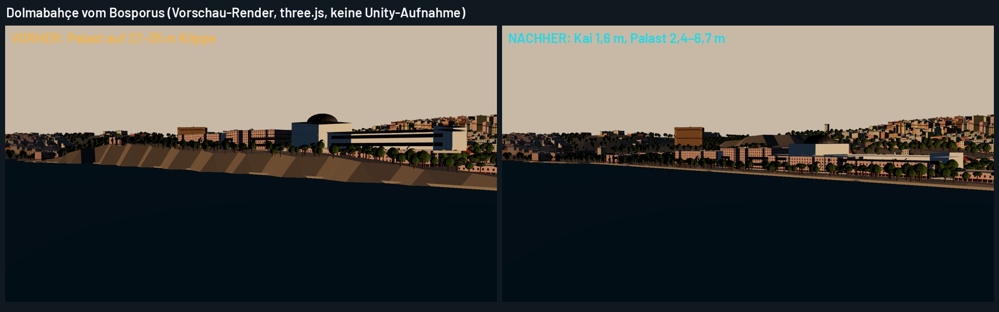
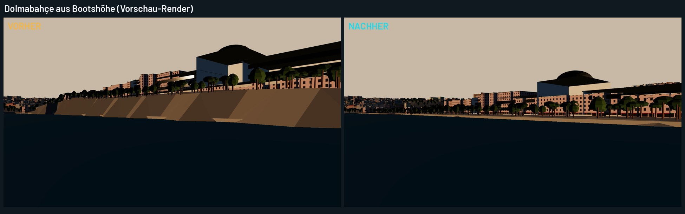
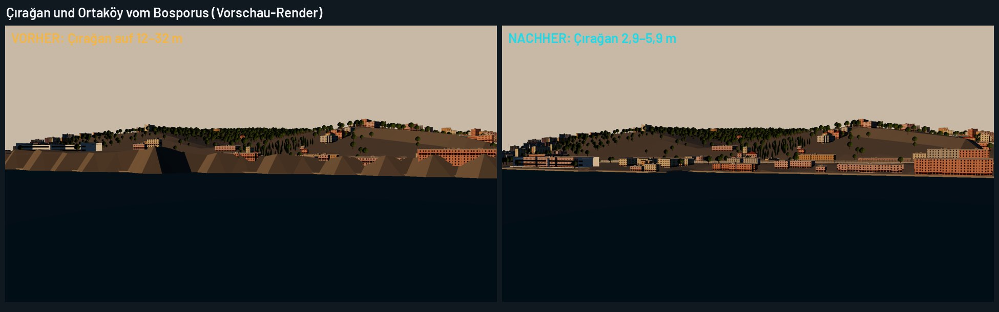

In der Vorschau sind die Paläste einfache Grundriss-Körper. Im Spiel stehen dort die detaillierten Landmarken-Modelle.

### Offen und ehrlich
- **Streckenhöhe:** umgesetzt in Abschnitt 2a.
- **Bäume vor den Palastfassaden:** Die Palastgärten werden dicht bepflanzt. Freie Sicht vom Wasser kommt in Phase 3 (Dolmabahçe-Referenzzone).
- **In Unity zu prüfen:** Gelände-Shader am neuen Uferstreifen (Gras/Erde/Mauer nach Neigung), Kaimauer-Anschluss, Kollision an Kai und Promenade.

## 2a. Streckenhöhe an der Uferstraße (freigegeben am 2026-11-01)
Das Straßenprofil (`plan.profile.street`, 10. Perzentil des Oberflächenmodells) hatte am Ufer denselben Fehler wie das
Gelände. `build_track_a.py` korrigiert es jetzt vor dem Höhenentwurf (`coastal_street`):
- **Obergrenze:** höchstens Kaihöhe + 0,6 m Fahrbahnwölbung, + 5 % auf den ersten 60 m vom Wasser, danach + 12 %.
- **Geltungsbereich:** nur bis 260 m vom Wasser. Die Absenkung wird über 160 m verteilt, damit keine Stufe entsteht.
- **Danach:** derselbe Entwurf gegen die Fahrzeuggrenzen (`vertical_alignment.py`) wie bisher.

**Ergebnis:**
- **Çırağan Caddesi** (Runde 1,55–2,06 km): um 0,7–2,8 m abgesenkt, auf 7,4–9,4 m statt 9,1–12,1 m.
- **Rest der Runde:** unverändert.
- **Länge:** unverändert 8,16 km.
- **Steigung:** höchstens 11 %.
- **Tests:** alle 211 grün, darunter die Tastatur-Runden aller Fahrprofile trocken und nass.

**Grenze dieser Korrektur:**
- Die Bremszone vor der Ortaköy-Kehre (letzte ~300 m) und die freigegebene R20-Kehre behalten ihr Profil (12–14 m bzw. ~10 m).
- **Versuch mit voller Korrektur** (`APEX_FULL_SHORE=1 python3 tools/geo/build_track_a.py`):
  - senkt dort um bis zu 11 m ab,
  - erzeugt aber eine Kuppe in der Bremszone aus 330 km/h (Experten-Tastaturrunde ohne ABS verlässt die Strecke),
  - verändert die Ideallinie auf dem Platz, sodass Gummiabrieb und Zaun-Mittelwand-Prüfung brechen.
- Das braucht einen Neuentwurf der R20-Kehre mit Fahrtests. Mein Vorschlag ist ein eigener Schritt.

## 2b. Phase 3: Referenzzone Dolmabahçe
**Quellen:**
- Die Palastfront steht auf einem ummauerten Kai von etwa 600 m.
- Zum Bosporus öffnen sich **fünf Seetore** (yalı kapıları). Das Tor in der Achse des Muayede-Saals ist größer und reicher verziert als die anderen vier.
- Das Haupttor ist in OSM erfasst: Knoten 13084855510 „Dolmabahçe Sarayı Deniz Kapısı“ (ODbL).

### Was gebaut ist
| Teil | Code | Inhalt |
|---|---|---|
| Palastkai | `PalaceWaterfront`, `Waterfront.Segment.palace`, `EnvironmentGeometry.PalaceRailing` | Kaistücke höchstens 75 m vor den Bosporus-Flügeln (Selamlık, Muayede, Harem): statt öffentlicher Promenade mit Pollern und Laternen ein weißer Marmorsockel mit Pfeilern und Kugelaufsatz, ein schmiedeeisernes Geländer mit vergoldeten Spitzen. An den Toren ist es unterbrochen. 417 m Palastkai. |
| Seetore | `LandmarkGeometry.SeaGate`, `PalaceWaterfront.PlaceGates` | Marmorportal mit Rundbogen, Archivolte und Schlussstein, Säulen auf Postamenten (am Haupttor gepaart), Gebälk, barocke Bekrönung (Kartusche mit vergoldetem Medaillon ohne Inschrift, Bogenhaube, Volutenstufen, Urnen), schmiedeeiserne Torflügel mit Rankenband. Drei Detailstufen. Nachts von der Kaiseite warm angestrahlt (ab Hoch). |
| Lage der Tore | wie oben | **Haupttor:** OSM, 8 m vom Knoten. **Die vier anderen:** nicht in OSM, daher genähert auf den Achsen von Selamlık und Harem und an den beiden Enden der Palastfront, mindestens 30 m Abstand. |
| Freier Vorplatz | `OsmCity.AddTree`, `PalaceWaterfront.InForecourt` | Zwischen Fassade und Kai (bis 55 m vom Wasser und von den Flügeln) wachsen keine Bäume mehr. Die Fassade ist vom Wasser aus frei. Die Gärten an den Enden bleiben. |
| Festliche Fassaden | `OsmCity.Building.raceFront`, `StreetFronts.FlagFront/FlagScale` | Straßenfronten zur Strecke hin (bis 25 m vom Fahrbereich) tragen zu 40 % hängende türkische Flaggen, Ortaköy zu 25 %, sonst zu 10 %. Flaggengröße zwischen 0,7 × 1,1 m und 1,6 × 2,4 m. Die Auswahl über eine Hashfunktion verhindert ein Raster. |

### Tests
- **`DolmabahceHasItsPalaceQuayFiveSeaGatesAndAnOpenForecourt`:**
  - Palastkai 250–700 m, ohne Promenade und Laternen.
  - Fünf Tore, das Haupttor höchstens 25 m vom OSM-Knoten, alle an Land mit Blick aufs Wasser, mindestens 30 m Abstand.
  - Geländer an den Toren unterbrochen.
  - Kein Baum im Vorplatz.
- **`FacadesAlongTheCircuitAreFestiveWithFlagsOfDifferentSizes`:** 216 Fronten zur Strecke, davon 41 % mit Flaggen, sonst 10 %. Größen gestreut.

### Bilder (three.js-Vorschau der Spielgeometrie, keine Unity-Aufnahme)
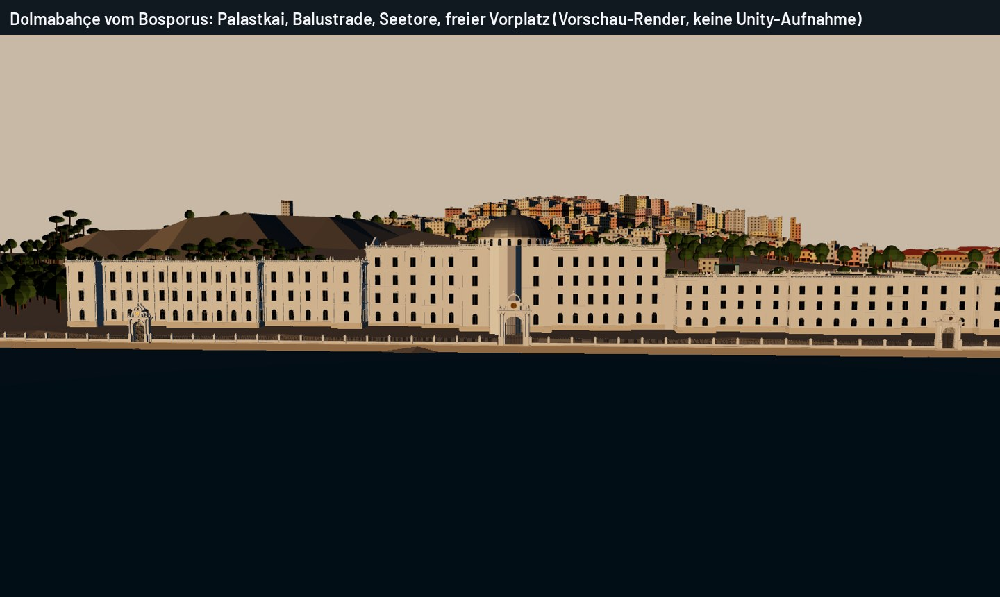
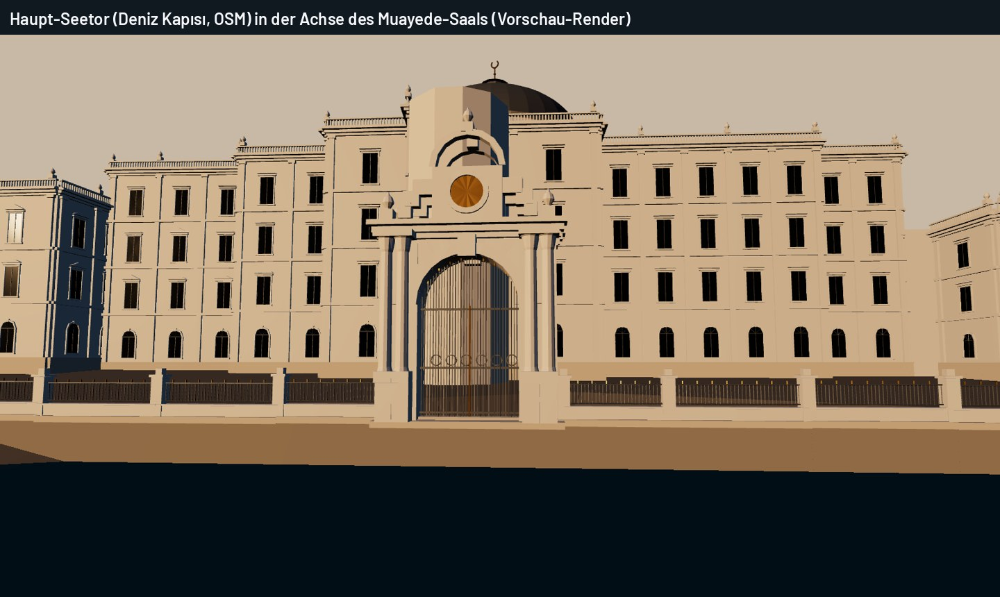
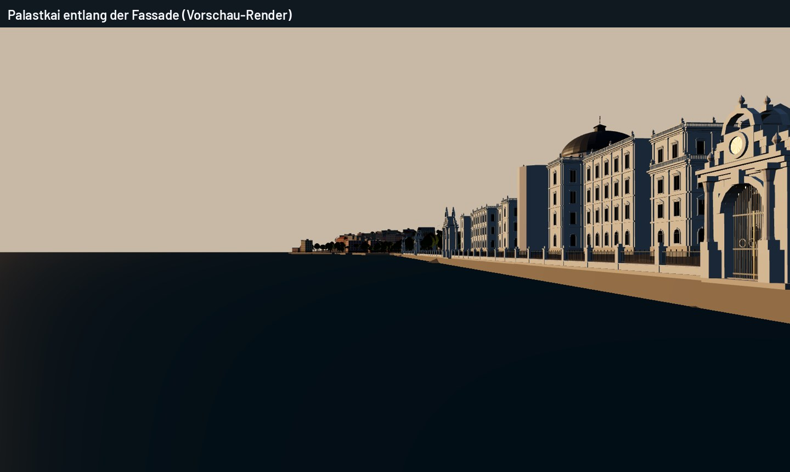
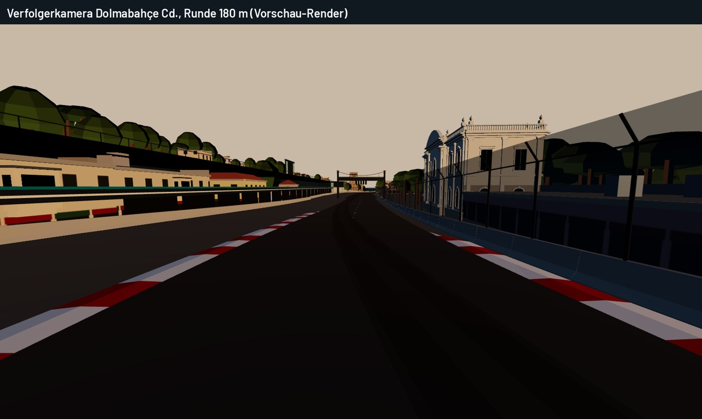
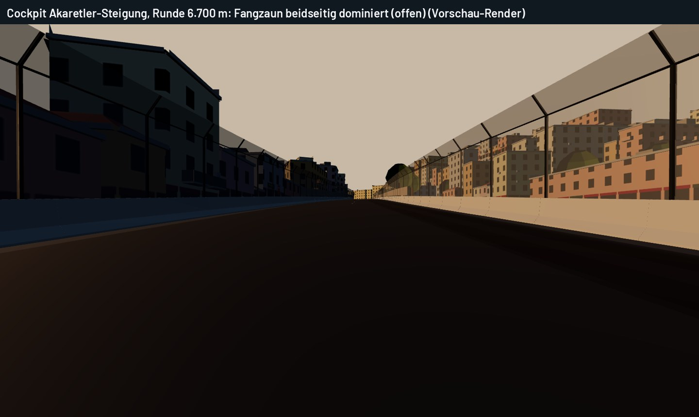

### Sichtbarkeit aus dem Fahrbetrieb (ehrlich)
- **Seetore:** Die Strecke liegt an der Dolmabahçe Caddesi, also auf der Landseite. Die Tore sind daher **vom Fahrer nicht zu sehen**, nur vom Wasser, aus Wiederholungs- und TV-Kameras. Das ist geografisch korrekt; ich habe keine Sichtachse erfunden.
- **Aus der Verfolgerkamera** sieht man an der Dolmabahçe Caddesi die Palast-Nebengebäude und das Saltanat-Tor.

### Offen nach Phase 3
- **Palastfassaden:** Die Grundriss-Modelle haben Fensterachsen, Gesimse und Balustraden. Die feine Gliederung der echten Bosporusfront (Pilaster und Säulenstellungen, reiche Fensterrahmungen) fehlt noch.
- **Tore:** Die Proportionen beruhen auf Fotos, nicht auf Bauaufnahmen. Für die vier genäherten Positionen bräuchte es eine Bauaufnahme oder Millî-Saraylar-Pläne.
- **Fangzaun an der Akaretler-Steigung:** beidseitig und im Cockpit dominant (Bild). Er gehört zur Infrastruktur-Phase 4.
- **Vorschau-Werkzeug:** zeigt die Flaggen an Straßenfronten aus Streckensicht schlecht (keine Schatten-/Licht-Abstimmung). Die Prüfung im Unity-Editor ist nötig.
- **Wind:** Die Bewegung der Balkonflaggen ist im Material nicht animiert; nur die Monumentalflagge bewegt sich.

## 2c. Phase 4, erster Teil: Infrastruktur, Ufertypen, Gebäudedetails
| Teil | Code | Inhalt |
|---|---|---|
| Bremstafeln | `TrackInfrastructurePlan.brakeBoards`, `TrackInfrastructureBuilder.BuildSigns` | Weiße Tafeln mit schwarzen Ziffern 150 / 100 / 50 m vor dem Einlenkpunkt jeder Kurve, die um mehr als 90 km/h angebremst wird, außen hinter der Barriere. Keine Tafel, die in die vorige Kurve fiele. 19 Tafeln. |
| TV-Kameratürme | `TrackInfrastructurePlan.tvTowers`, `TrackKitGeometry.TvTower` | Gerüst 1,8 × 1,8 m, Plattform auf 5 m, Leiter, Sonnendach, Kamera auf Stativ, Kameramann. 30 m nach dem Scheitel der sechs langsamsten Kurven, mindestens 250 m auseinander. Standort für Bäume und Gebäude reserviert. |
| Ufertypen | `PalaceWaterfront` | **Palastkai:** Dolmabahçe (417 m, mit Seetoren) und **Çırağan** mit Hotelflügel (519 m, Balustrade, keine erfundenen Tore). **Urbane Promenade:** übrige europäische Seite mit Pollern und Laternen. **Kai ohne Promenade:** asiatische Seite. |
| Gebäudedetails | `EnvironmentGeometry.FacadeOrnaments` | Zusätzlich zu Balkonen, Erkern, Markisen, Klimageräten und Flaggen: **Fallrohre** an beiden Enden jeder Straßenfront, **Satellitenschüsseln** (0–2 je Front) auf der Brüstung von Flachdächern, **Dachterrassen** mit Sonnensegel und Tisch auf jedem vierten Flachdach an der Straße. |

### Tests
- **`BrakeBoardsCountDownToHeavilyBrakedCornersAndTvTowersWatchTheSlowOnes`:** Reihenfolge 150 > 100 > 50 im Abstand von 50 m, mindestens vier vollständige Sätze, 4–6 Türme mit mindestens 250 m Abstand.
- **`TvTowersStandClearOfTreesAndBuildings`:** kein Baum im 4-m-Radius, kein Gebäude und kein Wasser am Turmstandort. Die Vorschau hatte zuerst einen Baum im Turm gezeigt; das ist jetzt behoben.
- **Dolmabahçe-Test erweitert:** Dolmabahçe 250–700 m, Çırağan 200–700 m Palastkai.

### Bilder (Vorschau, keine Unity-Aufnahme)
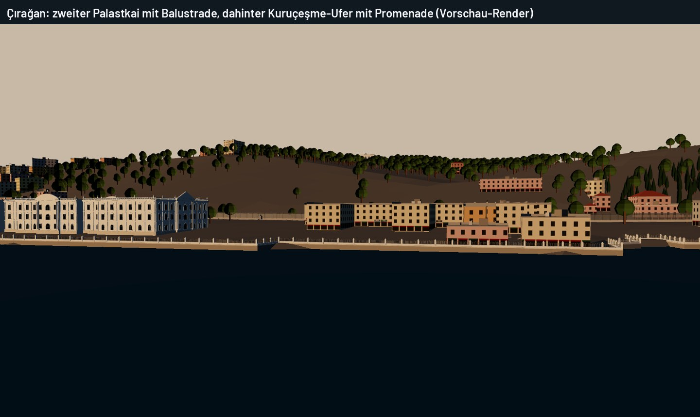
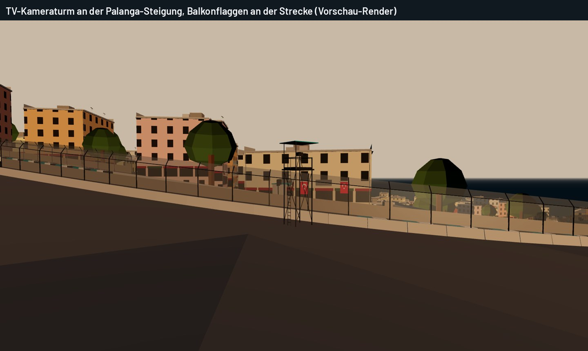
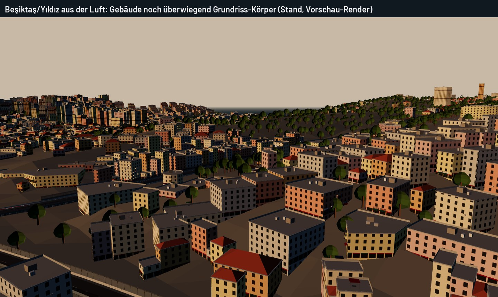

### Ehrlich: noch nicht erreicht
- **Gebäude:** Abseits der Straßenfronten sind die Gebäude weiter extrudierte Grundrisse mit gemeinsamer Fassadentextur (Luftbild). Für echte Gebäudefamilien fehlen:
  - eigene Grundtypen (osmanisches Holzhaus, Jugendstil-Apartment, 1970er-Block, Neubau),
  - Fensterrahmen als Geometrie,
  - Alterung über Texturvariation.
- **Rettungsfahrzeuge, Fotografenzonen, Service-Zugänge:** noch nicht gebaut. Die Notfalltore im Zaun gibt es (alle 160 m).
- **Fangzaun:** Die Regel (Bremszonen, über 234 km/h beidseitig, Start-Ziel) bleibt aus Sicherheitsgründen. Er ist bereits fein und transparent. Ob er im Cockpit noch zu dominant wirkt, muss die Unity-Prüfung zeigen.
- **Distanztafeln:** Es sind TextMesh-Schilder mit eingebauter Schrift, nicht die Barlow-Schrift. In der Vorschau fehlen sie, weil das OBJ keinen Text enthält.

## 2d. Phase 4, zweiter Teil: Gebäudefamilien
Jedes OSM-Gebäude bekommt eine Familie (`BuildingFamilies.Classify`) aus Nutzung, Höhe, Grundfläche, Denkmal-Tag und Viertel. Die Familie bestimmt Farbe, Dach und die Gliederung der Straßenfronten:

| Familie | Anteil | Farbe | Dach | Straßenfront |
|---|---|---|---|---|
| Osmanisches Holzhaus (bis 11 m, klein, in Ortaköy häufiger) | 6 % | gestrichenes Holz: Ochsenblut, dunkles Ocker, Graublau | Walmdach (vier Ecken) | Erker (cumba), Holzbänder zwischen den Geschossen, Eckbretter |
| Steinbau 19./frühes 20. Jh. (Denkmal oder jeder fünfte mittelhohe) | 18 % | Creme- und Hellgelb-Putz | Walmdach zur Hälfte | Bossensockel bis zum 1. OG, Gesimsband je Geschoss, einzelne Eisenbalkone |
| Wohnblock der 1960er–80er (apartman) | 57 % | Istanbuler Putzfarben | Flachdach mit Brüstung, Tanks, Treppenhaus | durchgehende Balkonplatten auf jedem Geschoss, Brüstung aus Metall oder Putz |
| Neubau (nach 2000) | 16 % | kühles Grau | Flachdach | schlanke Platten mit Glasbrüstung, senkrechte Lamellen |
| Büro, Hotel, Geschäftshaus | 3 % | Putz | Flachdach | Ladenzeilen |

Dazu kommen für alle Familien weiterhin die Fassadendetails aus Teil 1: Fallrohre, Satellitenschüsseln, Dachterrassen, Klimageräte, Markisen, Ladenschilder und Flaggen. Die Farbpalette wächst von 6 auf 10 Fassadenfarben (`EnvironmentMaterials.FacadeColours`).

**Test `TheCityIsBuiltFromSeveralBuildingFamilies`:**
- Alle Familien sind vorhanden, keine dominiert über 80 %, die Nachkriegsblöcke stellen mehr als ein Drittel.
- Holzhäuser sind niedrig und holzfarben, Blöcke haben Flachdächer, Walmdächer gibt es nur auf vier Ecken.

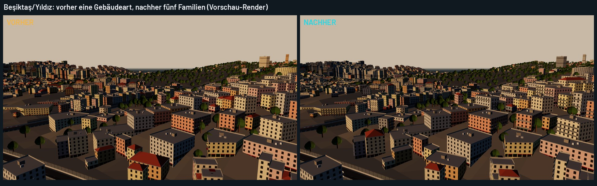
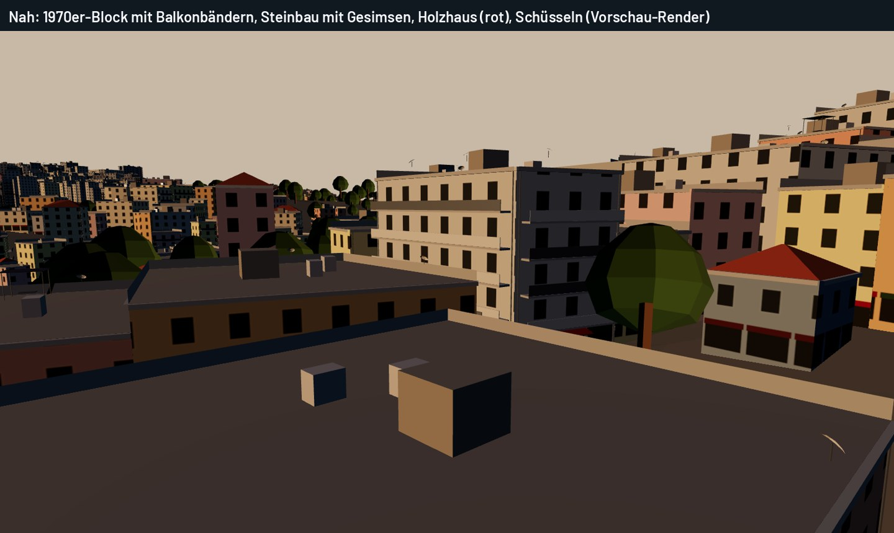

**Ehrlich:**
- **Aus der Luft:** ist der Unterschied mäßig. Die Gliederung entsteht nur an Straßenfronten. Rückseiten und Höfe bleiben glatte Wände mit der gemeinsamen Fenstertextur.
- **Fehlt noch:** Fensterrahmen als Geometrie, Alterung und Schmutzspuren sowie eine eigene Holzverschalungs-Textur. Das Holzhaus nutzt das Fenstermuster der Putzfassade in Holzfarben.
- **Anteile:** aus einer Regel, nicht aus einem Gebäudekataster. OSM kennt das Baujahr für diesen Ausschnitt nicht.

## 2e. Phase 5: Atmosphäre
### Was gebaut ist
- **Zuschauerzonen außerhalb von Ortaköy** (`SpectatorZones`, `TrackInfrastructurePlan.viewingSpots`):
  - Jede stark angebremste Kurve wird ein Aussichtspunkt. Das sind alle Kurven, in denen die Ideallinie mehr als 25 m/s abbaut (9 auf `bosphorus_a`).
  - Um den Scheitel entsteht eine Zone mit 85 m Radius. Zonen überlappen nicht und liegen außerhalb der Ortaköy-Menge.
  - Anzahl der Zonen nach Qualitätsstufe: Mobil 0, mittel 3, hoch 6, maximal 10.
  - Die Fans stehen wie in Ortaköy 1,2–8 m hinter der Barriere. Ein Rauschfeld mit 7 m Körnung bildet Gruppen mit Lücken dazwischen statt einer gleichmäßigen Reihe.
  - Bei Qualität 2 stehen in den Zonen 3273 Fans; ohne Gruppen wären es 5926.
- **Fotografen:** etwa 4 % der Fans. Sie springen nicht mit, tragen keine Handflagge und halten eine Kamera vor dem Gesicht. Die Kamera ist ein eigenes Mesh, passend zu Größe und Blickrichtung der Figur. Bei Qualität 2 sind es 128.
- **Bosporusverkehr** (`MarineTraffic`):
  - Neu ist ein Ausflugsschiff auf der Route „Boğaz turu“ von Eminönü zur Brücke (`LandmarkGeometry.TourBoat`, 28 m, blaues Band, Sonnendach).
  - Dazu kommen zwei Motorboot-Runden vor Ortaköy und Çırağan (`MotorBoat`, 9 m). Alle Punkte liegen mit mindestens 30 m Abstand auf dem Wasser.
  - Auf Mobil gibt es keine Motorboote.
- **Flaggen im Wind** (`FlagWave`, `FlagWindComponent`):
  - Die Balkon- und Fensterflaggen sind ein eigenes Objekt, abgetrennt von den statischen Fassaden.
  - Die Tuchfläche schwingt von der Aufhängung zum freien Ende aus der Fassade heraus, mit Ausschlag und Frequenz nach Windstärke und eigener Phase je Flagge.
  - Aktualisiert wird höchstens mit 20 Hz, nur bis 220 m Entfernung und nur wenn sichtbar.
- **Geräusche** (`AmbienceEvents`, `AmbienceComponent`):
  - Ein entferntes Schiffshorn ertönt alle 35–90 s, Möwenschreie alle 6–18 s.
  - Beide sind synthetisch erzeugt, also keine Aufnahmen und keine Fremdlizenz.
  - Sie sind nur zu hören, wo der Wasseranteil der Ambience über 0,15 liegt, und werden leiser, je weniger Wasser es gibt.

### Tests
- `SpectatorZonesStandInGroupsAtTheBrakingCorners`:
  - Mobil hat keine Zonen; bei Qualität 2 gibt es 3–6.
  - Keine Überlappung und nichts in Ortaköy.
  - Kein Fan steht im Wasser, in einem Haus oder vor der Barriere.
  - Die Gruppen ergeben weniger Fans als die gleichmäßige Verteilung.
  - Der Fotografenanteil liegt unter 10 %.
- `FlagsHangFromTheHoistAndSwingMoreInStrongerWind` und `ShipHornsAndGullsAreOccasionalAndOnlyByTheWater`.
- `FerriesAndShipsStayOnTheWater`, erweitert um Ausflugsschiff und Motorboote.

### Ehrlich: nicht geprüft und offen
- **Unity:** nichts davon ist im Editor gesehen oder gehört.
  - Offen ist, ob die Flaggen-Vertexanimation flüssig wirkt.
  - Offen ist, ob Horn und Möwen im Mix zu laut sind.
  - Offen ist, was die rund 4500 Zuschauer bei Qualität 2 kosten: Die Matrizen werden pro Bild auf der CPU berechnet, Ortaköy eingeschlossen.
- **Keine Vorschaubilder für Phase 5:** Zuschauer, Boote in Bewegung und Flaggenwind entstehen erst zur Laufzeit in Unity, und die three.js-Vorschau zeigt nur statische Geometrie.
- **Synthetische Geräusche:** Horn und Möwe sind Platzhalter. Echte Aufnahmen mit freier Lizenz wären besser und kämen in `docs/ASSET_LICENSES.md`.
- **Noch nicht umgesetzt:**
  - Bugwellen und Kielwasser der Schiffe
  - Licht der goldenen Stunde (inzwischen umgesetzt, `docs/LIGHTING_AND_GRAPHICS.md` Abschnitt 6)
  - Tribünen-Ereignisse (Mexican Wave, Pyro)

## 2f. Phase 6: Tests, Sichtachsen, Leistung
### Fahrbarkeit und KI (Bestand, nach allen Änderungen grün)
- **Tastatur-Runden:** `BosphorusGrandPrixKeyboardLapWithoutSpins` (trocken und nass, alle Fahrprofile).
- **Fahrbahn:** `RoadSurfaceDriveTests` A–G auf der echten Collider-Fläche.
- **KI:** `AIFieldRacesCleanlyOnRig("bosphorus_a")`, sechs KI-Autos über 3 Runden innerhalb der Strecke.
- **Freiraum:** Zuschauer, TV-Türme, Boote und Fassadenteile werden gegen den Fahrraum geprüft (Phase-5-Tests).

### Sicht aus dem Cockpit (`DriverSight`, neu)
- **Messung:**
  - Augenhöhe 0,95 m, Ziel 0,5 m, alle 10 m der Runde bis 300 m voraus.
  - Verdecker sind die Fahrbahn selbst (Kuppen), das Gelände und die OSM-Gebäude hinter der Barriere.
  - Bäume und das eigene Auto zählen nicht.
  - Die 1,1-m-Mauer liegt absichtlich über dem Auge, wie auf einem echten Stadtkurs.
- **Ergebnis `bosphorus_a`:**
  - Die Sicht endet an 329 Punkten an einer Kuppe, an 181 an einem Haus und an 59 am Gelände; 248 Punkte haben 300 m freie Sicht.
  - **Alle 19 Bremstafeln** sind mindestens 1,5 s vor dem Erreichen sichtbar. Am knappsten ist die 50-m-Tafel von Kurve 3: 140 m gesehen, 139 m nötig.
  - **Kuppen bei voller Fahrt:** Über 180 km/h sieht der Fahrer an 135 von 668 Punkten weniger als 2 s voraus.
    - Am kürzesten sind 70 m bei 342 km/h (2060–2090 m, Kuppe bei 2120 m) und 60 m vor Kurve 13 (7300 m, Gefälle Richtung Ortaköy).
    - Vor dieser Überarbeitung (`main` 8a3377a) waren es 130 Punkte mit denselben Tiefstwerten. Die Kuppen stammen aus dem Höhenentwurf (`vertical_alignment.py`), nicht aus der Uferkorrektur.
    - Hinter der Kuppe bei 2120 m folgen noch rund 450 m Gerade bis zur ersten Bremstafel. Die Kuppe ist kurz blind, verdeckt aber keine Kurve.
- **Test `TheDriverSeesTheBrakeBoardsAndCrestsStayReadable`:**
  - Jede Bremstafel ist rechtzeitig sichtbar.
  - Bei Tempo ist die Sicht nie kürzer als 50 m.
  - Weniger als ein Viertel der schnellen Punkte sind blind.
  - In langsamen Kurven zwischen Häusern sinkt die Sicht auf 40 m; das ist dort normal.
- **Werkzeug:** `dotnet run -c Release -- sight bosphorus_a` (in `build/Apex.Tuning`).

### Geometrie-Budget je Qualitätsstufe (statisch, ohne Unity)
Gezählt mit `Apex.ModelPreview --environment --real --quality q`. Das ist die gesamte Szene ohne LOD-Wechsel und ohne Culling, also eine obere Grenze. Im Spiel zeichnen LOD-Gruppen und Sichtkegel deutlich weniger.

| Stufe | Bäume | Fassadenrelief (Dreiecke) | Stadt LOD0 | Szene gesamt (Vorschau-OBJ) |
|---|---|---|---|---|
| 0 Mobil | 7 728 | 0 | 0,86 Mio | 1,94 Mio |
| 1 Mittel | 12 972 | 0,58 Mio | 0,91 Mio | 2,37 Mio |
| 2 Hoch | 16 481 | 0,88 Mio | 0,99 Mio | 2,69 Mio |
| 3 Extrem | 16 481 | 0,88 Mio | 0,99 Mio | 2,69 Mio |

- **Instanzierte Figuren** (nicht im OBJ):
  - Mobil hat keine Zuschauer.
  - Bei Qualität 2 sind es rund 4500 Zuschauer: Ortaköy plus 6 Zonen mit 3273.
  - Dazu kommen 400–700 Fußgänger und 150–260 Fahrzeuge (Qualität 1).
- **Auffällig für Mobil:**
  - Die Paläste (Marmor 0,34 Mio, Blei 0,14 Mio LOD0) sind auf allen Stufen gleich.
  - Die Bäume machen auf Mobil 0,57 Mio Dreiecke aus, wenn sie als Meshes gezählt werden.
  - Ob das auf einem Mittelklasse-Handy 30 fps hält, zeigt erst eine Messung.

### Leistungsmessung im Spiel (`PerfCapture`, neu)
- **Starten:** im Rennen oder Training **F6** drücken. Auf Touch-Geräten im Telemetrie-Fenster (Einstellungen → Telemetrie) auf **LEISTUNG MESSEN (1 RUNDE)** tippen.
- **Ablauf:** Die Messung zeichnet eine Runde auf, höchstens 180 s. Erneutes Drücken bricht ab und speichert, was bis dahin da ist.
- **Dateien:** `perf/perf_<Datum>.csv` (jedes Bild: ms, Streckenposition, Draw Calls, SetPass, Dreiecke) und `.txt` (Bericht) unter `Application.persistentDataPath`. Unter Windows ist das `%USERPROFILE%\AppData\LocalLow\<Firma>\<Produkt>\perf`.
- **Bericht** (`FrameStats`):
  - Mittelwert, Median, P95, P99 und Maximum der Bildzeit, 1-%-Tief und Ruckler.
  - Anteil im Ziel: 16,7 ms auf PC, 33,3 ms auf Mobil.
  - Die fünf langsamsten 250-m-Abschnitte der Runde.
  - Gerät, Grafikstufe, Umgebungsstufe und Kamera.
- **Render-Zähler:** gibt Unity nur im Editor und in Development-Builds aus, sonst steht „nicht verfügbar“ im Bericht.
- **Vorschlag für die Messreihe** (du in Unity):
  - Bosphorus GP, Zeitfahren, Verfolger- und Cockpit-Kamera.
  - PC auf Hoch und Extrem, Handy auf Mobil.
  - Bitte jeweils die `.txt` zurückgeben, dann kann ich gezielt an den langsamsten Abschnitten arbeiten.

### Ehrlich
- **Keine Frame-Zeiten:** Es gibt keine gemessene Frame-Zeit und keine fps-Zahl. Alles oben ist Geometrie und Logik ohne GPU.
- **Sicht vereinfacht:** Die Sichtprüfung kennt keine Bäume und kein Fahrzeug-Cockpit. Kopfhöhe und Halo-Bügel verändern das echte Bild.

## 3. Werkzeuge
```sh
cd build/Apex.Tuning
dotnet run -c Release -- coast-audit bosphorus_a              # Uferhöhen, Zellen über 3 m
dotnet run -c Release -- landmark-ground bosphorus_a [namen]  # Gelände unter Wahrzeichen-Grundrissen
dotnet run -c Release -- sight bosphorus_a                    # Sicht aus dem Cockpit, Bremstafeln, Kuppen
cd build/Apex.ModelPreview
dotnet run -c Release -- <out> --environment --real --quality 2 --crop x,z,radius   # Ausschnitt als OBJ
cd tools/carrender && APEX_PAGE=env.html APEX_VIEWS='name|eye|target|fov|&tod=golden' node render.mjs <out>/environment.obj <prefix>
```

## 4. Nächste Phasen (Plan)
3. **Referenzzone Dolmabahçe (300–500 m):**
   - Bosporusfassade mit Gliederung, die weißen Ufertore an der Kaimauer nach Referenzen, Ufermauer mit Geländer.
   - Gartenbepflanzung, die die Fassade freilässt.
   - Uferpromenade, Wohnhäuser mit Balkonen und türkischen Flaggen.
   - Barrieren und Zaun der Dolmabahçe Caddesi.
   - Prüfung aus Verfolger-, Cockpit- und TV-Sicht (Vorschau; Unity-Prüfung durch dich).
4. **Übertragung:** Gebäudefamilien mit Balkonen, Erkern, Klimageräten und Markisen; Flaggenverteilung; Ufertypen (historisch, urban, natürlich); Infrastruktur-Abgleich; Sektor-Charaktere.
5. **Atmosphäre:** Zuschauerzonen, Boote, Flaggenwind und Geräusche umgesetzt (Abschnitt 2e). Goldene Stunde (glühende Fenster, Dunst je Blickrichtung): implementiert und getestet, siehe `docs/LIGHTING_AND_GRAPHICS.md` Abschnitt 6, im Editor nicht gesehen. Offen: Kielwasser.
6. **Tests und Leistung:** Fahrbarkeit, KI, Sichtachsen und Messwerkzeug umgesetzt (Abschnitt 2f). Offen: Messreihe in Unity auf PC und Mobil, danach gezielte Optimierung.
