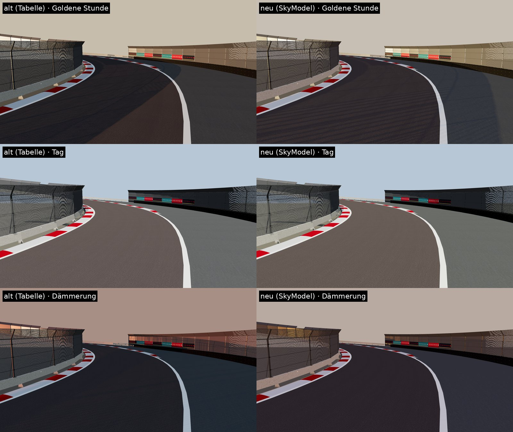

# Licht, Grafikstufen und Reflexionen

**Stand:** 2026-10-26.

**Status:**
- **Implementiert und getestet** (NUnit, ohne Unity): Sonnenstand, Himmels- und Sonnenlicht, Grafikstufen, Kaskadenaufteilung.
- **Implementiert, kompiliergeprüft:** Unity-Anbindung (`GraphicsQuality`, `EnvironmentReflections`, `WeatherVisuals`) gegen die URP-17-Signaturen.
- **Im Unity-6-Editor nicht gesehen, auf Geräten nicht gemessen.**
- **Offline-Vorschau:** three.js am T1-Abschnitt. Sie zeigt die Lichtverhältnisse ähnlich, nicht identisch.

## 1. Licht aus einem physikalischen Himmelsmodell (`SkyModel`)

**Vorher:**
- Eine handgesetzte Tabelle pro Tageszeit.
- Das Trilight-Umgebungslicht war fest auf Tag eingestellt.
- `RenderSettings.ambientIntensity` dimmt nur Skybox-Umgebungslicht, nicht Trilight. Deshalb blieb das Umgebungslicht nachts und bei Wolken gleich hell. Das war ein Fehler.

**Jetzt:**
- **Sonnenstand:** Der NOAA-Sonnenrechner für Beşiktaş (41,045° N, 29,01° O, UTC+3) am Rennwochenende (20. September 2026).
  - Geprüft gegen Tabellenwerte:
    - Mittagshöhe 50,0°
    - Sonnenuntergang 19:07
    - Untergangsazimut etwa 271°
    - Sommersonnenwende 72,4°
- **Uhrzeiten der Tageszeiten:**

  | Tageszeit | Uhrzeit | Sonnenhöhe | Azimut |
  |---|---|---|---|
  | Morgen | 08:45 | 20,7° | 108° (Ost) |
  | Tag | 13:00 | 50,0° | 181° |
  | Goldene Stunde | Untergang − 54 min (18:12) | 9,1° | 263° |
  | Dämmerung | Untergang − 18 min (18:48) | 2,5° | 269° |
  | Nacht | 22:30 | Mond, gestaltet | 140° |

- **Sonnenfarbe und -stärke:**
  - Berechnet aus der Durchlässigkeit der Atmosphäre je Farbkanal (610/550/465 nm): Rayleigh-Streuung und Stadt-Aerosol (optische Dicke 0,2 bei 550 nm, typischer klarer Tag über Istanbul), Luftmasse nach Kasten–Young.
  - Die Farbe ergibt sich daraus von selbst:
    - mittags fast weiß (sRGB 1,00/0,97/0,89)
    - goldene Stunde (1,00/0,85/0,58): golden, ohne Orangefilter
    - Dämmerung (1,00/0,64/0,20)
- **Himmelslicht:** Die diffuse Beleuchtungsstärke ist an Klarhimmel-Messwerte angepasst:
  - etwa 18 klux bei 50°
  - 7 klux bei 10°
  - unter 1 klux beim Untergang
  - 3 lux am Ende der bürgerlichen Dämmerung
- **Belichtungsanpassung:**
  - Eine Kamera passt die Belichtung an, deshalb wird die ganze Szene mit (Referenz/Szene)^0,6 skaliert.
  - Das Verhältnis Sonne zu Himmel bleibt physikalisch. Deshalb sind die Schatten bei tiefer Sonne hell und bläulich:
    - mittags 22 % Himmelsanteil
    - goldene Stunde 67 %
    - Dämmerung über 90 %
- **Umgebungslicht (Trilight):**
  - Der Himmel oben bleibt blau, der Horizont nimmt die Farbe der tiefen Sonne an.
  - Der Boden wirft mit Albedo 0,1 (Asphalt, Stein, Wasser) zurück.
  - Bewölkung macht das Licht grau und flach, die Sonne verliert bis zu 80 %.
- **Dunst und Himmel:** Nebelfarbe, Skybox-Belichtung und Atmosphärendicke (`Skybox/Procedural`) folgen der Sonnenhöhe.
  - Die Skybox ist jetzt eine Laufzeitkopie; vorher hat das Spiel das Projektmaterial verändert.
- **Nacht ist bewusst gestaltet** und nicht physikalisch: ein kühler Mond, warmes Stadtleuchten am Horizont, bei Wolken heller.
- **Sonnenrichtung bei tiefem Stand:** Unter 2° würde die Sonne nur endlose Schatten werfen. Ihre Richtung wird deshalb bei 2° gehalten, die Farbe bleibt die echte.
- **Diagnose:** `cd build/Apex.Tuning && dotnet run -c Release -- sky [bewölkung]` gibt alle Werte aus. `sky-json <Tageszeit>` liefert die Werte für die Vorschau.

## 2. Grafikstufen (`GraphicsPreset`, `GraphicsQuality`)

**Einstellung:** Optionen → „Grafikstufe“ mit Auto, Mobil, Mittel, Hoch, Ultra und (seit 2026-10-31) Kino.
- **Auto:** Mobilgerät → Mobil; PC mit mindestens 10 GB Grafikspeicher → Ultra, mit mindestens 6 GB → Hoch, sonst Mittel. „Kino“ wird nie automatisch gewählt.
- **Was sofort wirkt:** Schatten, Kantenglättung, SSAO, Reflexionen, LOD.
- **Was die Stufe mitsetzt:** Umgebungsdetails und 4K-Straßentexturen. Diese wirken ab der nächsten Session und lassen sich danach einzeln ändern.

| | Mobil | Mittel | Hoch | Ultra | Kino (PC) |
|---|---|---|---|---|---|
| Render Scale | 0,85 | 1,0 | 1,0 | 1,0 | 1,5 (Supersampling) |
| Kantenglättung | FXAA | SMAA (mittel) | MSAA 4× | TAA (hoch), MSAA aus | TAA (hoch) |
| Schatten | 120 m, 2 Kaskaden, 1024 px | 200 m, 3, 2048 px | 320 m, 4, 2048 px | 450 m, 4, 4096 px | 600 m, 4, 4096 px |
| Weiche Schatten | niedrig | mittel | hoch | hoch | hoch |
| SSAO | aus | aus | an | an | an |
| Reflexionssonde | 64 px, nur Himmel | 128 px, Welt, bei Lichtwechsel | 256 px, folgt Kamera, alle 4 s | 512 px, folgt Kamera, alle 1,5 s | 1024 px, alle 0,75 s |
| LOD-Bias | 1,0 | 1,25 | 1,6 | 2,2 | 3,0 |
| Anisotropie | pro Textur | pro Textur | erzwungen | erzwungen | erzwungen |
| Zusatzlichter je Objekt | 2 | 4 | 6 | 8 | 8 |
| Straßenlaternen als echte Lichter | 8 | 16 | 32 | 48 | 96 |
| Bloom-Filter | einfach | einfach | hochwertig | hochwertig | hochwertig |
| Bewegungsunschärfe (Kamera) | – | – | 0,25 | 0,30 | 0,35 |
| Umgebungsdetails / 4K | Niedrig / nein | Mittel / nein | Hoch / nein | Hoch / ja | Extrem / ja |

**Kino (PC, seit 2026-10-31):**
- **Zielgruppe:** starke Grafikkarten.
- **Bild:**
  - Die Szene wird mit 1,5-facher Auflösung gerendert und heruntergerechnet, TAA kommt darüber.
  - Die Schatten bleiben bis 600 m scharf, die Reflexionssonde hat 1024 px.
- **Umgebungsdetails „Extrem“:**
  - 2.600 Fußgänger und 360 Fahrzeuge (Hoch: 1.600 / 240), Sichtweite des Stadtlebens 520 m (Hoch: 350 m).
  - Zuschauer an der Strecke und auf Tribünen in voller Dichte, 36 Möwen, ferne Landschaft bis 9 km.
  - Die Stufe „Extrem“ ist auch einzeln wählbar.
- **Kosten:** nicht gemessen. Supersampling kostet etwa das 2,25-Fache an Pixeln.

**Bewegungsunschärfe:**
- Kamerabasiert (URP Motion Blur, „Camera only“). Strecke und Stadt verwischen bei Tempo, das Auto vor der Verfolgerkamera bleibt scharf.
- Ab Hoch aktiv; in den Optionen abschaltbar. Bei „Reduzierte Bewegung“ ist sie immer aus.
- Sie gehört zum Post-Processing-Volume, mit „Nachbearbeitung“ aus entfällt sie also auch.

**Kaskaden:**
- Praktische Aufteilung (Mischung aus logarithmisch und gleichmäßig, λ 0,75).
- Die erste Kaskade reicht bei Hoch bis 23 m und liegt damit scharf auf Auto und Kerbs. Unitys Standard (6,7 % von 320 m) ergibt 21 m.

**Ultra mit TAA:**
- TAA beruhigt auch das Glanzflimmern, das die 4K-Normalenkarte in der Vorschau zeigte (`CC0_MATERIALS.md`).
- URP schaltet TAA bei MSAA ab, deshalb hat Ultra MSAA aus. Ein Test prüft das.

**Unter URP:**
- **Pipeline-Asset:** Das aktive Asset wird zur Laufzeit kopiert, damit der Play-Modus das Projekt-Asset nicht verändert.
- **Kamera:** Die Kantenglättung sitzt an der Kamera. URP rechnet FXAA, SMAA und TAA im Post-Processing-Durchgang, deshalb bleibt Post-Processing an der Kamera immer an. Der Schalter „Nachbearbeitung (Farbe, Bloom)“ betrifft nur das Farb-Volume.
- **SSAO:**
  - Die Renderer-Funktion wird ein- und ausgeschaltet; sie muss im Renderer vorhanden sein.
  - Die Vorlage „Universal 3D“ hat sie im PC-Renderer.
  - Für andere Renderer legt *Project Apex → 4. Grafik einrichten (URP: SSAO)* sie an (auch Teil von „Projekt einrichten (alles)“).
  - Fehlt sie, zeigt das Menü „…, ohne SSAO“ statt eines falschen Versprechens.
- **Zurücksetzen:** QualitySettings und der SSAO-Schalter gehören zum Projekt und werden beim Beenden zurückgesetzt.

**Built-in-Pipeline:** Schatten, Kaskaden, MSAA, LOD und Anisotropie wirken über QualitySettings. SSAO und FXAA/SMAA/TAA gibt es dort nicht.

**Nicht zur Laufzeit setzbar** (URP-Asset, im Editor einstellen): HDR an, „Soft Shadows“ an. Beides ist Standard der Vorlage.

## 3. Reflexionen (`EnvironmentReflections`)

**Vorher:** Nasse Straßen, Lack und Glas spiegelten nur den Standard-Himmelswürfel. Zur Laufzeit erzeugte Welten haben keine gebackene Reflexion.

**Jetzt:**
- Eine globale Echtzeit-Reflexionssonde nach Grafikstufe (Tabelle oben).
- Die Sonde sitzt 12 m über der Kamera. Straße, Motorhaube und Fenster spiegeln vor allem Himmel und Fassaden; von dort füllt das eigene Auto nicht die untere Hälfte.
- Neue Aufnahme bei spürbarem Wechsel von Bewölkung (> 0,08) oder Nässe (> 0,15).
- Auf Hoch und Ultra ein Würfelseite pro Bild (Time-Slicing).
- Keine Box-Projektion: Die Sonde steht für die ferne Umgebung.
- **Lokale Sonden** an Start/Ziel und Ortaköy kommen mit Phase 2 (`ISTANBUL_WORLD_MASTERPLAN.md`).

## 4. Offline-Vorschau (keine Spielaufnahme)

T1-Abschnitt aus dem Rennstrecken-Kit mit den CC0-Materialien, Verfolgerperspektive:
- Links das alte Licht (Tabelle, festes Umgebungslicht), rechts das neue Modell.
- Zeilen: goldene Stunde, Tag, Dämmerung.



**Befund der Vorschau:**
- **Tag:** praktisch unverändert. Das ist gewollt, die Mittagssonne ist die Referenz.
- **Goldene Stunde:**
  - Die Sonne steht realistischer (263° statt 252°, 9° statt 11°).
  - Die Schatten sind heller und kühler, sonnige Flächen golden statt orange.
  - Mittlere Bildhelligkeit +7 %.
- **Dämmerung:**
  - Weniger rosa Dunst, die Szene ist vom Himmel beleuchtet.
  - Rotes Streiflicht nur noch an den Westseiten.
  - Mittlere Bildhelligkeit +14 %, weil die Kamera nachregelt.
- **Streifen auf dem Asphalt** bei tiefer Sonne in der Vorschau: Schattenakne von three.js bei 9° Sonnenhöhe. In Unity über den Schatten-Bias prüfen (Punkt 1 unten).

```sh
cd build/Apex.Tuning && dotnet run -c Release -- sky-json GoldenHour     # JSON für kit.html &sky=
```

## 6. Goldene Stunde: Effekte der tiefen Sonne (`GoldenHour`, 2026-11-01)
Ergänzt das physikalische Licht aus Abschnitt 1 um die drei Dinge, die Istanbuls Abendlicht ausmachen.

1. **Glühende Fenster am asiatischen Ufer:**
   - **Effekt:** Die nach Westen zeigenden Fenster von Üsküdar spiegeln die Abendsonne und leuchten vom europäischen Ufer aus golden.
   - **Rechnung:** Reflexion r = 2(n·s)n − s. Die Scheiben einer Stadt stehen nicht in einer Ebene, deshalb ist das Spiegelbild eine breite Keule (Exponent 6, etwa ±25°).
   - **Abschwächung:** mit der Wurzel des Einfallswinkels und mit der Bewölkung (bei Vollbewölkung −90 %).
   - **Zeitfenster:** setzt unter 22° Sonnenhöhe ein und wirkt voll unter 12°.
   - **Umsetzung:**
     - Eine additive Schicht (`Apex/SunGlint`, neuer Shader) liegt über den Wänden der mittleren und fernen Stadt, die zur Abendsonne zeigen.
     - Grundlage ist dieselbe Fenstertextur, mit einer Glasmaske, in der jede Scheibe eine eigene Helligkeit hat.
     - Die Wände sind nach Richtung (10°) und 1-km-Kachel gruppiert. `SunGlintComponent` setzt je Gruppe zehnmal pro Sekunde die Stärke aus Sonnenstand und Richtung zur Kamera.
     - Tagsüber und nachts sind alle Gruppen abgeschaltet.
     - Der Shader beachtet den Schatten der Hauptlichtquelle und blendet im Dunst auf null aus statt auf die Nebelfarbe.
   - **Werte** (westseitige Wand, aus 1,5 km Westen gesehen):

     | Tageszeit | Stärke | Farbe (sRGB, HDR) |
     |---|---|---|
     | goldene Stunde | 0,81 | (2,6, 2,2, 1,5) |
     | Dämmerung | 0,96 | (3,1, 2,0, 0,6) |
     | Tag und Nacht | 0 | – |

2. **Dunst je Blickrichtung:**
   - **Effekt:** Gegen die tiefe Sonne streut das Aerosol über dem Bosporus nach vorn (Mie-Streuung, Henyey–Greenstein, g = 0,72). Der Dunst leuchtet dort golden und bleibt auf der Gegenseite blaugrau.
   - **Umsetzung:** `WeatherVisuals` setzt die Nebelfarbe in jedem Bild aus dem Winkel zwischen Kamera und Sonne.
   - **Werte:**
     - goldene Stunde: zur Sonne (1,00, 0,88, 0,62), seitlich (0,78, 0,75, 0,70), abgewandt (0,77, 0,74, 0,71)
     - Mittag und Nacht: unverändert
3. **Dunstweite:**
   - Bei tiefer Sonne ist der Lichtweg durch die Luft länger. Der Nebel reicht dann von 320 bis 5200 m statt von 600 bis 8000 m. Das asiatische Ufer in 1–2 km Entfernung bleibt sichtbar, die Hügel dahinter versinken früher.
   - Regen wie bisher: 60 bis 900 m.

**Tests:** `GoldenHourTests` (3 Tests).

**Werkzeug:** `cd build/Apex.Tuning && dotnet run -c Release -- golden` gibt alle Werte je Tageszeit aus.

**Im Unity-Editor zu prüfen (nicht gesehen):**
- **Shader:** Kompiliert `Apex/SunGlint` unter URP 17? Falls nicht, entsteht keine Glanzschicht und es gibt sonst keine Folgen.
- **Stärke:** Wirkt das Glühen zu stark oder fleckig? Dann `GoldenHour.GlintPeak` (3,2) bzw. `GlintLobe` (6) anpassen.
- **Kanten:** Sitzt die Schicht sauber auf den Fenstern, ohne Z-Fighting? Sie liegt 8 cm vor der Wand und hat einen Tiefen-Offset.
- **Dunst:** Wirkt der goldene Dunst beim Blick nach Westen zu hell oder zu weiß? Dann die Mischung in `GoldenHour.Haze` anpassen.
- **Kurze Sichtweite:** Ist der Wechsel der Nebelfarbe beim schnellen Drehen der Kamera sichtbar? Dann dämpfen.

**Bekannte Grenzen:**
- Die nahe OSM-Stadt am europäischen Ufer hat keine Glanzschicht, nur die generische mittlere und ferne Stadt.
- Berghänge hinter dem Ufer schatten die Fenster nur innerhalb der Schattendistanz ab (≤ 600 m).
- Es gibt weiterhin keine Lichtstrahlen (God Rays); URP bietet sie nicht ohne eigenen Effekt.

## 5. Im Unity-Editor zu prüfen
1. **Tageszeiten:** Goldene Stunde, Tag und Dämmerung aus Verfolger- und TV-Kamera.
   - Wirken die Schatten bei tiefer Sonne zu hell? Dann `SkyModel.Adaptation` (0,6) senken.
   - Ist die Szene insgesamt zu dunkel? Dann die Belichtung in `ColorGrading` anpassen.
   - Schattenakne auf dem Asphalt bei tiefer Sonne? Dann Depth/Normal Bias im URP-Asset erhöhen.
2. **Nacht:** Das Umgebungslicht ist jetzt wirklich dunkel. Die Straßenlaternen müssen die Strecke tragen.
3. **Grafikstufen:**
   - Wechsel live im Menü.
   - Kein Schatten-Flackern an den Kaskadengrenzen.
   - TAA ohne Geisterbilder bei 300 km/h; falls doch, Ultra auf SMAA (hoch) stellen.
4. **SSAO:** Sichtbar an Barrieren und Bordsteinen (Hoch/Ultra), nicht als dunkler Rand um das Auto.
5. **Reflexionen:** Nasse Straße spiegelt Himmel und Fassaden; kein Ruckeln durch die Neuaufnahmen.
6. **Profiler** (Phase 7): Kosten je Stufe, vor allem Sonde, SSAO und 4096er-Schatten.
