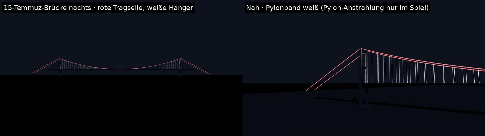

# Nachtbeleuchtung: Straßenlaternen und Bosporus-Brücke in Rot-Weiß

**Stand:** 2026-10-26.

**Status:**
- **Laternen-Lichtpool:** implementiert und getestet.
- **Brückenlicht:** implementiert, kompiliergeprüft, offline gesehen.
- **Im Unity-Editor nicht gesehen.**
- **Die Lichtwerte sind Gestaltungswerte** für die Nachtbelichtung des Spiels, keine photometrischen Messwerte.

## Straßenlaternen beleuchten die Strecke (`StreetLighting`, `StreetLightPool`)
**Vorher:** Nur die Lampenköpfe leuchteten (Emission), die Fahrbahn blieb dunkel.

**Jetzt:**
- **Lichtpool:** Echte Spotlichter (ohne Schatten) wandern mit der Kamera und sitzen unter den Laternen, die vor ihr am nächsten liegen. Laternen hinter der Kamera zählen doppelt so weit entfernt.
- **Stufen:** Mobil 8, Mittel 16, Hoch 32, Ultra 48 Lichter.
- **Kein Aufploppen:** Ein Platz behält seine Laterne, solange sie gebraucht wird, und blendet mit 4/s ein und aus (Test bei 288 km/h).
- **Lichtkegel:** wie eine breit strahlende Straßenleuchte, voll bis 90°, auslaufend bis 150°, Reichweite 32 m, warmweiß (~3000 K).
- **Helligkeit:** unter der Leuchte etwa 0,53 (Intensität / Höhe²), gemessen an Mond 0,16 und Umgebungslicht ~0,1.
- **Laternenabstand** an der Strecke von 45 m auf **34 m** verkürzt (rund 3,7 Masthöhen wie an beleuchteten Hauptstraßen; Niedrig 52 m), damit sich die Lichtkegel überlappen.
- **Daraus folgt automatisch:** Glanz auf nasser Fahrbahn, Lack und Barrieren. Der Gelände-Shader nimmt die Lichter ebenfalls auf.
- **Kosten:**
  - Unter URP Forward+ (Vorlage „Universal 3D“) gibt es keine Grenze je Objekt.
  - Unter Forward wirken je Objekt höchstens 2–8 Zusatzlichter (Grafikstufe).

## 15-Temmuz-Şehitler-Köprüsü in Rot und Weiß (`LandmarkGeometry.BridgeIllumination`)
Architekturlicht statt einer gleichmäßig glühenden Brücke:
- **Rot** (#E30A17): LED-Linien entlang beider Haupttragseile, sie zeichnen die Silhouette.
- **Weiß:** alle Hänger (18 m Abstand), Lichtbänder an den Innenkanten der Pylon-Beine, die oberen Querträger, die Lichtpunkte an der Fahrbahnkante.
- **Echte Lichtquellen:** vier weiße Spots strahlen die Pylon-Beine von Fahrbahnhöhe an, ohne Schatten, nur nachts.
- **Spiegelung im Bosporus:** über die Reflexionssonde (Mittel und höher). Bei Wolken- oder Lichtwechsel wird sie neu aufgenommen.
- **Emission:**
  - Rot ×1,3, Weiß ×2,4.
  - Rot heller als 1,3 bleicht unter dem ACES-Tonemapping zu Rosa aus; in der ersten Vorschau war das sichtbar.
- **Authored-Modell:** Auch mit einem gekauften Brückenmodell liegen die Lichter auf derselben parametrischen Geometrie (echte Maße). Bei einem Modell mit abweichender Seilführung müssen sie nachgezogen werden.
- **Nicht umgesetzt:** eine Lichtsequenz zur Rennvorstellung (sanftes Wandern entlang der Seile). Offen, wenn gewünscht.

## Fassadenstrahler in Ortaköy (seit 2026-10-31, ab Stufe Hoch)
- **Ortaköy-Moschee:** fünf warmweiße Spotlichter von der Kaiterrasse auf die drei freien Hallenfassaden, die Pavillonfront und die Kuppel. Dazu leuchten die Fenster von innen (`MosqueGlass`).
- **Esma Sultan Yalısı:** bernsteinfarbene Bodenstrahler vor jeder Wand über 12 m.
- **Technik:** echte Lichter ohne Schatten, geschaltet mit dem übrigen Nachtlicht (`EnvironmentInstance.AddRealLight`).
- **Helligkeit:** etwa 4 an der Fassade, zehnmal so hell wie die Fahrbahn unter einer Laterne.
- **Code:** `EnvironmentBuilder.Floodlight`.

## Im Unity-Editor zu prüfen
1. **Nachtfahrt:**
   - Ist die Fahrbahn durchgehend fahrbar hell, ohne harte dunkle Lücken?
   - Sieht man das Umsetzen der Lichter beim Fahren? Falls ja, Pool vergrößern oder `FadeRate` senken.
2. **Profiler:** Kosten von 32/48 Spots unter Forward+ (PC) und 8 unter Forward (Mobil).
3. **Brücke:**
   - Bleibt das Rot rot (ACES, Bloom)?
   - Sind die Pylone durch die vier Spots plastisch?
   - Spiegelt sich die Brücke im Wasser?
