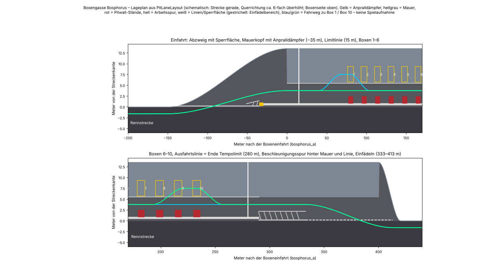
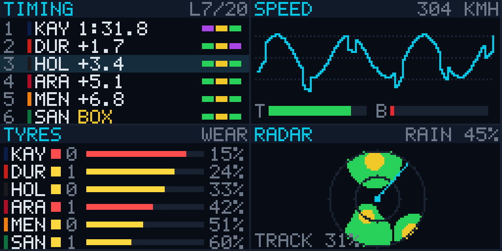
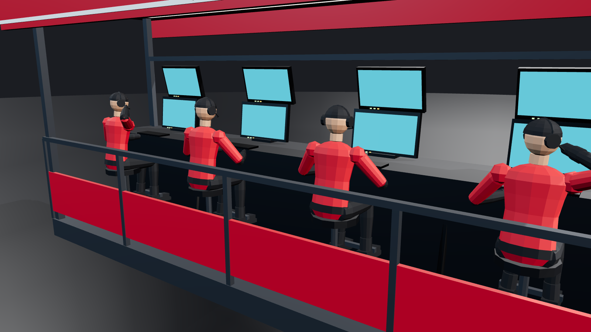
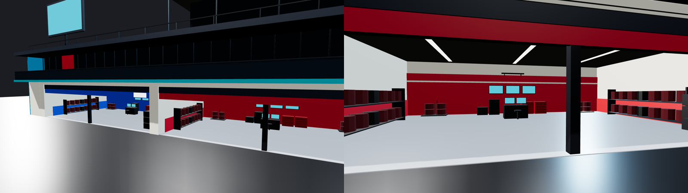

# Boxenanlage: Boxengasse, Boxenstopp, Pitwall, Boxengebäude

**Stand:** 2026-11-04, Boxenanlagen-Brief („professionelle Boxengasse, Pit Entry, Pit Exit und Pitwall").

**Status:**
- **Implementiert und getestet (Logik):**
  - Spurplan, Fahrbefehle der KI, Anhalten an der Box, Stoppfenster, sichere Freigabe, Einfädeln, Tempolimit-Kontrolle, Pitwall-Monitore und sitzende Ingenieure.
  - Alles in `Apex.Simulation` mit NUnit-Tests.
  - Fahrtests auf der echten Kollisionsfläche von `bosphorus_a`: Einfahrt bis Einfädeln, sowie automatisches Anhalten an Box 1, 5 und 10.
- **Implementiert, nur kompiliergeprüft:**
  - Unity-Seite: RaceController, sanftes Ausrichten im VehicleController, Markierungen, Pitwall, Boxengebäude, Anzeigen, HUD-Hinweis.
  - Gebaut gegen die Unity-Referenzen. **Im Editor nicht gesehen und nicht gefahren.**
- **Platzhalter-Art:** Alle Modelle sind selbst gebaut und prozedural (Gebäude, Garagen, Pitwall, Personen, Monitore), nicht fotorealistisch. Die Bilder unten sind three.js-Renders bzw. Pläne aus den Daten, keine Spielaufnahmen.

## Korrekturen nach dem Test im Editor (2026-11-05)
Rückmeldung aus Unity, alle Punkte behoben (Logik getestet, Unity-Seite nur kompiliergeprüft):

| Problem | Ursache | Lösung |
|---|---|---|
| Boxen-Assistent fährt an der Einfahrt gegen die Mauer | Die Lenkung des Assistenten hinkte dem Weg hinterher: Die KI zielt 6 m + 0,3 s voraus, bekam aber das Seitenziel ihres aktuellen Orts. Dazu bremste sie erst kurz vor der Limitlinie. Der alte Fahrtest begann mit 80 km/h hinter der letzten Kurve und hat beides nicht gezeigt. | `PitLaneLayout.Drive` gibt das Seitenziel für den Punkt, auf den die KI lenkt (`AIDriver.Lookahead`). Der Assistent hat 40 m vor der Einfahrt das Limit erreicht (7 m/s²) und reiht sich ab 440 m vorher ein. Die Einfahrtsspur beginnt bei Bosphorus früher (190 statt 150 m), direkt am Ausgang der letzten Kurve. |
| Säule der Startbrücke auf der Fast Lane | Die Pylone standen 3 m neben der Fahrbahn, also in der Boxengasse. | Der Pylon auf der Boxenseite steht auf dem Pitwall-Deck (`EventGeometry.Gantry` mit Abständen je Seite). |
| Pitwall zu nah an der Fast Lane | Zwischen Ständen und Autos lagen nur 35 cm. | Deck schmaler (0,85–2,25 m), Fast Lane nach außen (Mitte 4,3 statt 3,75 m), Boxen bei 8,3 statt 7,5 m. Zwischen Stand und Auto liegen jetzt über 1 m. Die Hocker stehen näher am Pult. |
| Crew wird nach dem Stopp überfahren | Die Crew lief sofort quer zur Garage zurück und folgte dem anfahrenden Auto. Der vordere Wagenheber stand vor dem Auto. | Nach der Freigabe bleibt jeder auf seinem Platz (`EndSpot`). Der vordere Wagenheber senkt ab und tritt mit dem Heber zur Garagenseite, der hintere senkt ab und bleibt seitlich hinter dem Auto. Zurück zur Garage geht es erst, wenn das Auto 12 m weg ist. Das Auto fährt die ersten 6 m gerade aus der Box und lenkt dann sanfter (30 statt 24 m) zur Fast Lane. |

**Neue Prüfungen:**
- `F_PitLaneIsDrivableEntryToExit` startet 500 m vor der Einfahrt mit 223 km/h, durch die letzte Kurve (Radius etwa 50 m).
- Gemessen: 80 km/h an der Einfahrt, mindestens 1,41 m Abstand zu Mauer und Anpralldämpfer, mindestens 1,05 m zur äußeren Barriere (an der engsten Stelle, bei 417 m, ist das Auto schon wieder auf der Strecke), 197 km/h vor dem Einfädeln.
- Gegenprobe mit dem alten Assistenten: 96 km/h an der Einfahrt, also zu schnell.
- `NobodyIsInThePathOfTheReleasedCar` (Garage links und rechts): Kein Crewmitglied steht im Weg des anfahrenden Autos, auf den ersten 35 m mit Körperbreite und 0,3 m Abstand.
- Das automatische Anhalten bleibt genau: 1–6 cm seitlich, unter 1° schräg.

## Analyse vorher (Stand PR #33)
- **Einfahrt:** Die Spur öffnete sich über 150 m neben der Strecke. Die Mauer begann aber erst 10 m nach der Einfahrt, davor gab es weder Sperrfläche noch Anpralldämpfer.
- **Boxen:** 20 Boxen im Abstand von 9 m. Der Einschwenkweg auf die Boxenlinie führte über die Nachbarbox. Ein dort stehendes Auto oder die bereitstehende Crew lag im Weg.
- **Anhalten:** „In der Box“ hieß ±2,5 m längs und ±3 m quer. Das Auto blieb stehen, wo es stand, auch schräg; die Crew rückte nach.
- **Freigabe:** sofort nach der Servicezeit, ohne Blick auf die schnelle Spur.
- **Ausfahrt:** Beim Einfädeln war das Auto für den Rennverkehr unsichtbar (`inPit`). Weder die KI auf der Strecke noch das ausfahrende Auto achteten aufeinander.
- **Tempolimit:** Der Begrenzer bremste, Überschreitungen wurden aber nicht erkannt.
- **Pitwall:** eine dünne Kollisionsfläche bei 2,1 m, ohne sichtbare Mauer, Zaun oder Stände.
- **Gebäude:** zweistöckiger Riegel mit dunklen Garagennischen, ohne Innenleben.

## Spuren und Querschnitt (`PitLaneLayout`)
- **Querschnitt, gemessen von der Streckenkante:**

  | Bereich | Abstand |
  |---|---|
  | Streifen an der Strecke | 0–0,45 m |
  | Boxenmauer (Beton, Fangzaun darauf) | 0,45–0,85 m |
  | Pitwall-Deck mit den Teamständen | 0,85–2,25 m |
  | schnelle Spur (Fast Lane) | 2,6–6,0 m, Mitte 4,3 m, Asphalt |
  | Arbeitsspur (Working Lane) | ab 6,0 m, Auto in der Box bei 8,3 m, versiegelter hellerer Belag (`PitWorkLane`) |
  | Crews | bis zur Garagenfront (15 m) |

- **Spurplan** (`PitLaneLayout.Plan`, Meter ab der Einfahrt, Werte für Bosphorus):

  | Abschnitt | Bereich | Abgrenzung zur Strecke |
  |---|---|---|
  | Einfahrtsspur zweigt ab | −150 … 0 m, die Fläche wächst weich auf 13,5 m | durchgehende weiße Linie an der Streckenkante, dann Sperrfläche (weiße Schrägstriche) zwischen Linie und Spurbegrenzung |
  | Anpralldämpfer | −35 … −30 m | gelb-schwarz, vor dem Mauerkopf |
  | Boxenmauer | −30 m … Ausfahrtslinie + 10 m | Mauer mit Fangzaun |
  | Tempolimit | 15 m … Ausfahrtslinie (280 m) | weiße Querlinien, „80“ und „END“ auf dem Asphalt |
  | Boxen | 10 Boxen, 80 … 233 m, Abstand 17 m | – |
  | Beschleunigungsspur | 280 … 333 m in der Spur | bis 290 m Mauer, dann Spurbegrenzung, Sperrfläche und weiße Linie |
  | Einfädeln | 333 … 413 m | gestrichelte Kantenlinie |

- **Geometrie:**
  - Der Weg von der Strecke in die Spur ist eine weiche S-Kurve: 5,35 m Versatz auf 150 m. Seitlich höchstens 0,054 m je Meter, es gibt also keine abrupte Richtungsänderung.
  - Die Spur liegt im Streckenrahmen neben der Start-Ziel-Geraden. Die Lage der realen Straßen bleibt unverändert, es wurde nichts verschoben.
- **Bosphorus-Besonderheit:**
  - Hinter dem Ende der Boxenfläche (Runde ~520 m) läuft die Strecke nach 1–3 m wieder zurück. Eine Spur hinter der Boxenfläche hätte Fahrbahn und Barriere der Gegenrichtung überdeckt; das war ein geprüfter, verworfener Versuch.
  - Deshalb liegt die Ausfahrtslinie 120 m vor dem Ende der Fläche. Man beschleunigt in der Spur selbst, erst hinter der Mauer, dann hinter der weißen Linie, und fädelt vor dem Ende ein.
  - Im Fahrtest erreicht das Auto bis zum Einfädeln 199 km/h.
- **Eine Box pro Team** (wie im Reglement, `box_count` 10, `box_spacing` 17 m):
  - Bei 9 m Abstand war kein Einschwenken möglich, ohne über die Nachbarbox zu fahren. Ein F1-Auto braucht für 3,75 m Versatz mit vernünftigem Radius rund 15–18 m.
  - Teamkollegen stapeln sich: Das zweite Auto wartet 8 m hinter der Box, bis das erste weg ist.
  - Andere Strecken behalten 20 Boxen (Standard `box_count` = 20).
- **Fahrweg** (`PitLaneLayout.Drive`, gleich für KI, Boxen-Assistent und Fahrtest):
  - Bremsen auf das Limit bis zur Limitlinie.
  - Schnelle Spur, 40 m vor der Box Einschwenken, die letzten 12 m gerade auf der Boxenlinie.
  - Anhalteprofil mit 3,2 m/s², auf dem letzten Meter Kriechtempo, Vollbremsung auf der Marke.
  - Nach dem Stopp über 24 m zurück auf die schnelle Spur, dann Ausfahrt.

## Markierungen (`CircuitBuilder.BuildBoxMarkings`, `BuildPitLaneMarkings`)
- **Je Box**, nach der echten Fahrzeuggeometrie (`VehicleSetup`: Achsen und Spurweiten, die gleichen Zahlen wie die Crew):
  - gelber Boxenrahmen 7,2 × 3,6 m
  - weiße Marken an den vier Reifenpositionen und ein Stoppbalken vor jedem Vorderrad
  - gestrichelte Führungslinie in Teamfarbe zur Boxenmitte
  - Boxnummer groß auf dem Asphalt, Teamstreifen am Garagenende
- **Spur:**
  - Trennlinie zwischen Fast Lane und Working Lane
  - Einfahrts- und Ausfahrtslinie, Spurbegrenzung, Sperrflächen-Chevrons
  - Limitlinien, „PIT“, „80“ und „END“ in einer eigenen 5×7-Pixelschrift (`Apex.UI.PixelFont`)
- **Schilder** (zweisprachig Englisch/Türkisch):
  - „PIT ENTRY / PİT GİRİŞİ“ 60 m vor dem Abzweig
  - Countdown-Tafeln „PIT 150 / 100 / 50“
  - „PIT LIMIT 80 / HIZ SINIRI“ an der Limitlinie
  - „PIT EXIT / PİT ÇIKIŞI“ an der Ausfahrtslinie
  - „PADDOCK · PADOK“ an den Gebäudeenden
- **Eigener Boxenplatz:** Solange der Stopp angefordert ist, leuchtet ein cyanfarbener Rahmen auf der eigenen Box, darüber dreht sich ein Pfeil.



Der Lageplan zeigt den Stand vor den Korrekturen vom 2026-11-05. Seitdem liegt die Fast Lane bei 4,3 m statt 3,75 m, die Boxen bei 8,3 m und die Einfahrtsspur beginnt 190 m vor der Einfahrt.

## Anhalten an der Box (`PitBoxStop`)
- **Stoppfenster**, in dem die Crew das Auto annimmt: längs ±0,5 m, quer ±0,35 m, schräg ±5°.
  - Erst dann beginnt die Servicezeit und das Auto wird angehoben.
- **Automatisch** (KI und Boxen-Assistent):
  - Fahrtest auf der echten Fläche, Ergebnis an Box 1, 5 und 10 jeweils:
    - längs 4 cm vor der Mitte
    - quer 2–10 cm neben der Linie
    - 0,7–2,4° schräg
- **Von Hand:**
  - Der HUD-Hinweis zeigt zuerst Box und Entfernung, auf den letzten Metern dann den Rest und die Korrektur. Beispiele: „BOX 3 · noch 3,2 m · 0,6 m nach links“, „BOX 3 · STOPP · mittig“.
  - Einparkhilfe (Einstellung „Einparkhilfe Box“, Standard an): Steht das Auto innerhalb von 1,2 m längs, 0,7 m quer und 12°, schiebt die Crew es auf die Marken.
  - Die Bewegung dauert 0,35–1,8 s, weich beschleunigt und gebremst (`VehicleController.GuideTo`, kinematisch, nur waagrecht und Gierwinkel). Keine Teleportation.
  - Ohne Einparkhilfe muss man selbst ins Fenster fahren.
  - Bis 2,5 m zu weit schiebt die Crew das Auto immer zurück („Zu weit – die Crew schiebt zurück“). Noch weiter gilt die Box als verpasst.
- **Box belegt:** Steht der Teamkollege auf der Box, wartet das Auto 8 m dahinter. Für Spieler zeigt der Hinweis „BOX n belegt – dahinter warten“.
- **Sichere Freigabe:** Nach der Servicezeit bleibt die Ampel rot, solange ein Auto auf der schnellen Spur gleich vorbeikommt. Das ist der Fall von 7 m daneben bis 10 m + 2,2 s Fahrt dahinter. Der Hinweis lautet dann „Freigabe wartet – Verkehr“.
- **Einfädeln:**
  - Ab der Mauer sieht der Rennverkehr das ausfahrende Auto (`inPit` endet dort), die KI hält seitlich Abstand.
  - Das ausfahrende Auto wartet in der Spur, bis niemand daneben ist oder schnell von hinten kommt. Es nimmt dabei Gas weg.
  - Spätestens 30 m nach dem geplanten Einfädelpunkt fädelt es ein, solange die Spur noch breit genug ist.
- **Tempolimit:**
  - Der Begrenzer greift ab der Linie bei 15 m.
  - Wer mehr als 0,3 m/s über dem Limit länger als 0,25 s fährt, bekommt eine Zeitstrafe. Sie ist einstellbar (`RaceRules.pitSpeedingPenalty`, Standard 5 s) und wird einmal je Durchfahrt verhängt.
  - Das Limit selbst kommt aus der Strecke (`speed_limit_kmh`, 80).
  - Eine LED-Anzeige 25 m nach der Linie zeigt die Geschwindigkeit des einfahrenden Autos, rot bei Überschreitung.
- **Boxenausfahrt-Ampel:** rot, bis die Autos fahren dürfen; danach grün.

## Pitwall (`PitWallBuilder`, `PitWallGeometry`, `PitWallComponent`, `PitWallDisplay`)
- **Mauer:**
  - Beton mit türkisfarbener Kappe
  - Sponsortafeln der fiktiven Marken aus dem Strecken-Kit auf der Streckenseite
  - Fangzaun 2,85 m über der Mauer
  - gelb-schwarzer Anpralldämpfer vor dem Kopf
  - Kollisionskörper als geschlossener Block aus `RoadSurface`
- **Ein Stand je Team**, gegenüber der eigenen Garage, 6 m lang, mit Kollider:
  - erhöhter Boden, Pult mit zwei Reihen Monitoren
  - Status-LEDs und Kabelstränge
  - vier Hocker mit Fußstütze
  - Dach in Teamfarbe mit weißem Streifen, beleuchteter Unterseite und einem geometrischen Teamzeichen (keine echten Logos)
- **Renningenieure** (vier je Stand):
  - Hemd in Teamfarbe, Kopf mit Headset und Mikrofon
  - Sitzpose `PitCrewFigure.SolveSeated`: Hände auf der Tastatur mit leichtem Tippen, langsames Umschauen zwischen Monitoren und Strecke
  - Ab und zu eine Hand am Headset und Nicken beim Funken
  - Instanziert gezeichnet, nur bis 160 m Entfernung.
- **Live-Monitore:** Eine 256×128-Textur wird zweimal pro Sekunde aus den Renndaten gezeichnet:
  - **Zeiten:** Positionen, Kürzel, Teamfarben, Abstände, BOX-Markierung, Sektorfarben
  - **Telemetrie:** Geschwindigkeitsverlauf des Spielerautos, Gas und Bremse
  - **Reifen:** Mischung, Verschleiß, Stopps
  - **Wetterradar:** Regenzellen nach Regenstärke, Streckennässe
  - Die gleiche Textur liegt auf den Garagen-Monitoren und den zwei großen LED-Leinwänden auf dem Dach.





## Boxengebäude und Garagen (`EventGeometry.PitBuilding`)
- **Erdgeschoss:** je Team eine Garage, 16 m breit:
  - zwei Tore mit Rolltor-Trommeln und Blende in Teamfarbe
  - beleuchtete Boxnummer
  - **Innen:**
    - Epoxid-Boden, Lichtbänder an der Decke
    - Rückwand in Teamfarbe mit drei Live-Monitoren
    - Reifenregale an beiden Seiten (Räder in Heizdecken)
    - zwei Reifenwagen, Werkzeugwagen, Datenstation mit zwei Monitoren und Hocker
    - Transportkisten, Ersatz-Frontflügel an der Wand
- **Obergeschoss:**
  - verglaste Teamsuiten mit Stahlpfosten
  - Balkon über der Boxengasse mit Glasgeländer
  - rot-weißes Band, türkisfarbene Balkonkante
- **Dach:**
  - Terrasse mit Podium und Pokal (wie bisher)
  - verglaster VIP-Pavillon auf der Hälfte ohne Podium
  - zwei LED-Leinwände mit Live-Zeiten
- **Türkische Identität:**
  - İznik-Fliesen an den Stirnseiten (wie bisher)
  - Event-Emblem und „BOSPHORUS GRAND PRIX · ISTANBUL“ (wie bisher)
  - Je eine große senkrecht hängende türkische Flagge an den Gebäudeenden. Das sind bewusst nur zwei; die Flaggen auf dem Dach gibt es weiterhin.
  - Zweisprachige Schilder.
- **Nachts:** Garagenlicht, Boxnummern, Monitore, Pitwall-Dach und LEDs leuchten über Emission. Echte Lichtquellen kamen nicht dazu, aus Rücksicht auf die Leistung.
- **Wie bisher vorhanden:** Rennleitung („YARIŞ KONTROL“), Zeitturm mit Live-Reihenfolge, Startbrücke mit funktionierenden Startlichtern, Startaufstellung, Haupttribünen an der Start-Ziel-Geraden, TV-Türme, Streckenposten, wehende Event-Flaggen.



## Nicht umgesetzt (offen)
- **Pit-Lollipop:** Die Freigabe gibt die elektronische Ampel je Box.
- **Autos in den Garagen** (optional im Brief): nicht gebaut, aus Rücksicht auf die Leistung.
- **Fotografen und Medienbereich, Kommentatorenkabinen:** nicht eigens gebaut. Vorhanden sind TV-Türme und die Rennleitung.
- **Begrenzer per Taste:** Der Begrenzer schaltet sich automatisch an der Linie ein. Wer zu schnell ankommt, wird trotzdem bestraft.
- **Fahrtest mit mehreren Autos gleichzeitig:** Doppelstopp, sichere Freigabe und Einfädeln sind als Logik getestet (`PitBoxStopTests`). Einen Fahrtest mit mehreren Autos auf der Kollisionsfläche gibt es noch nicht; das gehört in den Editor-Test.

## Boxencrew (`PitCrewChoreography`, `PitCrewFigure`, `PitCrewGeometry`, `PitCrewComponent`)
- **14 Personen je Box** in der Teamfarbe, eine Crew für jede Box, in der ein Auto der Session steht:
  - je Rad drei: Schlagschrauber, Rad ab, Rad drauf
  - eine Person vorn, eine hinten (Wagenheber)
  - Die Freigabe gibt die Ampel an der Box.
- **Modelle** (`PitCrewGeometry`, eigene prozedurale Platzhalter, ~1950 Dreiecke je Person):
  - **Person:** Overall in der Teamfarbe mit Gürtel und Reflexstreifen, Vollhelm mit dunklem Visier, Handschuhe, Stiefel. Zehn starre Teile: Rumpf, Kopf, je zwei Ober- und Unterarme, Ober- und Unterschenkel.
  - **Rad:** Reifen und Felge.
  - **Schlagschrauber:** mit Nuss und Griff.
  - **Wagenheber:** Hebekopf mit Rollen, Griffstange auf die Länge bis zu den Händen.
- **Skelett** (`PitCrewFigure`, reines C#):
  - Die Gelenke kommen aus Zwei-Knochen-IK.
  - **Laufen:** Schrittzyklus, dessen Tempo und Weite von der Geschwindigkeit abhängen; Arme schwingen gegenläufig.
  - **Schlagschrauber:** kniet am Rad, linkes Knie am Boden, beide Hände am Schlagschrauber auf der Radmutter.
  - **Radträger:** halten das Rad am Felgenrand vor der Brust. Beim Aufsetzen dreht es sich auf die Achse des Autos.
  - **Wagenheber:** drücken den Griff herunter, während das Auto oben ist.
  - **Haltung:** Der Kopf schaut auf die Hände.
  - Die Personen laufen versetzt, also nicht im Gleichschritt.
- **Ablauf, gekoppelt an die echte Servicezeit** (`PitState.serviceTotal`, typisch 2,3–3,0 s, länger bei klemmender Radmutter oder neuer Nase):
  1. **Warten:** zwei Reihen vor der Garage.
  2. **Bereit:** Ist das eigene Auto in der Boxengasse und weniger als 160 m entfernt, laufen alle in 1,6 s an ihre Plätze neben der Box.
     - Der hintere Wagenheber wartet seitlich, weil das Auto von hinten kommt.
     - Niemand steht auf dem Weg des Autos oder auf der schnellen Spur.
  3. **Service** (Anteile der Servicezeit):

     | Anteil | Schritt |
     |---|---|
     | 0–8 % | Wagenheber unter Nase und Heck |
     | 16–36 % | Schlagschrauber kniet, alte Räder ab und zur Seite |
     | 38–62 % | neue Räder drauf |
     | bis 78 % | Anziehen |
     | ab 86 % | Wagenheber ab |
     | Ende | Freigabe |

     - Während die Räder ab sind, werden die Räder am Auto ausgeblendet; die Crew trägt sie.
     - Die Crew arbeitet um das Auto herum, auch wenn es ein paar Meter neben der Boxenmitte hält.
  4. **Rückkehr:** in 2,4 s zurück vor die Garage; die alten Räder werden mitgetragen.
- **Nur Reparatur** (keine Reifen): Die Radcrews bleiben stehen, die Heber arbeiten.
- **Freigabe-Ampel je Box:** an einem Pfosten vor der Garage. Rot, solange das Auto stehen muss, grün bei der Freigabe.
- **Mobil** (Umgebungsdetails Niedrig): Nur Crews mit einem Auto auf dem Weg in die Box, in der Box oder gerade freigegeben werden gezeichnet. Wartende Crews entfallen.
- **Leistung:**
  - Instanziert gezeichnet, je Körperteil und Material ein Aufruf: 17 Draw Calls je sichtbarer Box für die Personen, dazu bis zu 8 für Räder und Werkzeuge.
  - Auf Mobil hat die Crew weniger Segmente (8 statt 12).
  - Nur bis 300 m Entfernung zur Kamera.


Erzeugt mit:

```sh
cd build/Apex.ModelPreview && dotnet run -c Release -- <out> --pitcrew
```

Das liefert `pitcrew_stop_<Anteil>.obj` im Box-Rahmen, Boden bei y = 0. Die Bilder entstehen dann mit `tools/carrender` (Materialien `CrewOverall`, `CrewDark`, `CrewHelmet`).

## Tests
- `PitBoxStopTests` (7):
  - Stoppfenster und Einparkhilfe
  - weiches, kurzes Ausrichten
  - Anhalteprofil
  - sichere Freigabe
  - Einfädeln gegen Rennverkehr
  - Tempolimit-Strafe einmal je Durchfahrt
  - HUD-Hinweis
- `RoadSurfaceDriveTests.H_AutomaticStopHaltsSquareOnTheBoxMarks` (Box 1, 5, 10): von 210 m vor der Einfahrt bis zum Stillstand in der Box, ohne Kontakt, im Stoppfenster.
- `RoadSurfaceDriveTests.F_PitLaneIsDrivableEntryToExit` (Box 1, 6, 10): bis nach dem Einfädeln, Beschleunigung in der Ausfahrtsspur.
- `PitCrewTests` (6):
  - Spuren, Einfahrt und Ausfahrt (2 Fälle)
  - niemand auf der schnellen Spur
  - Reihenfolge innerhalb der Servicezeit
  - Wege frei
- `PitCrewFigureTests` (7):
  - 14 Personen
  - Skelett in allen Rollen und Phasen
  - Schlagschrauber, Radträger, Laufen, Wagenheber
  - sitzender Renningenieur (Hände auf der Tastatur, Füße auf der Stütze)
- `PitWallDisplayTests` (2):
  - Inhalt aller vier Monitorbereiche
  - Pixelschrift mit den zweisprachigen Schildern
- `EnvironmentTests.BosphorusEventStructuresFitBesideTheTrack`: eine Garage je Box.
- **Werkzeuge:**
  - `cd build/Apex.Tuning && dotnet run -c Release -- pitcrew` (Positionen als CSV)
  - `… -- pitwall-screen <out.ppm> [Regen]` (Monitorbild)
  - `cd build/Apex.ModelPreview && dotnet run -c Release -- <out> --pitcrew | --pitwall` (OBJ für `tools/carrender`)

## Im Editor zu prüfen
- Ein Rennen mit Pflichtstopp und Boxen-Assistent, Stopp mit P anfordern.
  - Läuft die Crew rechtzeitig heraus?
  - Sitzt sie richtig am Auto?
  - Verschwinden die Räder am Auto und tauchen wieder auf?
- **Lage:** Stehen die Figuren auf der Fahrbahn? Ihre Höhe kommt aus der Streckenebene der Box (±1 cm).
- **Fahrweg:** KI-Autos in der Boxengasse fahren auf der schnellen Spur und biegen erst kurz vor ihrer Box ein.
- **Ampel:** Ist die Freigabe-Ampel aus der Verfolger- und Cockpit-Kamera sichtbar?
- **Modelle:**
  - Sind die Körperteile richtig ausgerichtet? Gelenke ohne Lücken, Stiefel auf dem Boden?
  - Passen die Farben zu den Teams?
  - Sind Schatten und Draw Calls in Ordnung?
- **Einfahrt und Ausfahrt:**
  - Sind die weißen Linien gut sichtbar?
  - Steht die Barriere neben der Einfahrtsspur richtig?
  - Fühlt sich das Beschleunigen hinter der Ausfahrtslinie bis zum Einfädeln gut an (Bosphorus ~133 m)?
- **Box anfahren von Hand:**
  - Stimmen Hinweis und Rahmen?
  - Fühlt sich das Ausrichten der Crew natürlich an? Ruckelt der kinematische Schub nicht?
  - Kommt die Strafe, wenn man zu schnell über die Linie fährt?
- **Pitwall:**
  - Sind die Monitore lesbar?
  - Sitzen die Ingenieure richtig auf den Hockern?
  - Wie viele Draw Calls entstehen nahe der Start-Ziel-Geraden?
- **Garagen bei Nacht:** Wirken Licht und Emission gut, ohne Überstrahlen?
- **Doppelstopp und Freigabe im Rennen mit vielen KI-Autos:** Gibt es Staus oder Kontakte in der schnellen Spur?
