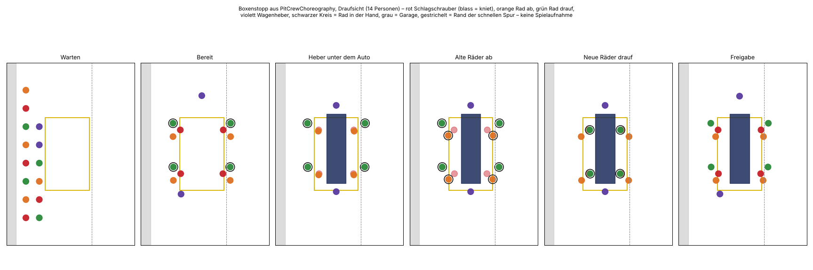
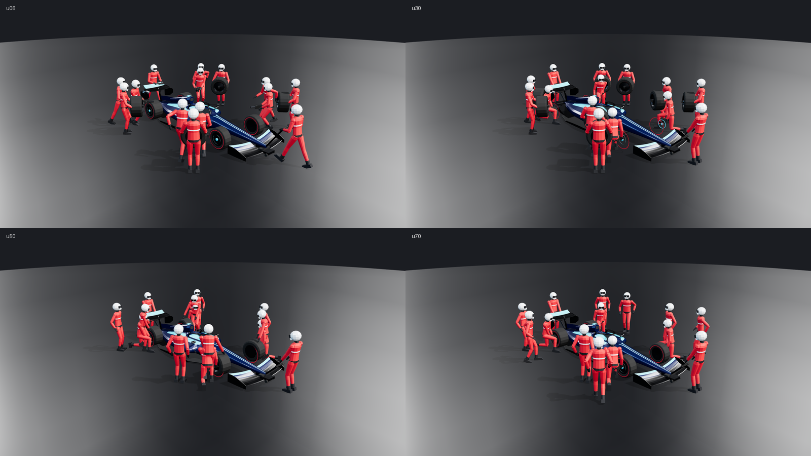

# Boxengasse, Boxencrew und Boxenstopp-Animation

**Stand:** 2026-11-04.

**Status:**
- **Implementiert und getestet:** Logik in `Apex.Simulation` mit NUnit-Tests. Dazu Fahrtests auf der echten Boxengassen-Fläche von `bosphorus_a`, von der Einfahrtsspur bis zum Einfädeln hinter der Ausfahrt.
- **Darstellung:** gegen die Unity-Referenzen kompiliergeprüft, **im Editor nicht gesehen**. Die Modelle sind als OBJ exportiert und mit three.js gerendert.
- **Platzhalter-Art:** Die Crew-Modelle sind selbst gebaut und prozedural, nicht fotorealistisch. Sie bestehen aus starren Körperteilen an einem einfachen Skelett, ohne Hautverformung.

## Änderungen 2026-11-04
- **Crew:** 14 statt 17 Personen. Je Rad stehen drei, dazu eine Person vorn und eine hinten. Stabilisierer und Freigabe-Mann entfallen, die Freigabe gibt die Ampel.
- **Modelle:** eigene Crew-Modelle mit Gliedern, Gehzyklus, Knien und Händen an Rad, Schlagschrauber oder Wagenheber.
- **Einfahrt:**
  - Eine eigene Einfahrtsspur öffnet sich über 150 m neben der Strecke.
  - Eine durchgehende weiße Linie an der Streckenkante markiert sie früh.
- **Ausfahrt:**
  - Das Tempolimit endet an der Ausfahrtslinie.
  - Dahinter beschleunigt man auf einer eigenen Spur hinter der Mauer, dann hinter einer weißen Linie, und fädelt erst danach ein.

## Vorher
- **Vorhanden:** Fahrbahn, Boxenmauer, Boxengebäude mit 20 Garagen, gelbe Boxenrahmen, Ein- und Ausfahrtschilder, der Stopp-Ablauf in `RaceController`.
- **Fehlte:** Es gab **keine Crew**. Beim Stopp stand das Auto einfach still, bis die Servicezeit um war.
- **Fehler in der Spurführung:** Automatisch gefahrene Autos fuhren die ganze Boxengasse auf der Linie der Boxen, also durch alle anderen Boxen hindurch.

## Spuren und Markierungen (`PitLaneLayout`, `CircuitBuilder.BuildPitLaneMarkings`)
- **Aufteilung, gemessen von der Streckenkante:**

  | Bereich | Abstand |
  |---|---|
  | Vorfeld | 0–2 m |
  | schnelle Spur | 2–5,5 m (Mitte 3,75 m) |
  | Arbeitsspur mit den Boxen | ab 5,5 m (Auto in der Box bei 7,5 m) |
  | Crews | bis zur Garagenfront |

- **Fahrweg** (`PitLaneLayout.Route`, gleich für KI, Boxen-Assistent und Fahrtest):
  - Spätestens 210 m vor der Einfahrt reiht sich das Auto auf der Boxenseite ein. Danach folgt es der Einfahrtsspur, während sie sich öffnet, und bremst auf das Limit.
  - In der Boxengasse fährt es auf der schnellen Spur. 28 m vor der eigenen Box biegt es in die Arbeitsspur ein. Nach dem Stopp fährt es über 24 m zurück auf die schnelle Spur.
  - Ab der Ausfahrtslinie beschleunigt es in der Spur. Auf den letzten bis zu 80 m wechselt es hinter der weißen Linie auf die Strecke. Das ist `Plan.MergeStart` bis `Plan.MergeEnd`, und dort endet der Boxenstopp.
- **Spurplan** (`PitLaneLayout.Plan`, Meter ab der Einfahrt):

  | Abschnitt | Bereich | Abgrenzung zur Strecke |
  |---|---|---|
  | Einfahrtsspur | −150 … 0 m (`entry_taper`), Breite wächst weich auf 13,5 m | durchgehende weiße Linie an der Streckenkante |
  | Boxenmauer | 10 m … Ausfahrtslinie + 10 m | Mauer |
  | Tempolimit | 15 m … Ausfahrtslinie (`limit_end`, sonst `exit`) | weiße Querlinien |
  | Beschleunigungsspur | Ausfahrtslinie … Ende der Boxengasse + `exit_taper` | erst Mauer, dann weiße Linie |

- **Bosphorus (`bosphorus_a`):**
  - Hinter dem Ende der Boxengasse (Runde ~520 m) läuft die Strecke nach 1–3 m wieder zurück. Dort ist kein Platz für eine Spur.
  - Deshalb liegt die Ausfahrtslinie bei 400 m (`limit_end`), 120 m vor dem Ende, und `exit_taper` ist 20 m.
  - Man beschleunigt in der Boxengasse: 10 m hinter der Mauer, dann hinter der weißen Linie, und ist bei ~533 m auf der Strecke.
  - Die Werte stehen in `build_track_a.py` und in beiden JSON-Dateien. Ohne `limit_end` gilt der allgemeine Fall: Ausfahrtslinie am Ende, Spur 170 m danach.
- **Fahrbahn** (`RoadSurface.pitWidth`):
  - Vorfeld und Spur sind so breit wie der Boxenbereich an der jeweiligen Stelle.
  - Neben der Einfahrts- und Ausfahrtsspur rückt die Barriere nach außen, der Auslauf beginnt erst an der Spurkante.
- **Spielerin oder Spieler ohne Assistent:**
  - Der Stopp gilt als begonnen, sobald man über die weiße Einfahrtslinie fährt; dann ist man nicht mehr in den Tracklimits.
  - Der Begrenzer greift erst an der Linie bei 15 m.
  - Hinter der Ausfahrtslinie ist er aus, mit der Meldung „Begrenzer aus – Ausfahrt“.
- **Markierungen:**
  - Weiße Trennlinie zwischen den Spuren, so weit die Boxenmauer reicht.
  - Weiße Querlinien bei Beginn und Ende des Tempolimits.
  - Weiße Einfahrts- und Ausfahrtslinie an der Streckenkante.
  - Ein Streifen in der Teamfarbe am Garagenende jeder Box (Box b gehört Team b/2).
  - Schilder: „PİT GİRİŞİ“ 60 m vor dem Beginn der Einfahrtsspur, „PİT 80 km/h“ an der Limitlinie, „PİT ÇIKIŞI“ an der Ausfahrtslinie.
- **Tests:**
  - `RoadSurfaceDriveTests.F_PitLaneIsDrivableEntryToExit`: erste, mittlere und letzte Box, von 210 m vor der Einfahrt bis nach dem Einfädeln, ohne Kontakt.
    - 30 m hinter der Ausfahrtslinie noch in der Spur.
    - Vor dem Einfädeln mehr als das 1,4-Fache des Limits; gemessen 199 km/h bei allen drei Boxen.
  - `PitCrewTests.EntryAndExitLanesLeadSmoothlyFromAndBackToTheTrack`: allgemeiner Fall und Bosphorus-Fall. Keine Sprünge im Fahrweg, mindestens 100 m von der Ausfahrtslinie bis zur Strecke, kein Einfädeln durch die Mauer.
  - `PitCrewTests.CarsUseTheFastLaneAndTurnInOnlyForTheirBox`.

## Boxencrew (`PitCrewChoreography`, `PitCrewFigure`, `PitCrewGeometry`, `PitCrewComponent`)
- **14 Personen je Box** in der Teamfarbe, eine Crew für jede Box, in der ein Auto der Session steht:
  - je Rad drei: Schlagschrauber, Rad ab, Rad drauf
  - eine Person vorn, eine hinten (Wagenheber)
  - Die Freigabe gibt die Ampel an der Box.
- **Modelle** (`PitCrewGeometry`, eigene prozedurale Platzhalter, ~1950 Dreiecke je Person):
  - **Person:** Overall in der Teamfarbe mit Gürtel und Reflexstreifen, Vollhelm mit dunklem Visier, Handschuhe, Stiefel. Zehn starre Teile: Rumpf, Kopf, je zwei Ober- und Unterarme, Ober- und Unterschenkel.
  - **Rad:** Reifen und Felge.
  - **Schlagschrauber:** mit Nuss und Griff.
  - **Wagenheber:** Hebekopf mit Rollen, Griffstange auf die Länge bis zu den Händen.
- **Skelett** (`PitCrewFigure`, reines C#):
  - Die Gelenke kommen aus Zwei-Knochen-IK.
  - **Laufen:** Schrittzyklus, dessen Tempo und Weite von der Geschwindigkeit abhängen; Arme schwingen gegenläufig.
  - **Schlagschrauber:** kniet am Rad, linkes Knie am Boden, beide Hände am Schlagschrauber auf der Radmutter.
  - **Radträger:** halten das Rad am Felgenrand vor der Brust. Beim Aufsetzen dreht es sich auf die Achse des Autos.
  - **Wagenheber:** drücken den Griff herunter, während das Auto oben ist.
  - **Haltung:** Der Kopf schaut auf die Hände.
  - Die Personen laufen versetzt, also nicht im Gleichschritt.
- **Ablauf, gekoppelt an die echte Servicezeit** (`PitState.serviceTotal`, typisch 2,3–3,0 s, länger bei klemmender Radmutter oder neuer Nase):
  1. **Warten:** zwei Reihen vor der Garage.
  2. **Bereit:** Ist das eigene Auto in der Boxengasse und weniger als 160 m entfernt, laufen alle in 1,6 s an ihre Plätze neben der Box.
     - Der hintere Wagenheber wartet seitlich, weil das Auto von hinten kommt.
     - Niemand steht auf dem Weg des Autos oder auf der schnellen Spur.
  3. **Service** (Anteile der Servicezeit):

     | Anteil | Schritt |
     |---|---|
     | 0–8 % | Wagenheber unter Nase und Heck |
     | 16–36 % | Schlagschrauber kniet, alte Räder ab und zur Seite |
     | 38–62 % | neue Räder drauf |
     | bis 78 % | Anziehen |
     | ab 86 % | Wagenheber ab |
     | Ende | Freigabe |

     - Während die Räder ab sind, werden die Räder am Auto ausgeblendet; die Crew trägt sie.
     - Die Crew arbeitet um das Auto herum, auch wenn es ein paar Meter neben der Boxenmitte hält.
  4. **Rückkehr:** in 2,4 s zurück vor die Garage; die alten Räder werden mitgetragen.
- **Nur Reparatur** (keine Reifen): Die Radcrews bleiben stehen, die Heber arbeiten.
- **Freigabe-Ampel je Box:** an einem Pfosten vor der Garage. Rot, solange das Auto stehen muss, grün bei der Freigabe.
- **Mobil** (Umgebungsdetails Niedrig): Nur Crews mit einem Auto auf dem Weg in die Box, in der Box oder gerade freigegeben werden gezeichnet. Wartende Crews entfallen.
- **Leistung:**
  - Instanziert gezeichnet, je Körperteil und Material ein Aufruf: 17 Draw Calls je sichtbarer Box für die Personen, dazu bis zu 8 für Räder und Werkzeuge.
  - Auf Mobil hat die Crew weniger Segmente (8 statt 12).
  - Nur bis 300 m Entfernung zur Kamera.





Erzeugt mit:

```sh
cd build/Apex.ModelPreview && dotnet run -c Release -- <out> --pitcrew
```

Das liefert `pitcrew_stop_<Anteil>.obj` im Box-Rahmen, Boden bei y = 0. Die Bilder entstehen dann mit `tools/carrender` (Materialien `CrewOverall`, `CrewDark`, `CrewHelmet`).

## Tests
- `PitCrewTests` (6):
  - Spuren, Einfahrt und Ausfahrt (2 Fälle)
  - niemand auf der schnellen Spur, in allen Phasen
  - richtige Reihenfolge innerhalb der Servicezeit, auch bei langen Stopps
  - Wege frei vor der Ankunft, Crew danach zurück an der Garage
- `PitCrewFigureTests` (6):
  - 14 Personen, 3 je Rad, 1 vorn, 1 hinten
  - **Skelett:** Gelenke verbunden, Achsen orthonormal. Füße nie unter dem Boden, Kopf über der Hüfte; geprüft für jede Rolle, Phase und Zeit.
  - **Schlagschrauber:** kniet, Knie unten, Hände am Schlagschrauber an der Nabe.
  - **Rad drauf:** Hände am Felgenrand, das Rad sitzt am Ende auf der Nabe.
  - **Laufen:** wechselnde Schritte; im Stand stehen die Füße nebeneinander.
  - **Wagenheber:** Griff unten, solange das Auto angehoben ist.
- `RoadSurfaceDriveTests.F_PitLaneIsDrivableEntryToExit` (Boxen 0, 10, 19).
- **Werkzeug:** `cd build/Apex.Tuning && dotnet run -c Release -- pitcrew` liefert die Positionen als CSV.

## Im Editor zu prüfen
- Ein Rennen mit Pflichtstopp und Boxen-Assistent, Stopp mit P anfordern.
  - Läuft die Crew rechtzeitig heraus?
  - Sitzt sie richtig am Auto?
  - Verschwinden die Räder am Auto und tauchen wieder auf?
- **Lage:** Stehen die Figuren auf der Fahrbahn? Ihre Höhe kommt aus der Streckenebene der Box (±1 cm).
- **Fahrweg:** KI-Autos in der Boxengasse fahren auf der schnellen Spur und biegen erst kurz vor ihrer Box ein.
- **Ampel:** Ist die Freigabe-Ampel aus der Verfolger- und Cockpit-Kamera sichtbar?
- **Modelle:**
  - Sind die Körperteile richtig ausgerichtet? Gelenke ohne Lücken, Stiefel auf dem Boden?
  - Passen die Farben zu den Teams?
  - Sind Schatten und Draw Calls in Ordnung?
- **Einfahrt und Ausfahrt:**
  - Sind die weißen Linien gut sichtbar?
  - Steht die Barriere neben der Einfahrtsspur richtig?
  - Fühlt sich das Beschleunigen hinter der Ausfahrtslinie bis zum Einfädeln gut an (Bosphorus ~133 m)?
