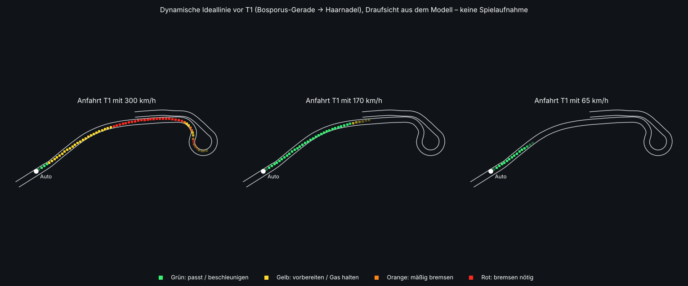

# Dynamische Ideallinie

**Stand:** 2026-11-01.

**Status:**
- **Implementiert und getestet:** Logik in `Apex.AI.RacingLineGuide`, 6 NUnit-Tests.
- **Darstellung:** `RacingLineGuideComponent` mit neuem Shader `Apex/RacingLine`, gegen die Unity-Referenzen kompiliergeprüft.
- **Im Unity-Editor nicht gesehen.** Der Shader kompiliert erst dort; ohne ihn fällt die Darstellung auf `Sprites/Default` zurück, dann ohne weiche Kanten.

## Was vorher war
Es gab keine Ideallinie. Die **schwarze Spur** auf dem Asphalt war der Gummiabrieb entlang der Ideallinie (`TrackInfrastructurePlan`, 6155 Streifen). Er ist ein Umgebungsdetail echter Rennstrecken, wirkte aber wie eine misslungene Fahrhilfe.
- Seine Deckkraft ist von 0,55 auf 0,3 gesenkt (`TrackInfrastructureBuilder.RubberOpacity`), er bleibt als dezentes Detail.

## Was die Linie zeigt
Leuchtende Segmente (3,2 m lang, alle 5,5 m, 64 cm breit, 4 cm über der Fahrbahn) entlang der geplanten Linie: außen anfahren, Scheitel, Ausgang nutzen.

**Planungsgrundlage** (`CarPerformance`, siehe `docs/HANDLING_KEYBOARD.md` Abschnitt 2):
- Die Linie ist dieselbe Planung, mit der die KI fährt, aus dem Grip, dem Abtrieb und der Bremsleistung des Spielerautos. Bei „Fahrverhalten: Bisherig“ ist es die Planung des bisherigen Autos.
- **Zielgeschwindigkeit je Punkt:** aus Kurvenradius und Abtrieb. Kurvenkombinationen und der Reibkreis (Bremsen und Lenken teilen sich den Grip) gehen ein.
- **Bremskurve:** rückwärts aus der echten Bremsverzögerung, mit Steigung und Gefälle.
- **Wetter und Reifen:** Bei nasser Strecke, kalten oder abgefahrenen Reifen wird mit weniger Grip neu geplant. Dieselbe Rechnung nutzt die KI.

**Farbe in jedem Bild aus der aktuellen Geschwindigkeit v:**

| Farbe | Bedeutung | Bedingung |
|---|---|---|
| Rot | Bremsen nötig | Die Planung liegt hier unter v, und die verlangte Verzögerung ist über 55 % dessen, was das Auto hier kann; oder das Auto ist für die nächsten Meter schon zu schnell |
| Orange | Geschwindigkeit reduzieren | Bremsbedarf 15–55 % (Ende der Bremszone, Anbremsen bis zum Scheitel) |
| Gelb | vorbereiten | Eine Bremszone beginnt in den nächsten 1,6 s; oder weiteres Beschleunigen wäre hier zu schnell (Gas halten); oder der Kurvenausgang ist noch langsamer als v |
| Grün | passt | Halten oder beschleunigen, ab dem Scheitel sobald die Planung über v steigt |

- **Abhängigkeit vom Tempo:** Bei 300 km/h beginnt Rot vor T1 188 m vor dem Scheitel, bei 170 km/h 111 m davor. Wer schon langsam genug ist, sieht kein Rot.
- **Konservative Planung vor T1:** Rot beginnt früher als bei reinem Geradeausbremsen, denn die Bremszone liegt in einem schnellen Knick (Radius ~270 m), dessen Kurvenfahrt Grip kostet. Die Planung hält außerdem eine Reserve für Tastaturbremse und ABS: 70–75 % der gemessenen Geradeaus-Verzögerung.
- **Vorausschau:** 4,5 s bei aktuellem Tempo, 90–650 m. Die Segmente blenden 4–10 m vor dem Auto ein und auf den letzten 20 % aus.
- **Farbwechsel:** fließend in ~0,15 s, kein Flackern. Der Bremsbeginn bleibt beim Annähern auf ±1 Segment stehen (Test).

## Einstellungen (Fahrverhalten)
- **Ideallinie:** Aus, Nur Kurven, Ganze Strecke (Standard).
  - „Nur Kurven“ zeigt die Kurvenzonen: Krümmung über 1/600 m oder Planung unter 97 % der Höchstgeschwindigkeit, je 40 m erweitert, dazu jede Warnung.
- **Dynamische Bremsanzeige:** An (Standard) oder Aus. Bei Aus ist die Linie durchgehend grün und zeigt nur die Linienführung.
- Beide werden gespeichert (`SettingsData.racingLineMode`, `dynamicBrakeLine`).
- **Bremsempfehlung Anfänger/Standard/Experte** ist nicht umgesetzt (im Auftrag „optional später“) und wird deshalb auch nicht angezeigt.

## Technik
- **Logik** (`Apex.Simulation`, reines C#, testbar):
  - `RacingLineGuide.Evaluate` füllt eine Liste der sichtbaren Segmente mit Farbe und Ausblendung.
  - Pro Bild entsteht keine Allokation.
- **Darstellung:**
  - **Mesh:** Ein Mesh mit einem Viereck je Segment für die ganze Runde (~1500 Segmente). Die Ecken werden beim Aufbau per Raycast auf die echte Fahrbahn gelegt, also einschließlich Quergefälle und Kuppen; Autos werden dabei ignoriert.
  - **Pro Bild:** nur die Vertexfarben der aktiven Segmente.
  - **Shader:** unbeleuchtet (bei Nacht und Regen gut sichtbar), weiche Ränder, heller Kern, Tiefenversatz gegen Durchsinken, mit Nebel.
- **Kameras:** Die Linie ist Weltgeometrie und funktioniert deshalb in jeder Kamera (Verfolger, T-Cam, Cockpit). Im Cockpit liegt das erste sichtbare Segment 4–10 m vor dem Auto.
- **Lage:** Die Linie bleibt auf der Fahrbahn. Sie hält 1,6 m Abstand zum Rand (`RacingLine`); Test `TheLineStaysOnTheAsphaltEverywhere` prüft alle Segmente mit 1 m Reserve.

## Tests (`RacingLineGuideTests`, Test E)

| Test | Inhalt |
|---|---|
| `BrakingWarningMovesWithTheApproachSpeed` | Rot früher bei 300 als bei 170 km/h, kein Rot wenn langsam genug, Gelb vor Rot |
| `TheLineTurnsGreenAfterTheApexAndIsGreenOnTheStraights` | Grün nach dem Scheitel; auf der Geraden bei moderatem Tempo überwiegend grün |
| `TheLineStaysOnTheAsphaltEverywhere` | Alle Segmente auf der Fahrbahn |
| `TheBrakingPointDoesNotJumpAsTheCarApproaches` | Kein Flackern des Bremsbeginns |
| `TheRedZoneLeavesEnoughRoomForTheRealBrakes` | Prüfstand-Vollbremsung ab Rotbeginn reicht bis zur Kurvengeschwindigkeit |
| `WetTrackAndModesChangeTheGuide` | Nässe bremst früher; Aus, nur Linie, nur Kurven |

**Werkzeuge:**
- `cd build/Apex.Tuning && dotnet run -c Release -- guide` zeigt das Geschwindigkeitsprofil.
- `guide <distanz> <kmh>` zeigt die Farben für ein Auto an dieser Stelle.

**Im Editor zu prüfen:**
- Sichtbarkeit bei Tag, Nacht und Regen.
- Wirkt die Linie zu hell, zu breit oder zu dunkel? Stellschrauben: `_Intensity` und `MaxAlpha`.
- Kein Durchsinken an Kuppen und Kerbs.
- Gefühl für den Bremspunkt vor T1, Ortaköy und Bayıldım.
