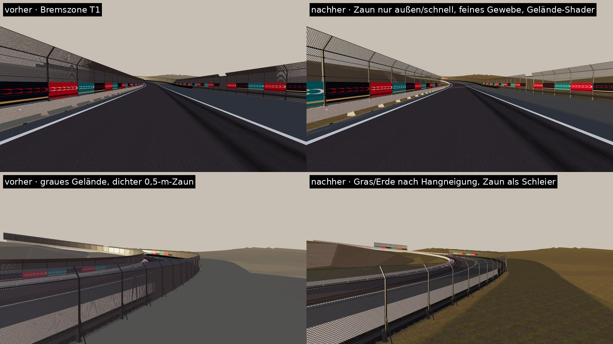

# Gelände und Fangzaun – Umbau gegen den „grauen Canyon“

**Stand:** 2026-10-26.

**Status:**
- **Geländeform:** implementiert und getestet.
- **Gelände-Shader `Apex/Terrain`:** geschrieben, nicht kompiliert (wie `Apex/Water`); offline als three.js-Portierung geprüft.
- **Fangzaun-Regel:** implementiert und getestet.
- **Zaun-Material:** implementiert, kompiliergeprüft, offline gesehen.
- **Im Unity-Editor nicht gesehen.**

Die im Brief erwähnten Screenshots lagen mir nicht vor; die Ursachen sind aus dem Code und einer Messung abgeleitet.

## 1. Audit: woher die grauen Wände kamen
| Quelle | Befund | Maßnahme |
|---|---|---|
| Nahgelände (`TerrainField.NearHeight`) | Bis 25 m neben der Achse auf Straßenhöhe − 1 m, dann in **35 m** auf die DEM-Höhe. Wo die Straße unten am Hang liegt (Çırağan, Yıldız, Barbaros), wurde ein 40–60 m hoher Hang auf 35 m zusammengedrückt: Wände bis 79°. | Hangform: Plateau 30 m, dann höchstens ~18° (0,32 m/m) bis zur echten Höhe (`PlateauWidth`, `MaxHillGradient`). |
| Material `FarGround` | Nah- **und** Ferngelände in einer flachen grau-beigen Farbe (0,47/0,45/0,40) ohne Textur. | Gelände-Shader mit drei gescannten Schichten nach Hangneigung (unten). |
| Gelände-Rand (12 m Schürze), Auslauf-Schürze | senkrechte Flächen, ebenfalls grau | bekommen jetzt das Gelände-Material; steile Flächen zeigen Mauerwerk. |
| Beton unter Gehwegkanten (2,5–4 m) | graue Streifen, wo das Gelände tiefer liegt | durch die neue Hangform meist nur noch ~1 m sichtbar; später Mauerwerk (Phase 2). |

**Höhendaten:** Das DEM-Raster ist nicht schuld. Es nimmt pro 100-m-Zelle die Bodenhöhe ohne Dächer (10. Perzentil, Gebäude ausgeschnitten); der Hang zum Yıldız-Hügel ist echt.

**Messung** (`dotnet run -- terrain-audit bosphorus_a`, Profile alle 10 m, beide Seiten, 0–80 m hinter der Barriere; „Wand“ = über 4 m Anstieg und steiler als 30° auf 6 m):

| | vorher | nachher |
|---|---|---|
| Profile mit Wand | **63 %** (~9,6 km) | **6,3 %** (~1 km) |
| höchste Wand | 59 m, bis 79° | 40 m |
| steilster Schritt meist | 60–70° (41 % der Profile) | 20–30° (73 %) |

**Restliche Wände** (Runde ~6,3–7,3 km, Barbaros/Akaretler):
- Dort liegen zwei Streckenteile auf unterschiedlicher Höhe nebeneinander. Eine Stützmauer ist dort real nötig.
- Der Shader zeichnet sie als Bruchsteinmauer.
- Ein Regressionstest (`TheTerrainBesideTheTrackIsNoLongerAGreyCanyon`) hält den Anteil unter 10 %.

**Folgeänderung:** Die Monumentalflagge stand auf der alten, künstlich flachen Terrasse. Die Standortsuche (`flagsite`) hat neu gewählt: game 903/787, Bodenhöhe 87,5 m, von 81 % der Runde sichtbar.

## 2. Gelände-Shader `Apex/Terrain`
| Schicht | CC0-Satz (Poly Haven) | Wann | Projektion |
|---|---|---|---|
| Gras | `leafy_grass` (2 m) | flach bis ~18° | von oben |
| Erde mit Steinen | `forest_ground_04` (3,15 m) | mittlere Hänge | von oben |
| Bruchsteinmauer | `old_stone_wall` (2 m), heller Kalkstein wie osmanische Stützmauern | steiler als ~37° | von der Seite, Lagen bleiben waagerecht |

- **Übergänge:** Die Schwellen werden durch großflächiges Rauschen verschoben, damit es keine geraden Linien gibt.
- **Gegen Kachelwiederholung:**
  - großflächige Helligkeitsvariation (37 m)
  - ab 40 m Entfernung eine zweite, 3,7-mal größere Grasprobe
- **Albedo kalibriert** auf Gras und Erde 0,12, Stein 0,22 (linear). Der Gras-Scan allein hat 0,24, das ist zu hell.
- **Beleuchtung:** URPs eigener PBR-Pfad (Schatten, SSAO, Zusatzlichter – die künftigen Laternenkegel –, Sonden, Nebel). Nässe macht alle Schichten glänzender und dunkler.
- **Passes:** ShadowCaster, DepthOnly, DepthNormals.
- **Fallback:** Lit mit der Gras-Textur.

**Ehrlich:**
- **Vegetation:** Bäume, Büsche und Blumenbeete fehlen weiter (Phase 2).
- **Stadt am Hang:** Die Hänge sind jetzt Wiese/Erde statt Beton. Eine Stadt am Hang – Wohnstraßen, Treppen, Terrassenhäuser – ist damit noch nicht gebaut.

## 3. Fangzaun
**Wo** (`TrackInfrastructurePlan.BuildFenceNeeds`):
- an der Kurvenaußenseite vom Bremspunkt bis 70 m nach dem Scheitel
- beidseitig, wo die Ideallinie schneller als 234 km/h ist
- an der Start-/Ziel-Geraden mit den Haupttribünen (±350 m)
- **Glättung:** Lücken unter 60 m werden geschlossen, Stücke unter 40 m entfallen.
- **Offen bleiben** Kurveninnenseiten und langsame Abschnitte, mit Blick auf Stadt, Bosporus und Wahrzeichen.

**Ergebnis:**
- Zaun auf **71 %** der Barrierenlänge statt 93 %.
- Mehr lässt die Regel auf dieser schnellen Runde nicht zu, ohne die Sicherheit auf den langen Geraden aufzugeben.
- Test: `CatchFenceStandsWhereCarsArriveFastNotAlongTheWholeLap`.

**Wie** (`TrackInfrastructureBuilder.CatchFenceTexture`):
- **Gewebe:** echte Maschenweite (100 mm statt 0,5 m), dünner, kantengeglätteter Draht.
- **Darstellung:** transparent statt Alpha-Test. Aus der Ferne mitteln die Mip-Stufen das Gewebe zu einem leichten grauen Schleier (~25 % Deckung).
- **Nachteil:** Transparente Materialien werfen in URP keinen Schatten. Die Gitter-Schatten auf der Fahrbahn entfallen.

## Im Unity-Editor zu prüfen
1. Kompiliert `Apex/Terrain`? Bei Fehlern greift das Lit-Gras; bitte die Meldung weitergeben.
2. Hänge an Çırağan/Yıldız aus der Verfolgerkamera: Sind Wiese, Erde und Mauer stimmig, und ist keine Kachelung sichtbar?
3. Barbaros/Akaretler: Wirken die Stützmauern glaubhaft, oder braucht es echte Mauergeometrie (Fugen, Entwässerung, Abdeckung)?
4. Zaun aus Cockpit und TV-Kamera: Ist er bei 300 km/h flimmerfrei? Ist der Schleier nicht zu stark oder zu schwach?
