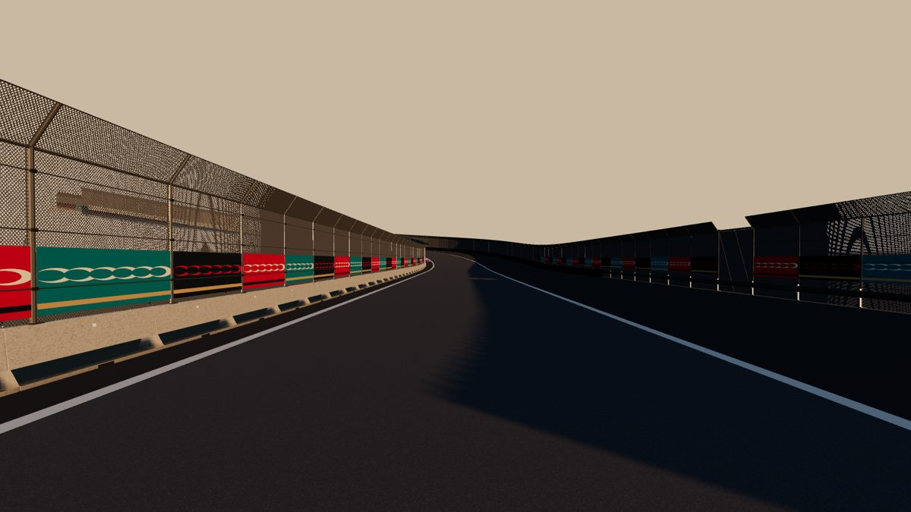
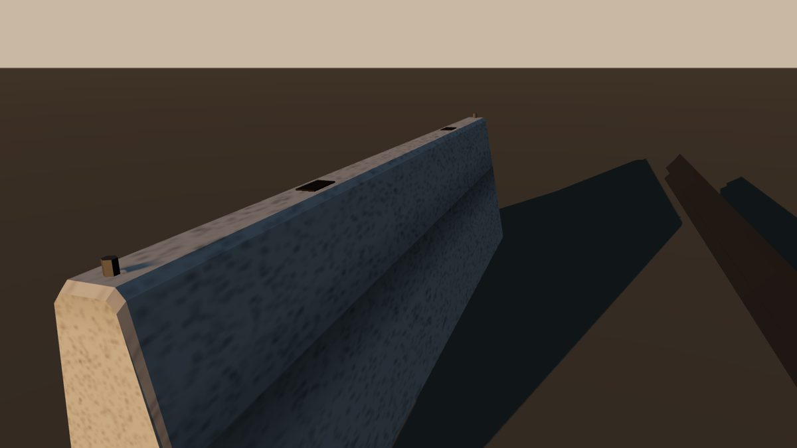
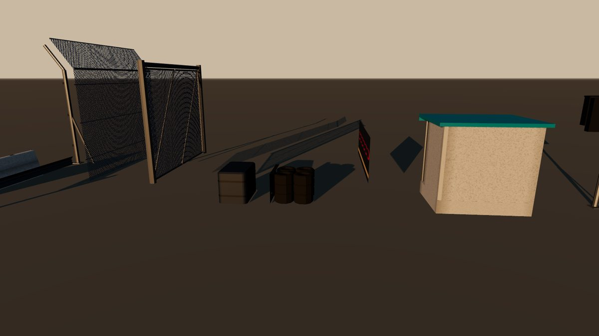

# Modulares Rennstrecken-Kit

**Stand:** 2026-10-26, Branch `track-kit` (baut auf PR #10 auf).

**Status:**
- **Implementiert, offline getestet:** NUnit-Tests der Platzierung, Kompilierprüfung gegen Unity-Referenzen, three.js-Vorschau.
- **Im Unity-Editor nicht gesehen.** Das LOD-Überblenden, URP-Materialien und die Leistung prüft erst der Editor.
- **Ehrliche Einordnung:**
  - Die Module sind prozedurale Geometrie mit realistischen Formen und Maßen (Sicherheitsprofil, W-Profil, Fangzaun mit Überhang), aber **noch keine fotorealistische Kunst**.
  - Den Qualitätssprung bringen Materialien: gescannte PBR-Texturen (CC0), Normal- und Masken-Maps, Decals für Verschmutzung und Abrieb. Das ist der nächste Schritt für Ortaköy.
  - Alternativ ersetzen modellierte Prefabs einzelne Module (siehe „Prefab-Ersatz“).

## Module

| Modul | Maße | Dreiecke LOD0 / LOD1 / LOD2 | Details LOD0 |
|---|---|---|---|
| Betonblock (`BarrierBlock`) | 3,8 m, 1,0 m hoch, Fuß 0,6 m, Kopf 0,15 m | 134 / 22 / 6 | Sicherheitsprofil mit Fuß, Knick bei 33 cm, gefaste Kanten und Blockenden (Fuge), Hebeaussparungen, Kupplungsbolzen, Entwässerungsschlitz, Reflektor |
| Leitplanke (`GuardrailSpan`) | 4 m, W-Profil 0,45–0,76 m | 72 / 24 / 16 | 7-Punkt-W-Profil, C-Pfosten, Distanzstück, Stoßschrauben |
| Fangzaun-Pfosten (`FencePost`) | 3 m über Barriere bzw. 4 m vom Boden | 136 / 40 / 12 | Rohr, Fußplatte, Strebe, Seilklemmen, Überhangarm 35° |
| Fangzaun-Feld (`FencePanel`) | 4 m | 52 / 16 / 8 | Drahtgitter (Alpha), Oberholm, 3 Spannseile, Überhang mit Seil |
| Notausgang (`FenceGate`) | 4 m | 172 / 64 / 64 | Schwerlastpfosten, Torflügel mit Rahmen und Streben; Schild „ACİL ÇIKIŞ“ an jedem dritten Tor |
| Aufprallschutz (`EnergyModule`) | 1,5 × 0,9 × 1,0 m | 180 / 60 / 12 | abgerundeter Grundriss, gefaster Deckel, 2 Spanngurte; Navy / Elfenbein / Türkis im Wechsel |
| Reifenstapel (`TyreStack`) | 1,25 m, 1,3 m tief | 1.094 / 130 / 14 | 2 × 2 Säulen à 3 Reifen mit Flankenrillen, Förderband-Verkleidung mit Falz und Verschraubung |
| Banner (`Banner`) | Feldbreite, 1,2 m hoch | 4 / 4 / 2 | Bosphorus-GP-Grafik (`EventArt.Banner`, 3 Varianten, ohne Text), Rückseite neutral |
| Streckenposten (`MarshalPost`) | 2,6 × 2,0 m | 228 / 108 / 48 | erhöhter Boden mit Stufen, Wände, Dach mit Blende, Handlauf, Flaggenkiste, Feuerlöscher |
| LED-Flaggentafel (`FlagPanelHousing`) | 1,3 × 0,95 m | 128 / 68 / 32 | Gehäuse mit Blende und Sonnenschutz, Trennsteg, Mast mit Fußplatte und Strebe; Anzeige-Logik unverändert (`FlagPanelComponent`) |

- Keine Herstellermarken: Die Module folgen gängigen Bauarten, ohne Logos.
- Die Kerbs bleiben Teil der Fahrfläche (`RoadSurface`, AGENTS.md-Regel). Ihr Upgrade läuft über Material und Textur, nicht über die Geometrie.

## Platzierung (`TrackKitLayout`, Apex.Simulation)
- **Barrierenlinie:** Die Module folgen der Wandlinie der `RoadSurface`, also derselben Linie, an der die Kollisionswände stehen.
- **Abstände nach Bogenlänge:**
  - Starre Module sind Sehnen, deren Enden auf der Linie liegen. Die Kette ist dadurch geschlossen.
  - Die Abstände folgen der Bogenlänge der Linie selbst. Außen in Spitzkehren ist sie bis zu 50 % länger als die Mittellinie; so behalten die Blöcke ihre 3,8 m (Test: > 95 % auf ±10 %).
- **Kurven zur Strecke hin:** Dort würde die Sehnenmitte vor der Linie stehen. Das Modul wird um diese Stichhöhe zurückgesetzt, damit nichts vor der Kollisionswand steht.
- **Sprünge in der Linie** (Boxeneinfahrt, Auslaufbuchten) beenden einen Abschnitt; eine quer gestellte Blockreihe schließt den Sprung.
- **Barrierentyp je Abschnitt** wie bisher:
  - Beton
  - Leitplanke bei Auslauf ≥ 4 m, Zaun dann vom Boden
  - Mittelwand ohne Zaun
  - Boxenmauer ohne Zaun
- **Tore** wechseln die Seite und weichen aus, wo eine Seite keinen Zaun hat.
- **Banner** hängen in den Anfahrten der Bremszonen (320 bis 40 m vor dem Scheitel).
- **Aufprallschutz:**
  - Überlappende Schutzbereiche benachbarter Kurven werden zusammengelegt (vorher doppelte Module).
  - **Wo der Auslauf schmaler ist als das Modul, entfällt es.** Vorher standen die Module dort auf dem Asphalt; das betraf 59 Messpunkte an der Bosporus-Strecke.

## Darstellung (`TrackKitBuilder`, Apex.Runtime)
- **Abschnitte und Detailstufen:**
  - Je 60 m Runde ein Objekt mit **LODGroup und Cross-Fade**.
  - LOD0 bis 90 m, LOD1 bis 260 m, LOD2 bis 900 m (ab der Abschnittsmitte, Referenz-FOV 60°, `QualitySettings.lodBias` skaliert), danach ausgeblendet.
  - Pro Stufe ist alles pro Material zusammengeführt, also wenige Draw Calls je Abschnitt.
- **Umgebungsdetails „Niedrig“:** nutzt in der Nähe LOD1.
- **Kollision:**
  - Die Barrieren kollidieren weiter an den Wänden der `RoadSurface`.
  - Der Aufprallschutz erhält einen eigenen, unsichtbaren Kollider aus einfachen Boxen pro Modul (vorher das ganze Sichtmesh).
- **Unity-6-Einstellung:** Im URP-Asset muss „LOD Cross Fade“ aktiv sein; sonst wechseln die Stufen hart.
- **Prefab-Ersatz:** Ein Prefab unter `Resources/TrackKit/<Modul>` (z. B. `BarrierBlock`) ersetzt das prozedurale Modul überall.
  - Konvention: Meter, Kit-Rahmen (+z entlang der Strecke, +x von der Strecke weg, +y oben), Nennlänge des Moduls, Ursprung wie im prozeduralen Modul (Barriere: Fußkante der Vorderseite; Zaun: Zaunlinie; Aufprallschutz: Mitte).
  - Eine LODGroup im Prefab liefert die drei Stufen.

## Vorschau (offline, three.js, keine Spielaufnahme)
```sh
cd build/Apex.ModelPreview && dotnet run -c Release -- <out> --kit        # Katalog und T1-Abschnitt als OBJ, je LOD
cd tools/carrender && APEX_PAGE=kit.html APEX_VIEWS='t1|-118.7,1.6,-88.3|-20,-0.5,-25|55|&shadow=120&groundY=-6' node render.mjs <out>/kit_t1_lod0.obj <out>/t1
```
- **T1-Abschnitt** (Rundenmeter 1700–2250): 1.118 Module; LOD0 gesamt 215k Dreiecke inklusive Fahrbahn. Im Spiel ist LOD0 nur im 90-m-Umkreis aktiv.





## Nächste Schritte für Ortaköy (nach dem Unity-Handlingtest)
1. **Materialien:** Beton, Stahl und Gitter mit gescannten CC0-Texturen (Poly Haven, ambientCG) plus Normal- und Masken-Maps; Lizenzzeilen in `ASSET_LICENSES.md`.
2. **Decals:** Reifenabrieb an Barrieren in Bremszonen, Ablaufspuren, Kerb-Abnutzung.
3. **Kerbs:** Textur mit Riffelung (Normal-Map) und Farbabrieb.
4. **Im Editor:** LOD-Übergänge bei 330 km/h prüfen (kein sichtbares Umschalten), Draw Calls und Dreiecke im Profiler, Schatten der Zaunfelder (Alpha-Clip) auf Mobile.
