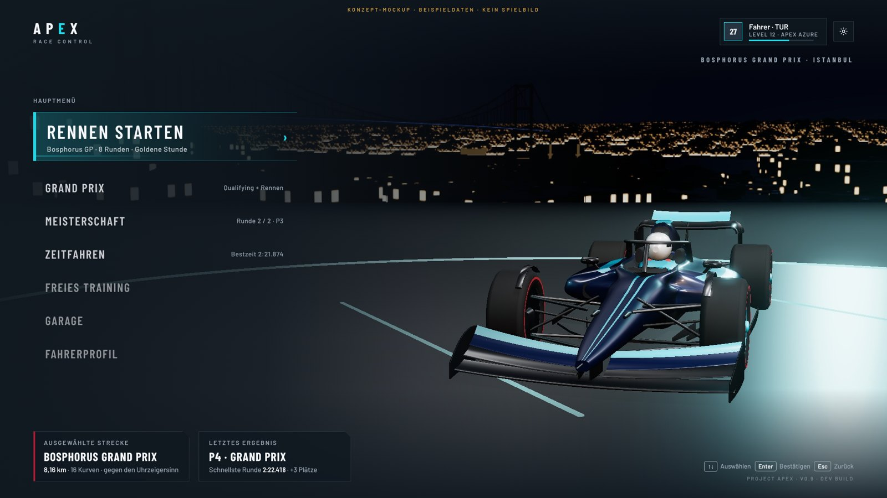
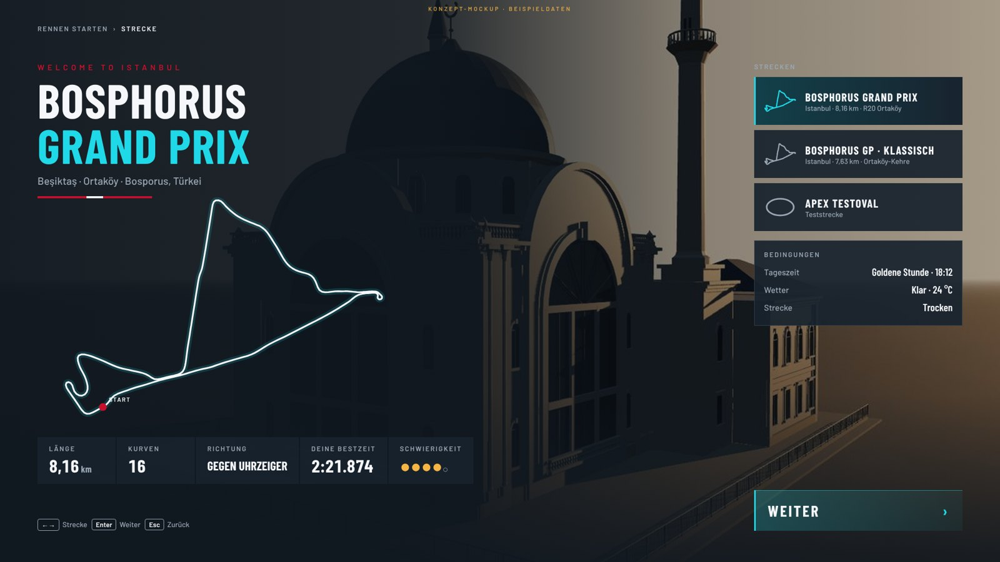
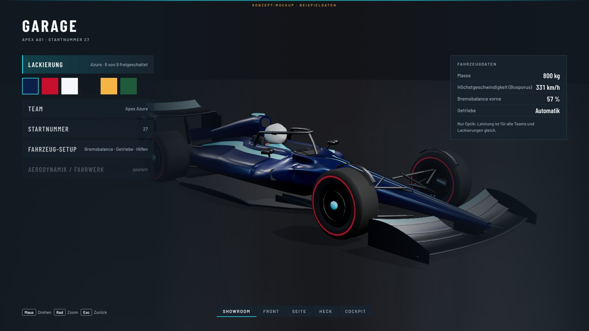
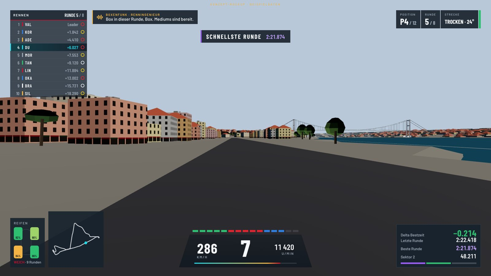

# APEX // RACE CONTROL – UI/UX-Neugestaltung

**Stand:** 2026-10-31.

**Status (ehrlich):**
- **Phase 1** (Analyse, Designsystem, Architektur, Mockups, Technikplan): fertig.
- **Phase 2** (Fundament und Hauptmenü): implementiert, automatisch getestet (Modelle, Kompilierprüfung). **In Unity nicht gesehen.**
- **Phasen 3–6:** geplant.

Die Mockups sind Konzeptbilder: HTML/CSS über Offline-Renders aus dem Projekt, mit Beispieldaten. Sie sind keine Spielaufnahmen.

## 1. Analyse des bestehenden UI-Systems
**Technik:**
- Alle Oberflächen sind Unity-IMGUI (`OnGUI`) in `ApexGame.Menus.cs` (Menüs, Setup, Meisterschaft, Garage, Einstellungen, Pause, Ergebnisse, Hilfe) und `ApexGame.Hud.cs` (HUD, Touch-Tasten).
- Stil aus `ApexStyle` (Panels, Akzent Cyan, Textfarben). Laut Code-Kommentar war das von Anfang an eine Übergangslösung („interim IMGUI layer … M4 replaces it“).

**Stärken (bleiben erhalten):**
- **Zustandsautomat:** einheitlich (`GameStateMachine`: Boot, MainMenu, TrackSelect, CarSelect, Garage, Loading, Grid, Driving, RadioOverlay, Pause, PitApproach, PitStop, Results, Replay) mit festen Zurück-Zielen, getestet.
- **Echte Spielfunktionen hinter allen Menüpunkten:**
  - Grand Prix (Qualifying + Rennen)
  - Meisterschaft (Kalender, Punkte 25-18-…, Bonuspunkt schnellste Runde)
  - Zeitfahren, Freies Training
  - Garage (Team, Lackierung, Startnummer; Showroom-Auto)
  - Einstellungen (Fahrhilfen, Steuerung inkl. Gyro und Touch, Grafikstufen, Ton)
  - Pause, Ergebnisse
- **HUD:**
  - Positionsturm, Info-Panel, Tacho/Dash, Startlichter, Meldungen, Minimap, Boxenfunk, Boxen-Timer, Telemetrie
  - Touch-Tasten mit Safe Area, Linkshänder-Layout, Größe und Deckkraft
- **Eingabe:** Tastatur, Gamepad, Touch und Gyro (`InputRouter`, `TouchLayout`).
- **Persistenz:** `SaveService`, `SettingsData`, `CareerData` (XP/Level, Rennen, Siege, Podien, Poles, Lackierungen).

**Schwächen:**
- **Darstellung:** Ohne Layout-System und Animationen; jede Oberfläche wird pro Bild neu aufgebaut (`OnGUI`, Listen-Allokationen pro Frame). Schriftart: Unity-Standard.
- **Hauptmenü:** Textliste über einem Auto auf einer Asphaltscheibe im Leeren; keine Stadt, keine Bühne.
- **Navigation:** Einstellungen sind eine einzige lange Liste ohne Kategorien.
- **Fehlende Bildschirme:** kein Fahrerprofil, kein Rennwochenenden-Hub, kein Boot-Bildschirm. Der HUD-Editor fehlt, HUD-Varianten gibt es nur teilweise (Telemetrie an/aus).
- **Ton:** Es gibt keine UI-Sounds und keine Menümusik.

**Technische Abhängigkeiten:**
- Unity 6 mit URP und Input System. Die Kompilierprüfung läuft gegen UnityEngine 2021.3; `UnityEngine.UIElementsModule` ist enthalten.
- Das gesamte Gameplay liest Zustände aus `ApexGame` und `RaceController`. Das neue UI darf nur darstellen und auslösen; Spielregeln und Fahrphysik bleiben unverändert.

## 2. Designsystem „APEX RACE CONTROL“
Zentral im Code: `Apex.UI.UiTokens` (Simulation, getestet) und `tools/uimock/apex.css` (Mockups).

**Farben**

| Token | Wert | Verwendung |
|---|---|---|
| Midnight Navy | `#101820` | Grundfläche, Bildschirmhintergrund, Verläufe |
| Carbon Dark | `#18232E` | Panels |
| Surface Dark | `#253440` | erhöhte Flächen, Fortschrittsbalken-Hintergrund |
| Electric Cyan | `#20D9E8` | Fokus, Auswahl, Interaktion, Geschwindigkeit; nur als Kante, Linie oder schmale Fläche |
| Turkish Red | `#C8102E` | Istanbul-Branding, besondere Rennmomente (Startlichter, Sieg) |
| Racing Amber | `#F4B544` | Warnungen, Strategie, Boxenfunk |
| Ivory White | `#F5F7FA` | wichtige Texte und Zahlen |
| Muted Steel | `#9BA8B5` | Labels und Nebeninformationen |
| Flaggen | Grün `#2FBF71`, Gelb `#F2D21B`, Rot `#E0242F`, Blau `#2F7FE0` | nur für Rennleitungsinformation |
| Persönliche/Sitzungsbestzeit | Violett `#9B5CF6` | Motorsport-Konvention für Bestzeiten, sparsam |

**Regeln:**
- Kein flächiges Neon und kein Glow um Texte. Lichtakzente sind 1–3 px breite Linien oder Kanten.
- Kontrast: Fließtext ≥ 4,5:1, große Zahlen ≥ 3:1 gegen die Panelfarbe. Das ist getestet.

**Typografie:**
- **Schriften:**
  - Überschriften, Zahlen und Timing: Barlow Condensed (SemiBold/Bold), Großbuchstaben, leicht gesperrt.
  - Fließtext und Labels: Barlow (Medium/SemiBold).
  - Lizenz: beide SIL Open Font License 1.1 (`Resources/Fonts`, `ASSET_LICENSES.md`).
- **Größen (bei 1080 p):**

  | Rolle | Größe |
  |---|---|
  | Display | 88 |
  | H1 | 54 |
  | H2 | 40 |
  | Menü | 26 |
  | Body | 17 |
  | Label | 13 (Großbuchstaben, Sperrung 0,16 em) |
  | HUD-Gang | 92 |
  | HUD-Tempo | 54 |
  | Timing | 24 |

- **Ziffern:** Timing-Zahlen stehen rechtsbündig in fester Breite. Ob Barlow tabellarische Ziffern im UI Toolkit liefert, ist in Unity zu prüfen; sonst gilt eine Breite je Ziffernfeld.

**Abstände:** Raster 4 px (4, 8, 12, 16, 24, 32, 48, 64). Bildschirmrand 72 px, auf dem Telefon die Safe Area plus 24 px.

**Flächen:**
- Panels in Carbon Dark (Deckkraft 78–92 %) mit 1-px-Haarlinie in Steel (22 % Deckkraft).
- Eine abgeschrägte Ecke (14 px) als Markenmerkmal.
- Feine Cyan-Ticks an Fokus-Elementen; der Fokus ist eine Cyan-Kante (3 px links) mit Verlauf.

**Bewegung:**
- **Dauern:**

  | Bewegung | Dauer |
  |---|---|
  | Fokuswechsel | 120 ms |
  | Einblenden eines Panels | 220 ms |
  | Bildschirmwechsel | 320 ms |
  | Gestaffelte Menüeinträge | 40 ms Versatz |
  | Zahlen-Hochzählen | höchstens 600 ms |

- **Easing:** Out-Cubic für Eintritte, In-Out-Cubic für Kamerafahrten.
- Jede Animation ist durch eine Eingabe überspringbar.
- Mit „Reduzierte Bewegung“ entfallen Verschiebungen, nur Überblendungen bleiben.

**Klang:**
- UI-Sounds (Fokus, Bestätigen, Zurück, Übergang) sind kurz und elektronisch.
- Sie entstehen prozedural im Code, damit keine Lizenzfragen entstehen.
- Die Lautstärke folgt der Gesamtlautstärke; eine eigene UI-Lautstärke kommt in Phase 6.

## 3. Menüarchitektur

```
Boot (Logo, Laden der Menükulisse)
└─ Hauptmenü (Cinematic Showroom)
   ├─ RENNEN STARTEN ............ Schnellstart mit den letzten Einstellungen (Grand Prix, Format „Nur Rennen“)
   ├─ Grand Prix ................ Setup → Rennwochenende (Qualifying → Startaufstellung → Rennen → Ergebnis)
   ├─ Meisterschaft ............. Saisonübersicht (Kalender, Wertung) → nächste Runde
   ├─ Zeitfahren ................ Strecke → Fahrt (Bestzeit, Sektoren)
   ├─ Freies Training ........... Strecke → Fahrt
   ├─ Garage .................... Lackierung · Team · Startnummer · Setup (Bremsbalance, Getriebe, Hilfen)
   ├─ Fahrerprofil .............. Daten und Statistik (ab Phase 5)
   ├─ Einstellungen (oben rechts) Grafik · Steuerung · Fahrverhalten · Audio · HUD · Barrierefreiheit
   └─ Beenden (nur PC)
Rennen: Grid → Fahrt ⇄ Boxenfunk/Strategie ⇄ Pause → Ergebnisse → (Podium) → Hauptmenü
```

**Regeln:**
- Ein Menüeintrag erscheint nur, wenn die Funktion existiert (`MainMenuModel`, getestet).
- „Fahrerprofil“ kommt in Phase 5 dazu. Karriere, Spezialevents, Herausforderungen und eigene Meisterschaften werden erst gezeigt, wenn sie implementiert sind.

**Navigation:**
- `UiNavigator` (Simulation, getestet): Bildschirmstapel, Zurück, Fokus je Bildschirm gemerkt, Übergangszustand.
- Der Spielzustandsautomat bleibt maßgeblich.
- Eingaben: Tastatur (↑↓ Enter Esc), Gamepad (Steuerkreuz/Stick, A, B), Maus (Hover = Fokus, Klick) und Touch (Tippen).

## 4. Bildschirme: Layouts und Mockups
**Hauptmenü** (`docs/img/ui_mock_main_menu.jpg`):
- **Bühne:** der A01 auf einer dunklen, spiegelnden Bühne mit Cyan-Lichtring und roter Akzentlinie, dahinter Bosporus, Brücke und Skyline bei Nacht aus dem Spiel. Die Kamera umkreist langsam.
- **Links:** Menü. „RENNEN STARTEN“ ist größer, mit Cyan-Kante, Verlauf, Geschwindigkeitslinie und der Zusammenfassung der letzten Einstellungen.
- **Oben:** Logo, Fahrerprofil-Chip (Startnummer, Level, XP-Balken), Einstellungen.
- **Unten:** Karte „Ausgewählte Strecke“ mit rotem Istanbul-Akzent, Karte „Letztes Ergebnis“, Steuerungshinweise, Version.



**Streckenauswahl Istanbul** (`docs/img/ui_mock_track_select.jpg`):
- „WELCOME TO ISTANBUL“ in Rot, Streckenname groß, Ort, Bandstreifen in den Nationalfarben.
- Große Streckenkarte aus den echten Streckendaten (animiert gezeichnet).
- Kennzahlen: Länge, Kurven, Richtung, Bestzeit, Schwierigkeit.
- Rechts die Streckenliste mit Mini-Karten und die Bedingungen; im Hintergrund die Ortaköy-Moschee aus dem Spiel.



**Garage** (`docs/img/ui_mock_garage.jpg`):
- Links Kategorien. Die echten sind Lackierung (mit Farbfeldern), Team, Startnummer und Setup (Bremsbalance, Getriebe, Hilfen). „Aerodynamik/Fahrwerk“ ist als „geplant“ ausgegraut.
- Rechts die Fahrzeugdaten, unten die Kameraperspektiven.



**Renn-HUD** (`docs/img/ui_mock_race_hud.jpg`, Broadcast-Stil):

| Position | Inhalt |
|---|---|
| oben links | Positionsturm (Platz, Teamfarbe, Kürzel, Abstand, Reifenmischung; Spieler mit Cyan-Kante) |
| daneben | Boxenfunk (Amber, Wellenform) |
| oben rechts | Position, Runde, Bedingungen, Flaggenstreifen |
| oben mittig | Ereigniseinblendungen (z. B. „Schnellste Runde“), kurz und schmal, nie über der Fahrbahn |
| unten mittig | Gang groß, Tempo, Drehzahl, 15 Shift-LEDs (Grün, Rot, Blau), Drehzahlband |
| unten links | Reifen (Temperatur als Farbe, Verschleiß in %, Mischung) und Minimap |
| unten rechts | Delta zur Bestzeit, letzte und beste Runde, Sektor, Sektorbalken |

**Presets:**
- **Minimal:** Dash und Position.
- **Standard:** wie der Mockup ohne Telemetrie.
- **Erweitert:** zusätzlich Telemetrie.
- **Aus.**
- **HUD-Editor:** Größe, Position und Deckkraft je Element (Phase 4).



**Weitere Bildschirme** (Phasen 3–5, Layoutbeschreibungen):

| Bildschirm | Layout |
|---|---|
| Rennwochenenden-Hub | links die Sessions als Zeitleiste (Qualifying ✓, Startaufstellung, Rennen) mit Fortschritt; Mitte Streckenkarte, Länge, Kurven; rechts Wetter-/Streckenbedingungen und Reifenwahl; unten „Weiter zur nächsten Session“ |
| Meisterschaft | Kalenderleiste mit Rundenkarten (erledigt/nächste); Fahrer- und Teamwertung als Tabellen; Punkteschema; Saisonfortschritt |
| Pause | Rennbild bleibt sichtbar und abgedunkelt; rechts Seitenpanel mit Session, Runde, Position; Fortsetzen, Neustart, Einstellungen, Steuerung, Session verlassen (mit Bestätigung) |
| Ergebnisse | Endplatzierung groß; Tabelle mit Zeit, Abstand, schnellster Runde, Positionsgewinn, Stopps, Punkten; bei Podium die bestehende Podiumsszene (`EventGeometry`: Podest, Pokal) |
| Fahrerprofil | Karten für Rennen, Siege, Podien, Poles, Level/XP; Bestzeiten je Strecke; Diagramm der letzten Platzierungen (Datenerweiterung nötig, Phase 5) |
| Einstellungen | Kategorien links (Grafik, Steuerung, Fahrverhalten, Audio, HUD, Barrierefreiheit), Einträge rechts mit Beschreibung; alle bestehenden Einstellungen bleiben |

## 5. Technischer Plan
**UI-Technik:** UI Toolkit (Runtime, Unity 6).
- **Begründung:**
  - Retained Mode: kein Neuaufbau pro Bild.
  - Flexbox-Layout für verschiedene Seitenverhältnisse, Fokus und Navigation.
  - Gute Text-Darstellung.
  - Kein zusätzliches Paket nötig.
- **Aufbau:** komplett im Code (keine UXML-Dateien nötig), `PanelSettings` zur Laufzeit, 1920×1080 skaliert.
- **Übergang:** Ein Bildschirm nach dem anderen wechselt von IMGUI auf UI Toolkit. Der jeweils alte IMGUI-Bildschirm bleibt nur als Rückfall (wenn UI Toolkit nicht startet) und nutzt dieselben Modelle; nach der Prüfung in Unity wird er entfernt.

**Schichten:**
- **Simulation (getestet):**
  - `UiTokens` (Farben, Abstände, Typo, Dauern, Kontrast)
  - `UiMotion` (Easing, überspringbare Tweens)
  - `MainMenuModel` (Einträge aus echtem Spielzustand)
  - `UiNavigator` (Bildschirmstapel, Fokus, Zurück)
  - später: `HudLayout` (Presets, Editor-Daten), `RaceEventFeed` (Ereignisse aus Rennzustand)
- **Runtime:**
  - `ApexUi` (Root, PanelSettings, Schriften)
  - Komponenten: Panel, Menüeintrag, Karte, Chip, Tastenhinweis
  - `UiSounds` (prozedurale Klänge)
  - `MainMenuView`
  - `MenuStage` (Bühne, Licht, Kamera, Istanbul-Kulisse)

**Leistung:**
- Werte werden nur bei Änderung gesetzt; Animationen laufen über `style.translate` und `opacity` (kein Layout-Neuaufbau).
- Das HUD aktualisiert Zahlen mit 10–20 Hz, Positionen bei Änderung.
- Die Menükulisse (Stadt) wird auf Mobil nicht gebaut.

## 6. Phasen
1. **Analyse und Design:** dieses Dokument und die Mockups. Erledigt.
2. **Fundament und Hauptmenü:**
   - UI-Toolkit-Grundlage, Tokens, Navigation, UI-Sounds, neues Hauptmenü.
   - Bühne mit Lichtring; Istanbul-Kulisse aus dem Spiel ab Stufe Mittel.
   - Erledigt, siehe Abschnitt 8.
3. **Spielmodi:** Rennvorbereitung (Grand Prix, Zeitfahren, Training), Meisterschaftsübersicht, Streckenauswahl (Istanbul-Auftritt). Implementiert, siehe Abschnitt 9; der Grand-Prix-Hub zwischen Qualifying und Rennen folgt mit dem Ergebnisbildschirm (Phase 5).
4. **Renn-HUD:** Turm, Dash mit Shift-LEDs, Timing, Reifen, Ereignis-Feed, Presets, HUD-Editor, Startampel. Implementiert, siehe Abschnitt 10; Kamerafahrt vor dem Start und die Abstimmung mit den Touch-Tasten sind offen.
5. **Weitere Oberflächen:** Garage (Kameraperspektiven, Drehen/Zoom), Boxenstrategie, Pause, Ergebnisse/Podium, Fahrerprofil, Einstellungen mit Kategorien.
6. **Feinschliff:** Übergänge, Musik, Lokalisierung (Deutsch/Englisch), Leistung, Barrierefreiheit (Textgröße, Kontrast, Farbenblind-Modi, Untertitel für Boxenfunk).

## 7. Fehlende Assets

| Asset | Heute | Weg |
|---|---|---|
| UI-Schrift | Barlow / Barlow Condensed (OFL), im Projekt | – |
| Logo „APEX“ als Grafik | Text-Logo in der Schrift | Grafikdesign (Auftrag oder intern), eigenes Markenzeichen |
| Icons (Einstellungen, Reifen, Wetter, Flaggen, Funk, Kamera) | einfache Formen im Code | Icon-Set (z. B. eigenes SVG-Set oder OFL/MIT-Set, Lizenz prüfen) |
| Menümusik | keine | lizenzfreie Produktion oder Auftrag (Musiklizenz für Spiele, Freigabe nötig) |
| UI-Sounds hoher Qualität | prozedural | Sounddesign-Auftrag oder CC0-Bibliothek |
| Motor-Startsound für Rennstart | vorhandener Motorsound | Aufnahmen (Lizenz) oder Synthese verfeinern |
| Konfetti, Pokal, Fahrer fürs Podium | Podium und Pokal prozedural (`EventGeometry`), keine Fahrerfiguren | Charaktermodelle (siehe `ORTAKOY_REFERENCE.md`), Partikel |
| Garage-Umgebung (Werkstatt) | Bühne | Werkstatt-Kit (Auftrag), LED-Leisten im Code |
| Lackierungs- und Teamdesigns | Farben je Team | Lackierungsvorlagen (eigene Designs, keine echten Teams) |

## 8. Umsetzung Phase 2: Fundament und Hauptmenü

**Status: implementiert, Simulationsteil getestet; in Unity nicht geprüft** (kein Unity-Editor in der
Entwicklungsumgebung). Kompiliert wurde gegen UnityEngine-2021.3-Referenzen (ohne und mit URP-Stub, 0 Fehler,
0 Warnungen); `tools/verify.sh` läuft durch (194 NUnit-Tests grün, Testprojekt kompiliert gegen NUnit 3.5).

### 8.1 Was gebaut ist
| Teil | Datei | Inhalt |
|---|---|---|
| Design-Tokens | `Runtime/Simulation/UI/UiTokens.cs` | Palette, Flaggenfarben, Panel-Deckkraft, 4-px-Abstände, Schriftgrade, Bewegungszeiten, WCAG-Kontrast |
| Bewegung | `Runtime/Simulation/UI/UiMotion.cs` | Easing, `Tween` (überspringbar, ohne Sprung umzielbar), gestaffelte Einblendung, Hochzählen |
| Menümodell | `Runtime/Simulation/UI/MainMenuModel.cs` | Einträge nur für vorhandene Funktionen; „Meisterschaft fortsetzen“ nur bei laufender Saison; „Beenden“ nur auf PC |
| Navigation | `UiNavigator` (ebenda) | Bildschirmstapel, Fokus je Bildschirm merken, Zurück |
| UI-Toolkit-Wurzel | `Runtime/Game/UI/ApexUi.cs` | UIDocument mit Laufzeit-PanelSettings (1920 × 1080, nach Höhe skaliert), Barlow-Schriften, Stilhelfer, Zeiger über Input System + `panel.Pick` (kein EventSystem nötig) |
| Hauptmenü | `Runtime/Game/UI/MainMenuView.cs` | Boot-Bildschirm, Logo, Menüliste (Primäreintrag „Rennen starten“), Karten (Strecke, letztes Ergebnis), Profil-Chip, Profilbildschirm mit echten Statistiken, Tastatur/Gamepad/Maus/Touch |
| Showroom | `Runtime/Game/UI/MenuStage.cs` | Bühne mit LED-Ring und rotem Akzent, drei Spots, Kamerafahrt ±10° (bei „reduzierte Bewegung“ still) |
| Kulisse | `ApexGame.BuildMenuBackdrop` | baut auf PC `bosphorus_a` samt Wetter (klar, Nacht oder goldene Stunde) als Hintergrund; Bühne auf dem Wasser vor Ortaköy; abschaltbar in den Einstellungen („Menükulisse Istanbul“) |
| UI-Sounds | `Runtime/Game/UI/UiSounds.cs` | Fokus, Bestätigen, Zurück, Übergang, Start: zur Laufzeit synthetisiert |
| Profilwerte | `CareerData.RecordSession` | Zielankünfte, Ø-Platz, gefahrene km, letztes Ergebnis (gespeichert im bestehenden Speicherstand) |

Alle übrigen Bildschirme (Streckenwahl, Garage, Einstellungen, Hilfe, HUD, Pause, Ergebnis) sind weiterhin die
bestehenden IMGUI-Bildschirme; das alte IMGUI-Hauptmenü bleibt als Rückfall, falls die neue Ansicht nicht erzeugt
werden kann. Menüeinträge führen ausschließlich zu bestehenden Funktionen (`StartSession`, Setup, Garage …).

### 8.2 Tests
`Tests/EditMode/UiModelTests.cs`: Kontraste (Ivory ≥ 7:1, Steel/Cyan/Amber ≥ 4,5:1 auf den Panels), 4-px-Raster,
Easing monoton, Tween überspringbar, Menü zeigt nur funktionierende Modi in der richtigen Reihenfolge, Fortsetzen der
Meisterschaft, Mobile ohne „Beenden“, Navigator merkt Fokus und geht zurück.

### 8.3 In Unity zu prüfen (offen)
1. `FontDefinition.FromFont` mit den TTF-Schriften (Unity 6 bevorzugt FontAsset; ggf. `FontAsset.CreateFontAsset`).
2. Laufzeit-PanelSettings mit leerem Theme: Darstellung, Sortierung über IMGUI.
3. Zeigerkoordinaten (y-Spiegelung in `ApexUi.ReadPointer`), Hover und Klick bei verschiedenen Auflösungen.
4. Bauzeit der Istanbul-Kulisse beim Start (Boot-Bildschirm „ISTANBUL WIRD GELADEN“) und Speicherbedarf.
5. Bühnenposition (2075 / 815) wirklich auf dem Wasser, Blick auf Moschee und Brücke; Licht von `WeatherVisuals` im Menü.
6. Lautstärke und Klang der synthetisierten UI-Sounds.

## 9. Umsetzung Phase 3: Rennvorbereitung, Streckenauswahl, Meisterschaft

**Status: implementiert, Simulationsteil getestet; in Unity nicht geprüft.** `tools/verify.sh` läuft durch
(199 NUnit-Tests grün; Runtime, URP-Pfad, Editor und Tests kompilieren ohne Fehler und Warnungen).

### 9.1 Was gebaut ist
| Teil | Datei | Inhalt |
|---|---|---|
| Einstellungsmodell | `Runtime/Simulation/UI/SetupModel.cs` | Optionen je Modus in Gruppen (Strecke & Bedingungen, Rennformat, Feld, Regeln); jede Option ändert ein bestehendes Feld von `SessionConfig`; Zeitfahren ohne Wetter/Reifen/Feld, Qualifying-Dauer nur mit Qualifying; Startzusammenfassung; erste Session; Punkteschema aus `RaceRules.Points` |
| Streckendaten | `Runtime/Simulation/UI/TrackPresentation.cs` | `TrackFacts` (Länge, Kurven, Richtung aus der Flächenorientierung, Höhenunterschied, Sektoren, Bestzeit, Kurvennamen in Rundenreihenfolge), `TrackMap.Fit` (Karte genordet, eingepasst, Sektor je Punkt, Startlinie, Kurvennummern) |
| Meisterschaft | ebenda, `ChampionshipModel` | Kalender mit Status (gefahren / nächste / ausstehend), Fahrerwertung (Spieler immer sichtbar, bei Gleichstand vorn wie im Hauptmenü) |
| Karte | `Runtime/Game/UI/TrackMapElement.cs` | Strecke als UI-Toolkit-Mesh (Kontur, Sektorfarben Rot/Cyan/Amber, Startlinie, Kurvennummern), wird beim Öffnen „gezeichnet“ |
| Ansicht | `Runtime/Game/UI/SetupView.cs` | links Optionen (scrollbar, ‹ › mit Maus, ←→ mit Tastatur/Gamepad), unten „Start“ mit Zusammenfassung und „Zurück“; rechts Streckenauftritt: beim Bosphorus GP „WELCOME TO ISTANBUL“, Band in Rot-Weiß-Rot, Slogan; Karte, fünf Kennzahlen, Streckenkarten zum Anklicken. Meisterschaft: Kalender, Wertung, „Nächste Runde“, „Aufgeben“ mit zweiter Bestätigung; ohne Saison: Einstellungen, Kalendervorschau mit Karten, Punkteschema |
| Anbindung | `ApexGame.ShowSetupView`, `OnSetupStart` | startet dieselben Sessions wie bisher; Änderungen werden validiert und sofort gespeichert. Die IMGUI-Bildschirme nutzen jetzt ebenfalls `SetupModel` (keine doppelte Logik) und bleiben nur als Rückfall |

Nicht gezeigt, weil nicht vorhanden: Schwierigkeitsangabe der Strecke, eigene Meisterschaften, Spezialevents.

### 9.2 Tests
`UiModelTests`: sichtbare Optionen je Modus, Optionen ändern die echte Konfiguration (Strecke rundum, Format, Runden,
Verschleiß-Grenze), Startzusammenfassung und erste Session, Streckenfakten des Bosphorus GP (8,0–8,3 km, 16 Kurven,
gegen den Uhrzeigersinn), Karte genordet und eingepasst mit allen Sektoren, Kalenderstatus und Wertung mit Spieler.

### 9.3 In Unity zu prüfen (offen)
1. Mesh-Zeichnung der Karte (`generateVisualContent`, Dreiecksorientierung im Uhrzeigersinn) in Unity 6.
2. Scrollen der Optionsliste (Mausrad über `Mouse.current.scroll`, Fokus bleibt sichtbar).
3. Lesbarkeit der rechten Seite über der Showroom-Kamera (Abdunklung 55 %).
4. Zeilenumbruch der Kurvennamen unter der Karte.

## 10. Umsetzung Phase 4: Renn-HUD

**Status: implementiert, Simulationsteil getestet; in Unity nicht geprüft.** `tools/verify.sh` läuft durch
(205 NUnit-Tests grün; Runtime, URP-Pfad, Editor und Tests kompilieren ohne Fehler und Warnungen).

### 10.1 Was gebaut ist
| Teil | Datei | Inhalt |
|---|---|---|
| Layout und Presets | `Runtime/Simulation/UI/HudModel.cs` | Elemente Positionsturm, Rennstatus, Ereignisse, Cockpit-Anzeige, Reifen, Streckenkarte, Zeiten mit Ankern (rechte Elemente bleiben bei 21:9 am rechten Rand); Presets Minimal (Anzeige, Status, Ereignisse), Standard (alles), Erweitert (plus Telemetrie), Aus (nur Startampel und Flaggen); Freihaltezone vor dem Auto; Konfliktprüfung |
| HUD-Editor | ebenda, `HudEditor` | Element wählen, verschieben (bleibt auf dem Bildschirm), Größe 70–140 %, Deckkraft 30–100 %, zurücksetzen; gespeichert in `SettingsData.hudLayout` (repariert beschädigte Einträge) |
| Schaltlichter, Reifen | ebenda | 15 LEDs (5 grün, 5 rot, 5 blau) ab 72 % der Begrenzerdrehzahl, Blinken am Schaltpunkt; Reifentemperatur kalt/optimal/heiß wie bisher |
| Ereignisse | `Runtime/Simulation/UI/RaceEventFeed.cs` | Banner mit Priorität (Flagge vor Strafe vor Rekord vor Positionswechsel), Warteschlange, keine Wiederholung binnen 3 s; `RaceEventDetector`: Gelb (nur am eigenen Ort), VSC, Safety Car, Grün nach Neutralisierung, Positionswechsel erst nach 1,5 s (kein Flackern im Zweikampf), letzte Runde, Ziel |
| Ansicht | `Runtime/Game/UI/RaceHudView.cs` | UI Toolkit, Broadcast-Stil laut Mockup; Minikarte aus den Streckendaten mit Autos; Startampel mit fünf Doppelleuchten; Editor-Overlay mit Freihaltezone, Rahmen, Werten, Hinweisen (Tastatur, Gamepad, Maus ziehen) |
| Anbindung | `ApexGame.RaceHud.cs` | füllt jedes Bild alle Werte aus der Simulation (dieselben wie das alte HUD); Spielmeldungen (Strafen, Funkantworten) laufen in das Banner; Taste H und Einstellungen: Preset; Pause → „HUD anpassen“ |

IMGUI bleibt für Boxenfunk, Boxenstopp-Timer, Telemetrie, Touch-Tasten, Pause-/Funk-Knöpfe und die Layoutprüfung (F2)
sowie als vollständiger Rückfall ohne UI Toolkit.

### 10.2 Tests
`UiModelTests`: Presets, Standardlayout ohne Überdeckung von Fahrbahn und Elementen bei 16:9, 21:9 und 16:10, rechte
Anker bei Ultrawide, Editor (verschieben, Rand, Größe, Deckkraft, Zurücksetzen, Konfliktmeldung, beschädigte Daten,
Einstellungs-Migration), Schaltlichter monoton mit Farbfolge, Reifenbänder, Ereignis-Priorität, Entprellung,
Warteschlange, Detektor (Flaggen, gehaltene und rückgängig gemachte Überholmanöver, letzte Runde, Ziel), Kartenprojektion.

### 10.3 Offen und in Unity zu prüfen
1. Lesbarkeit und Größe im Fahrbetrieb (Verfolger- und Cockpitkamera), Leistung bei 20 Autos.
2. `style.transformOrigin` und Skalierung der Elemente; Mausziehen im Editor.
3. Touch-Tasten (IMGUI) gegen die neuen Elemente: die F2-Prüfung kennt die UI-Toolkit-Elemente noch nicht.
4. Reihenfolge IMGUI über UI Toolkit (Funk, Telemetrie über dem HUD).
5. Nicht umgesetzt: Kamerafahrt vor dem Start, Boxenfunk mit Wellenform (Mockup) – der Funk bleibt vorerst IMGUI.

## 11. Nächste Phasen
5 Garage, Pause, Ergebnis, Podium, Einstellungskategorien · 6 Feinschliff, Musik, Lokalisierung.
