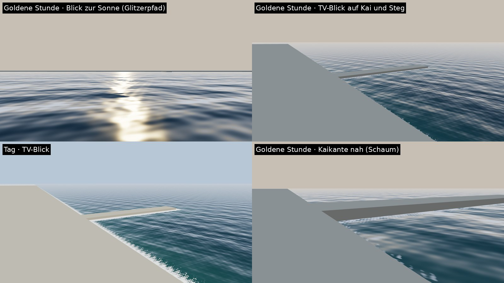

# Bosporus-Wasser-Shader (`Apex/Water`)

**Stand:** 2026-10-26.

**Status:**
- **Physik-Eingaben implementiert und getestet** (NUnit, `WaterTests`): Fresnel, Rauheit aus Wind und Regen, Wellenschichten, Uferabstandsfeld.
- **Shader geschrieben, nicht kompiliert.** Die Funktionsaufrufe sind gegen die URP-17-Quellen (Unity 6, `6000.0/staging`) abgeglichen.
  - Ein HLSL-Compiler lief hier nicht: Das Ausführen eines heruntergeladenen Compilers wurde in dieser Umgebung nicht erlaubt.
  - **Die erste echte Kompilierung macht der Unity-6-Editor.**
- **Offline-Vorschau:** GLSL-Portierung derselben Formeln in three.js (`tools/carrender/water.html`), siehe unten.
- **Im Spiel nicht gesehen.**

## Was der Shader macht
| Teil | Umsetzung | Quelle der Werte |
|---|---|---|
| Wellen | 3 Normal-Map-Schichten (Kacheln 64 / 23 / 8,5 m, ±30° um den Wind), Drift mit Tiefwasser-Geschwindigkeit c = √(gλ/2π) | `WaterOptics.Layers`, vom Wind der Strecke (`WindField`) |
| Spiegelung | Schlick-Fresnel mit F0 = 0,021 (Meerwasser n = 1,34). Gespiegelt wird die Reflexionssonde, also Himmel und Stadt (`EnvironmentReflections`). | `WaterOptics.F0` |
| Sonnenglitzern | GGX wie URP Lit, Rauheit aus der Cox–Munk-Neigungsvarianz σ² = 0,003 + 0,00512·U | `WaterOptics.Roughness(Wind, Regen)` |
| Ferne | Die Wellendetails blenden bis 350 m aus; die nicht mehr aufgelöste Neigung geht in die Rauheit. Dadurch wird der Glitzerpfad breiter, statt zu flimmern. | Shader |
| Wasserkörper | tief blaugrün → heller und grüner in 45 m Uferbreite | `WaterOptics.DeepColor/ShallowColor` |
| Schaum | schmaler, unterbrochener Saum (4 m) an Kaimauern und Ufern | Uferabstands-Textur |
| Regen | Regenringe machen die Oberfläche rauer | `EnvironmentInstance.RainIntensity` |
| Nebel, Schatten | pro Pixel: Die Meerenge ist ein einziges großes Rechteck, und Werte pro Ecke würden über Kilometer interpoliert. | URP `MixFog`, `GetMainLight(TransformWorldToShadowCoord)` |

**Uferabstands-Textur:**
- Erzeugt beim Streckenaufbau aus den Landmassen der Strecke (`CoastDistanceField`): Scanline-Rasterung, dann exakte euklidische Distanztransformation.
- Abdeckung: 6 × 6 km um die Strecke, 1024² (Niedrig: 512²) als R8, Reichweite 64 m.
- Aufwand nur beim Laden, keine Tiefentextur nötig, läuft auch mobil.

**Passes:**
- `UniversalForward`
- `DepthOnly` und `DepthNormals`: damit SSAO und die Tiefentextur das Wasser kennen.
- Wasser wirft keine Schatten.

**Fallback:**
- Ohne URP oder wenn der Shader nicht unterstützt wird, bleibt das bisherige glänzende Lit-Material mit wanderender Normal-Map.
- Der Shader liegt in `Runtime/Resources/Shaders/` und wird deshalb in jeden Build aufgenommen.

## Offline-Vorschau
GLSL-Portierung mit derselben Wellentextur und denselben Konstanten. Licht aus `SkyModel` (`sky-json`).

**Unterschiede zu Unity:**
- Die Spiegelung ist ein analytischer Himmel ohne Stadt.
- Das Ufer ist ein künstlicher Kai mit Steg.
- Es gibt keine Schatten.



**Befund:**
- Der Glitzerpfad zur goldenen Stunde ist golden und zur Ferne verbreitert.
- Zum Horizont spiegelt das Wasser stark (Fresnel), nah ist es dunkel blaugrün.
- Der Schaum war im ersten Durchgang zu breit und zu weiß (7 m). Jetzt ist er ein schmaler Saum (4 m), passend zu den ruhigen Bosporus-Kais.
- **Wiederholung:** In der TV-Ansicht ist die Kachelung als regelmäßige Querstreifen erkennbar. Im Editor prüfen; falls störend, eine vierte, gedrehte Schicht oder Rauschen in den UVs ergänzen.

```sh
cd build/Apex.Tuning && dotnet run -c Release -- sky-json GoldenHour     # JSON für water.html &sky= (URL-kodiert)
cd tools/carrender && APEX_PAGE=water.html APEX_VIEWS='glitter|400,3,0|-2000,0,-250|55|&sky=<json>' node render.mjs /dev/null /tmp/water
```

## Im Unity-Editor zu prüfen
1. **Kompilierung:** Shader `Apex/Water` ohne Fehler, für Windows (DX11/12) und Android (Vulkan/GLES3).
   - Bei Fehlern greift automatisch der Lit-Fallback, das Wasser wird also nicht rosa.
   - Die Fehlermeldung bitte an mich weitergeben.
2. **Goldene Stunde von der asiatischen Seite bzw. entlang der Meerenge:** Glitzerpfad, kein Flimmern bei Fahrt (TAA auf Ultra).
3. **Nasse Stadt und Brücke in der Spiegelung:** Das hängt an der Reflexionssonde (Mittel und höher).
4. **Schaum an Kaimauern und Anlegern:**
   - Sitzt er an der richtigen Linie? Die Uferlinien sind Näherungen.
   - Ein Raster aus 5,9-m-Zellen darf nicht sichtbar werden.
5. **Nacht:** Wasser fast schwarz mit Spiegelung der Lichter.
   - Die Straßenlaternen spiegeln sich noch nicht direkt (keine Zusatzlichter im Shader); offen für Phase 6.
6. **Mobil:** Kosten messen (3 Normal-Samples + 2 für Schaum, 1 Würfelkarten-Sample).
